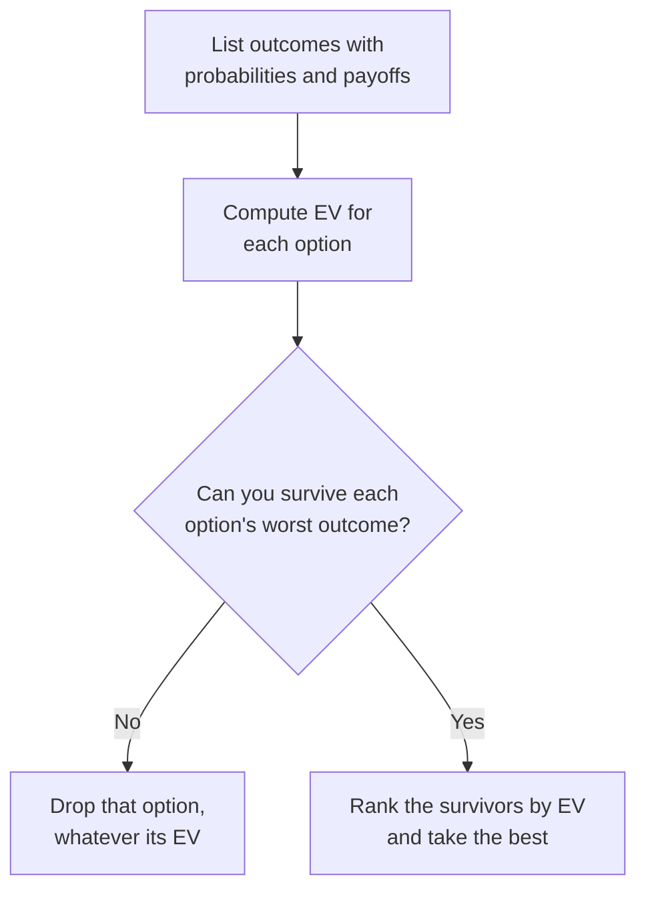

import LevelIntro from "../../../components/LevelIntro.astro";
import Checkpoint from "../../../components/Checkpoint.astro";
import PracticeCheck from "../../../components/PracticeCheck.astro";

export const unit = {
  track: "logic",
  unitSlug: "expected-value",
};

L1 found that the park stand beats the school gate on average, $52 to $46,
yet nobody ever earns $52 on a given Saturday. That raises a sharp question:
**if the best average can be a number you never actually receive, when should
you trust it, and when should you not?** This level answers that, and then
shows where the probabilities come from when nobody hands them to you.

<LevelIntro
  items={[
    "Long-run average versus one-shot survival",
    "Filter first, rank by EV second",
    "Sourcing probabilities and payoffs",
  ]}
/>

## Why can a positive EV still be a bad bet?

Someone offers you this deal, once: 90% of the time you win $150, 10% of the
time you lose $500. You have $400 in savings. **Is it a good bet?**

| Outcome | Chance | Payoff | Chance x payoff | Can you survive it with $400?       |
| ------- | ------ | ------ | --------------- | ----------------------------------- |
| Win     | 0.9    | +$150  | +$135           | Yes, you end with $550              |
| Lose    | 0.1    | -$500  | -$50            | No, you owe $100 more than you have |
| **EV**  | 1.0    |        | **+$85**        |                                     |

On paper it is a great bet: +$85 per play. But EV is a **long-run
average**: the number your results converge toward if you repeat the same bet
many times. You play once. The 10% branch is not "an average cost of $50," it
is a $500 loss in the one timeline where it happens, and it is more than you
own. Repeating is what turns the average into a promise, and a bet that can
wipe you out first never gets to repeat.

This is the two-step process the whole unit runs on: **filter out what you
cannot survive first, then rank what is left by EV.** The filter is a gate,
not a penalty subtracted from the EV and not a tiebreaker for close calls.

<Checkpoint question="A friend says: 'The EV is +$85, so turning down the bet just means you are afraid of risk.' What is wrong with that?">

EV silently assumes the bet repeats enough times for the average to show up.
One play does not. The question is not "what is the average," it is "can I
absorb the bad draw if it happens," and a $500 loss against $400 in savings
is not absorbable. Refusing is not nervousness about a small probability, it
is recognizing that for you there is no long run to converge to. Compare
someone who can repeat the bet thousands of times with small stakes: for them
the average is exactly the right frame.

</Checkpoint>

<PracticeCheck
  track={unit.track}
  unitSlug={unit.unitSlug}
  topicId="tail-and-survival"
/>

## Does this show up in real engineering choices?

Yes, and this is where the domain grounding is the content. A team must
choose how to migrate a database. **Staged rollout**: move traffic in steps.
If all goes well it costs about $18,000 in extra engineer time (95% chance);
with 5% chance a problem is caught at the first step and the rollout is
rolled back, costing about $4,000 up to that point. **Big-bang cutover**: move
everything over a weekend. It costs about $2,000 if it goes fine (80%), and
$60,000 in refunds and cleanup if it causes a multi-hour outage (20%). All
numbers are the team's assumptions.

| Option           | Outcome      | Chance | Cost    | Chance x cost  |
| ---------------- | ------------ | ------ | ------- | -------------- |
| Staged rollout   | Goes fine    | 0.95   | $18,000 | $17,100        |
| Staged rollout   | Caught early | 0.05   | $4,000  | $200           |
| **Staged**       |              | 1.0    |         | **EV $17,300** |
| Big-bang cutover | Goes fine    | 0.80   | $2,000  | $1,600         |
| Big-bang cutover | Outage       | 0.20   | $60,000 | $12,000        |
| **Big-bang**     |              | 1.0    |         | **EV $13,600** |

Here costs are positive, so the lower EV is better: big-bang is $3,700
cheaper on average. Yet its worst case, $60,000, is more than three times
staged rollout's worst case, $18,000. If a $60,000 hit during a visible
migration is something the business cannot absorb (a lost major customer, a
contract penalty the number does not capture), the filter removes big-bang
before EV ever ranks it.

<Checkpoint question="Big-bang cutover has the better EV. State, in one sentence, what must be true for the team to still choose staged rollout.">

The $60,000 outage, at 20% odds, must be something the team cannot or will
not absorb, so big-bang fails the survival filter before EV is consulted.
Staged rollout then wins not because its EV improved (it did not) but
because it is the only option left that passes the gate.

</Checkpoint>

## Where do the probabilities and payoffs come from?

**Every example so far handed you clean numbers. Real decisions do not.** In
order of how often each is available:

1. **Real history**, when it exists: "the last 12 comparable migrations had
   1 bad outcome." The strongest input, so check for it first.
2. **A disciplined rough estimate**, built the way `logic/fermi-estimation`
   builds a quantity: split "how likely is a bad cutover?" into smaller,
   easier judgments (how many similar cutovers has the team done, how much
   changed since the last, is there a tested rollback) and combine them.
3. **A reference class**: a similar earlier decision used as an anchor, then
   adjusted. If your last three weekend cutovers went fine, fine, and
   badly, the rough base rate is one in three, nudged up or down for what is
   different this time.

A rough, explicit estimate beats refusing to quantify. Refusing does not
remove the uncertainty, it hides it behind a gut feeling nobody can
challenge. The goal is not "exactly 20%," it is a number precise enough to
compare options and explicit enough that someone can argue with it.

How wrong can the estimate be before the decision flips? The slider on this
level holds big-bang's two costs fixed ($2,000 and $60,000) and moves only
the outage probability, so you can see where its EV crosses staged
rollout's fixed $17,300. L3 derives that crossing point exactly.

<PracticeCheck
  track={unit.track}
  unitSlug={unit.unitSlug}
  topicId="estimating-inputs"
/>

## The two steps, put together

1. **Compute EV honestly**, using real data where it exists and disciplined
   estimates otherwise.
2. **Before ranking by EV, drop every option whose worst realistic outcome
   you cannot survive.** Then rank what remains.

L3 turns this into a calculator you write yourself, checks how fragile the
inputs are, and asks where the whole frame stops applying.
