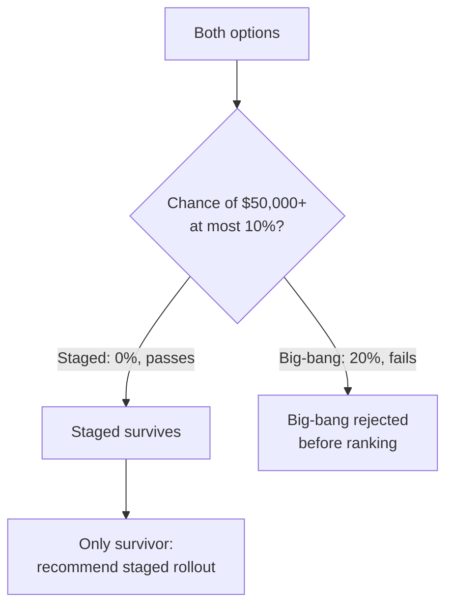
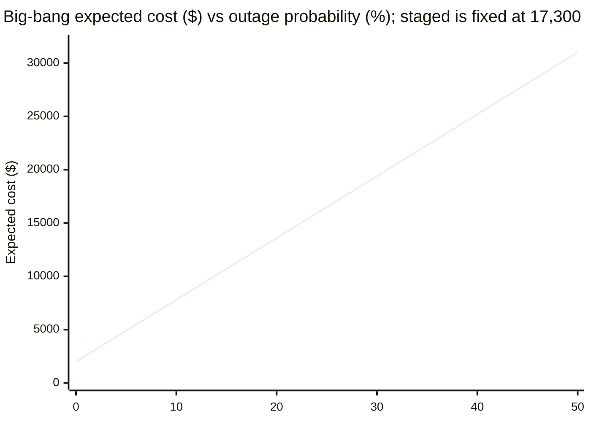

import Scenario from "../../../components/Scenario.astro";
import LevelIntro from "../../../components/LevelIntro.astro";
import Checkpoint from "../../../components/Checkpoint.astro";
import PracticeCheck from "../../../components/PracticeCheck.astro";

export const unit = {
  track: "logic",
  unitSlug: "expected-value",
};

<Scenario label="The migration meeting, run through a calculator that cannot forget the question">
  <Fragment slot="facts">
    <div class="not-prose flex flex-col gap-1.5 text-sm text-slate-700 dark:text-slate-300">
      <div class="flex items-center gap-1.5"><span>💰</span> Staged rollout: EV $17,300, worst case $18,000, 0% chance of $50,000 or more</div>
      <div class="flex items-center gap-1.5"><span>💰</span> Big-bang cutover: EV $13,600, worst case $60,000, 20% chance of $50,000 or more</div>
      <div class="flex items-center gap-1.5"><span>🚫</span> Rule: reject any option with more than a 10% chance of a $50,000+ outcome</div>
    </div>
  </Fragment>

L2 computed EV for both migration strategies by hand and argued that an
option you cannot survive should be dropped before EV ranks anything. In a
real meeting someone has to remember to ask that question every time, and
the hand arithmetic is easy to slip on. **Can the two steps be written down
so precisely that a calculator applies them the same way every time, and what
does it reveal that the EV column alone hid?**

</Scenario>

<LevelIntro
  items={[
    "EV, worst case and tail chance side by side",
    "A survival filter applied before ranking",
    "Breakeven odds and where EV stops being the frame",
  ]}
/>

## What does a decision look like as data?

An option is a name plus a list of outcomes, each with a probability and a
cost. To keep arithmetic exact, store probabilities as whole percentages and
divide once at the end.

```js
const staged = [
  { pct: 95, cost: 18000 },
  { pct: 5, cost: 4000 },
];
const bigBang = [
  { pct: 80, cost: 2000 },
  { pct: 20, cost: 60000 },
];

// EV: add pct x cost for every outcome, then divide by 100.
const expectedValue = (outcomes) =>
  outcomes.reduce((sum, o) => sum + o.pct * o.cost, 0) / 100;

// Tail: the combined chance of landing at or above a threshold.
const tailPct = (outcomes, threshold) =>
  outcomes
    .filter((o) => o.cost >= threshold)
    .reduce((sum, o) => sum + o.pct, 0);
```

| Option           | EV      | Worst case | Chance of $50,000 or more |
| ---------------- | ------- | ---------- | ------------------------- |
| Staged rollout   | $17,300 | $18,000    | 0%                        |
| Big-bang cutover | $13,600 | $60,000    | 20%                       |

Ranked by EV alone, big-bang wins by $3,700. **The two columns next to EV
tell a different story:** its worst case is more than three times larger and
it has a one-in-five chance of landing there. EV erased exactly the
information a once-only decision needs.

<Checkpoint question="Why compute the worst case and the tail chance next to EV, when the decision is ultimately ranked by EV?">

Ranking by EV alone quietly assumes the decision repeats enough times for the
average to show up. The extra two numbers expose what the average throws
away: how bad the worst single draw is and how likely it is. Someone reading
only "13,600 versus 17,300" has no way to see a 20% chance of a $60,000
result. Seeing the three numbers together is what makes the tail visible
rather than buried.

</Checkpoint>

<PracticeCheck
  track={unit.track}
  unitSlug={unit.unitSlug}
  topicId="ev-calculator"
/>

## What does the filter do to the recommendation?

The rule: reject any option with more than a 10% chance of a $50,000+
outcome, then take the lowest cost among the survivors.



**The recommendation flips.** Big-bang had the better EV but failed the gate,
so it was never ranked. Staged rollout wins not because its EV improved, but
because it is the only option the stated risk tolerance allows. Reordering
the steps (rank by EV, then discard failures) would leave the same final
list here, but it would frame survival as an afterthought. Filtering first
encodes that survival is a precondition for being ranked at all.

<Checkpoint question="If the 10% rule were loosened to 25%, what would the recommendation become, and what does that tell you about the rule itself?">

Big-bang's 20% tail would now pass, both options would survive, and EV would
rank big-bang first, so the recommendation flips back. The result shows that
the answer depends on the tolerance, which is a judgment about what the
business can absorb. The calculator does not decide the tolerance, it only
applies it consistently. That makes the threshold the number most worth
arguing about, and the one to write down before looking at the EVs.

</Checkpoint>

## How wrong can the estimate be before the answer flips?

**Every probability above was an estimate. If the 20% outage chance is
wrong, where does the EV comparison break?** Set big-bang's EV equal to
staged rollout's $17,300 and solve for the outage probability p:

```text
(1 - p) x 2,000 + p x 60,000 = 17,300
2,000 + 58,000 p = 17,300
p = 15,300 / 58,000 = 0.2638
```

| Outage probability | Big-bang EV | Versus staged ($17,300) |
| ------------------ | ----------- | ----------------------- |
| 10%                | $7,800      | Much cheaper            |
| 20% (the estimate) | $13,600     | Cheaper by $3,700       |
| 26.4%              | $17,300     | Tied                    |
| 30%                | $19,400     | More expensive          |



The estimate is 20% and the tie is at about 26.4%: a margin of under seven
percentage points. An estimation error that small and entirely plausible is
enough to flip the EV ranking, before the survival filter even enters. A
confident EV built on a loose probability points in the wrong direction as
confidently as in the right one. That is why L2 insisted on history,
decomposition, and reference classes, and why you should always compute the
breakeven. Notice also that the survival filter is far less sensitive to the
estimate here: it only passes big-bang if p is at most 10%, so a 20% estimate
would have to be badly off to change that verdict.

<PracticeCheck
  track={unit.track}
  unitSlug={unit.unitSlug}
  topicId="breakeven-sensitivity"
/>

## When is EV not the right frame at all?

The gate treats survival as a precondition and ranks the rest by EV. For
rare, catastrophic, hard-to-reverse decisions (an irreversible data
deletion with no rollback, a change that could expose customer data) even
that understates it. The honest process is to remove the unsurvivable failure
modes structurally (a rollback path, a smaller blast radius, a dry run
against a copy), until the worst case is survivable, and only then compare
what remains by EV. EV compares survivable options. It is never the tool for
deciding whether an unsurvivable option is worth the risk.

## Extend the example: this is a case, not the whole territory

The migration is one worked case. Try changing it before reading on.

**What if a third option appears, an automated canary rollout: 85% chance of
a smooth $9,000 run, 12% chance of a $15,000 partial rollback, and 3% chance
that the rollback itself fails into a $90,000 outage?** Compute its EV, its
worst case, and its chance of $50,000 or more, then ask whether it passes the
10% gate and whether it beats staged rollout among the survivors. (Its EV is
$12,150 and its tail is 3%, so it passes and wins, which confirms the
function generalizes past two options.)

**What if the "caught early" branch of staged rollout also forces a redo that
costs another $18,000?** Its cost becomes $22,000, its EV rises to $18,200,
and every comparison above shifts. Which of your conclusions survive?

**What if the team ran this migration every quarter for five years instead
of once?** Then the average does converge, a single bad draw is absorbed by
the others, and ranking by EV alone becomes the right frame again. The
filter earns its keep specifically because the decision is made once.

## Failure modes

| Failure mode                                                | What it gets wrong                                                                |
| ----------------------------------------------------------- | --------------------------------------------------------------------------------- |
| Ranking by EV alone, ignoring worst case and tail chance    | Treats a one-shot decision as an average over repetitions that will never happen  |
| Applying the survival rule as a tiebreaker after ranking    | Implies EV decides and survival only matters on close calls                       |
| Trusting a probability without a breakeven check            | A small, plausible estimation error can flip the ranking with no visible warning  |
| Using even filtered EV for an irreversible catastrophic bet | Some decisions need survival to dominate outright, not just narrow the candidates |
| Refusing to estimate because there is no clean data         | Hides the uncertainty inside an unexamined gut call instead of an arguable number |
| Forgetting a cost that one branch quietly adds              | The table looks complete while an omitted redo or cleanup cost distorts the EV    |
