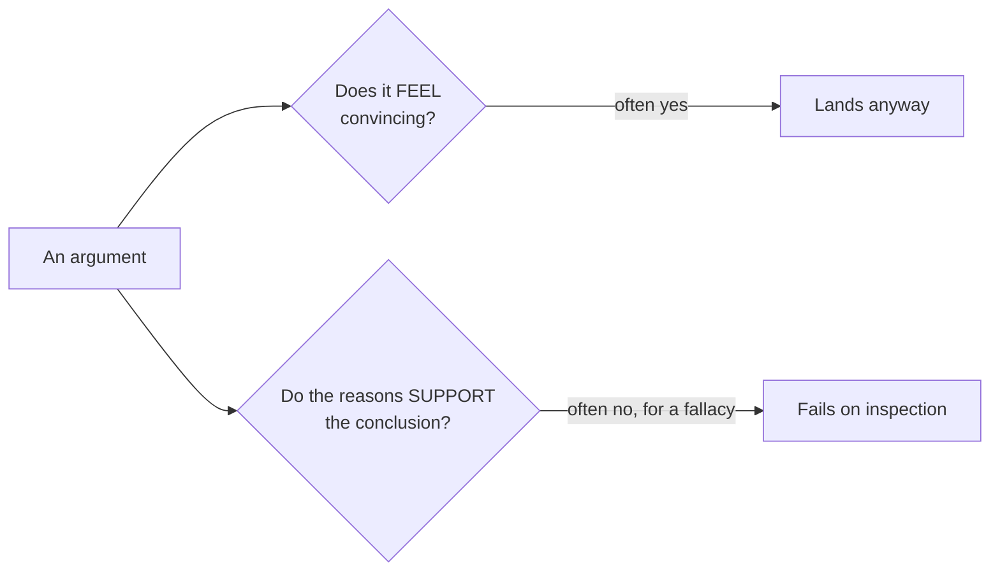

import Scenario from "../../../components/Scenario.astro";
import LevelIntro from "../../../components/LevelIntro.astro";
import PracticeCheck from "../../../components/PracticeCheck.astro";

export const unit = { track: "logic", unitSlug: "fallacies" };

<Scenario label="The problem">
  <Fragment slot="facts">
    

      

        4 of 6
        showed up last Friday
      

      

        

      

    

    

      
💼 One friend had a work deadline

      
😅 One friend just forgot

    

    
Voices in the chat

    

      
📢 "Either we commit every week, or admit it's over"

      
🙅 "So guilt-trip anyone who's ever busy?"

      
👉 "Jamie only says that because Jamie picks the games"

    

  </Fragment>

Six friends have run a Friday game night for over a year. Last week, two
people missed it, one with a work deadline and one who simply forgot, and
attendance dropped to 4 of 6. In the group chat, someone writes: **"Either we
commit to showing up every week, or we admit game night is over."** Before
anyone can answer calmly, the thread spirals. People defend themselves,
question each other's commitment, and predict the friendship is unraveling.

| Message in the chat                                          | Something is off, but what? |
| ------------------------------------------------------------ | --------------------------- |
| "Either we commit every week, or admit it's over."           | ?                           |
| "So you want us to guilt-trip anyone who's ever busy?"       | ?                           |
| "Jamie only says that because Jamie always picks the games." | ?                           |

**Nobody here is lying and nobody is acting in bad faith. So what is wrong
with each of these three messages?**

</Scenario>

None of the three speakers is being dishonest, and each message sounds
reasonable in the moment. What is wrong is the _structure_ of the reasoning:
the way a phrase connects a reason to a conclusion.

<LevelIntro
  items={[
    "Persuasive versus valid",
    "Five common patterns and their tells",
    "Straw man and ad hominem up close",
  ]}
/>

## Why can an argument feel convincing and still be broken?

**If nobody lied, how can the thread still go wrong?** Because two different
questions hide inside "does this argument work?"

- A **fallacy** is a specific, nameable pattern of flawed reasoning. Naming one is precision, not pedantry: "false dichotomy" says exactly what is wrong, where "that sounds off" does not.
- **Persuasive** describes the effect on a listener. **Valid** (in this unit) means the reasons actually support the conclusion.
- To check an argument, separate three things:

| Question               | What you are looking for                        |
| ---------------------- | ----------------------------------------------- |
| What was claimed?      | The conclusion someone wants others to accept   |
| What reason was given? | The evidence, example, authority, or assumption |
| What jump was made?    | The move from reason to conclusion              |

<PracticeCheck
  track={unit.track}
  unitSlug={unit.unitSlug}
  topicId="persuasive-vs-valid"
/>

## What are the five patterns, in one glance?

**Do the three chat messages share one flaw, or three?** Three, and two more
turn up constantly in other threads. Each has a quick tell:

| Fallacy                       | The move                                                            | Quick tell                                                           |
| ----------------------------- | ------------------------------------------------------------------- | -------------------------------------------------------------------- |
| False dichotomy               | Presents two options as the only ones when a third genuinely exists | "Either... or..." with an unnamed middle ground sitting right there  |
| Straw man                     | Refutes a distorted, easier-to-beat version of the real position    | The reply argues against something more extreme than what was said   |
| Ad hominem                    | Attacks the person instead of engaging the claim                    | "Of course you would say that, you are the one who..."               |
| Appeal to authority (misused) | Cites authority in an unrelated domain to settle a claim            | An expert's general credibility stands in for checking this one fact |
| Slippery slope                | Claims a bounded step inevitably cascades, with no mechanism shown  | "If we allow this once, we will have to allow everything"            |

Not every either/or sentence is a fallacy. "The invite either went out or it
did not" really has two options. The fallacy appears when real alternatives
exist and the argument hides them. L2 covers false dichotomy, authority and
slope in depth.

## How do straw man and ad hominem dodge the real claim?

**Which two of the chat messages never touch what was actually proposed?**
The second and third. Each swaps the real claim for something easier to
attack.

- **Straw man:** "So you want us to guilt-trip anyone who's ever busy?" answers a claim nobody made. The real proposal was to adjust expectations or try a small fix, like a reminder text.
- **Ad hominem:** "Jamie only says that because Jamie picks the games" might even be true. It still does not address whether Jamie's actual point, that attendance dipped once and is not yet a trend, is correct.
- The repair is the same for both: restate the real claim, then answer that.

<PracticeCheck
  track={unit.track}
  unitSlug={unit.unitSlug}
  topicId="straw-man-ad-hominem"
/>
