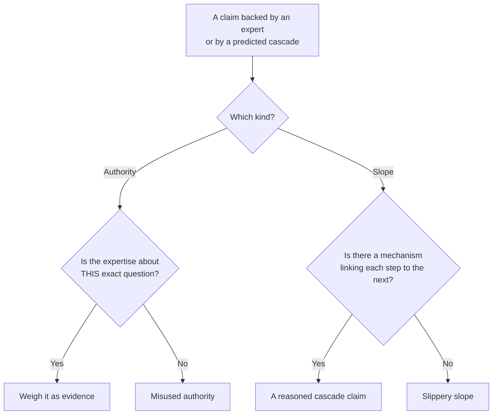

import LevelIntro from "../../../components/LevelIntro.astro";
import Checkpoint from "../../../components/Checkpoint.astro";
import PracticeCheck from "../../../components/PracticeCheck.astro";

export const unit = { track: "logic", unitSlug: "fallacies" };

L1 named five fallacies in one game-night thread and separated persuasive
from valid. L2 gives you a checkable test for each of the three that need
one: false dichotomy, misused authority, and the slippery slope.

<LevelIntro
  items={[
    "A possibility-space check for false dichotomy",
    "Does the expertise cover this question?",
    "Does the slope have any links?",
  ]}
/>

## How do you check whether an either/or is false?

Take the chat message "either we commit every week, or admit it is over."
**Before reading on: if a friend said that to you, what would you need to
know to decide whether it is true?** You would need the list of what is
actually possible. A false dichotomy is a possibility-list problem: did the
speaker present the real options, or hide some?

| Option                    | Offered by the claim? | Real option? | Result               |
| ------------------------- | --------------------- | ------------ | -------------------- |
| Commit weekly             | Yes                   | Yes          | Covered              |
| Admit it is over          | Yes                   | Yes          | Covered              |
| Send a reminder text      | No                    | Yes          | Excluded real option |
| Rotate who hosts          | No                    | Yes          | Excluded real option |
| Accept an occasional miss | No                    | Yes          | Excluded real option |

If any row reads "No / Yes", the claim "these two are the only options" was
incomplete. The check is always the same: can you name a third option the
claim silently excluded? If yes, the dichotomy was false. If the space
genuinely has two members, it was not a fallacy at all.

Excluded options are not decoration. Last Friday 2 of 6 missed, a miss rate
of 33%. If a reminder text cut that miss rate by 40%, the expected
attendance would be about 4.8 of 6. The interactive demo for this level lets you drag that
reduction and see how a third option changes the picture.

<Checkpoint question="Someone says 'either we ship the fix today, or we admit we are not a serious team.' Using the possibility-space check, is this a false dichotomy, and what is one real third option?">

Yes. Run the check: can you name something the claim silently excludes? One
real third option is shipping the fix tomorrow morning after a night of
testing, which is neither "ship today" nor "not a serious team." The two
claimed options are extreme points on a spectrum with reasonable options in
between. Naming one such option is the entire test, however urgent the
framing sounded.

</Checkpoint>

<PracticeCheck
  track={unit.track}
  unitSlug={unit.unitSlug}
  topicId="false-dichotomy"
/>

## When does citing an expert, or predicting a cascade, go wrong?

**Does an expert's word, or a vivid warning about where things will end up,
count as a reason?** Only if two tests pass. Both fallacies borrow weight
instead of supplying a reason.

| Fallacy                       | Example                                                                                     | What it borrows                                                   |
| ----------------------------- | ------------------------------------------------------------------------------------------- | ----------------------------------------------------------------- |
| Appeal to authority (misused) | "My uncle is a therapist and says friend groups always fall apart once people skip"         | Real expertise on groups in general, applied to this group's week |
| Slippery slope                | "If we let two people skip without consequence, everyone will skip and game night will die" | The drama of an extreme ending, applied to a small first step     |

Neither pattern is banned outright. A structural engineer's view on whether
a beam holds a load is legitimate authority, and some chains of
consequences are real. The fallacy is specifically a missing link: expertise
that does not cover the question, or a cascade with no shown mechanism.

<Checkpoint question="A coworker says 'everyone on the team agrees this migration is a bad idea' and it makes you reconsider. Does the fact that it changed your mind tell you whether the argument is valid?">

No. Changing your mind shows the claim was _persuasive_. It says nothing
about whether "everyone agrees" is true, or whether agreement is a reason
the migration is bad rather than a headcount. Persuasiveness measures the
effect on the listener; validity measures whether the reasons support the
conclusion. A claim can score high on the first and zero on the second,
which is the gap a fallacy lives in. So feeling convinced is a prompt to
check the reasoning, not a substitute for having checked it.

</Checkpoint>

<PracticeCheck
  track={unit.track}
  unitSlug={unit.unitSlug}
  topicId="authority-and-slope"
/>

## Why does naming the pattern pay off in practice?

Compare two replies in the group chat. One says "that feels like a straw
man." The other says "the position you are refuting is not the one I stated;
I said we should try a reminder text, not guilt-trip anyone." **Which is more
likely to move the thread back to a real decision?** The second, because it
restates the real position and shows exactly where the distortion happened.
The name is a shortcut to a precise correction, not a label for its own
sake. L3 shows this on a full annotated thread.
