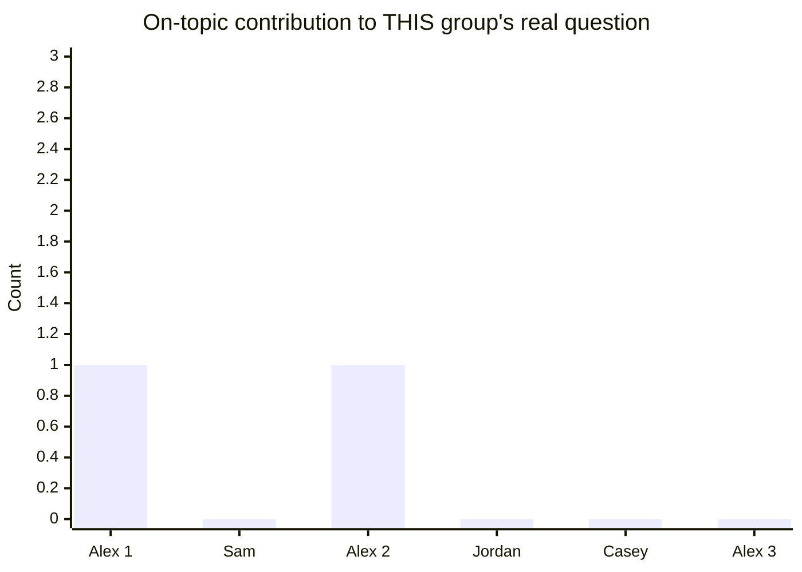
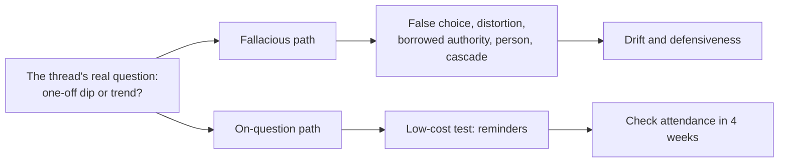

import Scenario from "../../../components/Scenario.astro";
import LevelIntro from "../../../components/LevelIntro.astro";
import Checkpoint from "../../../components/Checkpoint.astro";
import PracticeCheck from "../../../components/PracticeCheck.astro";

export const unit = { track: "logic", unitSlug: "fallacies" };

<Scenario label="The scenario">
  <Fragment slot="facts">
    

      

        4 of 6
        showed up last Friday
      

      

        

      

    

    

      
💼 One friend had a work deadline

      
😅 One friend just forgot

      
🎲 One year of weekly game night, unbroken until now

    

  </Fragment>

Six friends have run a weekly Friday game night for over a year. Last week
two people missed it, dropping attendance to 4 of 6. Someone posted "either
we commit every week, or admit it's over" in the group chat. What follows is
what actually got typed in response, before anyone stepped back to ask what
was really being argued.

</Scenario>

<LevelIntro
  items={[
    "Annotating a thread fallacy by fallacy",
    "Measuring on-topic contribution",
    "Failure modes of naming fallacies live",
  ]}
/>

## What does the thread look like, move by move?

**Can you spot all five patterns before the annotations tell you?** Each
message reads as reasonable in the moment and only looks flawed once named.

> **Alex:** "Either we commit to showing up every single week from now on, or we admit game night is basically over." _(False dichotomy: a reminder text, rotating who hosts, or accepting the occasional miss are real alternatives the framing excludes.)_
>
> **Sam:** "So you want us to guilt-trip anyone who's ever busy or sick?" _(Straw man: Alex proposed committing or quitting, not guilt-tripping anyone. An extreme version is easier to attack than the actual claim.)_
>
> **Alex:** "That's not what I said. I just think we need to actually decide something instead of letting it fade out." _(The correct repair: restate the real position precisely rather than objecting to the distortion in the abstract.)_
>
> **Jordan:** "Well, my uncle's a therapist, and he says friend groups always fall apart once people start skipping regular things, so we're probably already doomed." _(Misused authority: a therapist's general expertise is real, but it does not settle whether this group, after one missed week, is declining.)_
>
> **Casey:** "You only think we're fine because you're the one who always picks the games and doesn't want to lose that." _(Ad hominem: even if true, it never asks whether the group is fine. It would be equally irrelevant if the group genuinely were fine.)_
>
> **Alex:** "If we let two people skip without any consequence, everyone's going to start skipping and this is just going to quietly die." _(Slippery slope: two people missing once establishes no mechanism by which every future miss cascades into the end of the group.)_

<Checkpoint question="Jordan's line cites a therapist uncle's opinion that friend groups fall apart once people start skipping things. Before reading the analysis: what does that citation fail to establish about this thread's actual question?">

It fails to establish anything about _this specific group_ after _one_
missed week. A therapist's expertise on friend-group dynamics in general is
real and might matter on a genuinely open question about typical patterns.
But the thread is asking whether this particular six-person group, after a
single dip from 6 to 4, is declining. General authority on a broader
question does not resolve a specific, checkable claim about this case, and
that gap is what makes the appeal misused rather than merely irrelevant.

</Checkpoint>

## What does the annotated version reveal?

Six messages, five distinct fallacies, and not one deliberate manipulation.
Every participant plausibly believes their message is a fair contribution.
That is the point of learning these names: the patterns need no bad faith,
and they derail a discussion just as effectively either way. The thread's
real question, whether a two-person miss is a decline and what a reasonable
fix would be, keeps getting pulled into tangents.

Counting only on-topic contribution to that question, not word count (Jordan's
message is nearly as long as Alex's first and adds no checkable specifics):

Only Alex's first two messages name the attendance context or return to the
real decision. Sam, Jordan, and Casey are fluent, confident, and about zero
checkable facts regarding whether this group is declining.

## What does a version that stays on the question look like?

> **Alex:** "Two of us missed last Friday for real reasons. I don't think that means we're doomed, but I do think we should try something so it doesn't become a habit. What if whoever's hosting sends a reminder the day before?"
>
> **Casey:** "That seems reasonable. If attendance is still dropping after a month of reminders, then maybe we talk about whether the group's interest has changed."
>
> **Alex:** "Deal. Let's check back in four weeks and look at actual attendance, not just how the last one felt."

Same facts, same people, same territory, but every message engages the real
claim: is this a one-off dip or a trend, and what is a low-cost fix to test
it?

## Where does naming fallacies go wrong?

- **Using fallacy names as a way to win, not to clarify.** Shouting "straw man!" without restating the actual position (as Alex does correctly above) is itself a rhetorical move, not a correction.
- **Seeing fallacies everywhere.** Not every either/or is a false dichotomy ("the invite either went out or it did not"), not every appeal to expertise is misused (a doctor on a medical question), and not every mention of someone's role is ad hominem (context is sometimes relevant, just not sufficient). Over-applying labels erodes them the way crying wolf does.
- **Missing that fallacies compound.** One fallacious move often provokes another (Sam's straw man answering Alex's false dichotomy). Untangling a compounded thread means addressing each move separately, not with one blanket objection.
- **Assuming naming settles the disagreement.** Identifying Sam's straw man does not answer whether attendance is declining. The fallacy-free thread still needs a judgment call (try reminders, check in a month).

<Checkpoint question="Suppose someone correctly calls out Sam's straw man and restates Alex's real position. Does that resolve the disagreement?">

No. Correcting the straw man clears a distortion that was blocking a real
conversation, but it does not answer the question the group needs to
answer: whether a two-person miss is a one-off or the start of a decline,
and what a reasonable fix would be. Removing a fallacy restores the path to
that judgment call; it does not make the call. That is why the clean version
of the thread still ends with Alex and Casey agreeing to check back in four
weeks, not with the question already settled.

</Checkpoint>

A useful response template is:

> "I think this is drifting into **[fallacy name]**. My version of the real claim is **[X]**. The question we still need to answer is **[Y]**."

For authority and credibility questions, connect this with
`learning-craft/weighing-credibility`.

<PracticeCheck
  track={unit.track}
  unitSlug={unit.unitSlug}
  topicId="naming-well"
/>

## Beyond this example

This thread is one case, not the whole territory. Test whether the model
transferred, not just this specific chat:

- What changes if attendance had been declining for two straight months instead of one dip? Which of the five fallacies gets harder to dismiss once the worry has real evidence behind it, and which stays exactly as fallacious?
- Which disagreements in your own life map onto Alex, Sam, Jordan, and Casey: a false choice, a distortion, borrowed authority, an attack on the messenger?
- If a fifth person joined who has quietly wanted an excuse to stop coming, which of the five would they be most tempted to reach for, and why might spotting that motive matter as much as spotting the fallacy?
