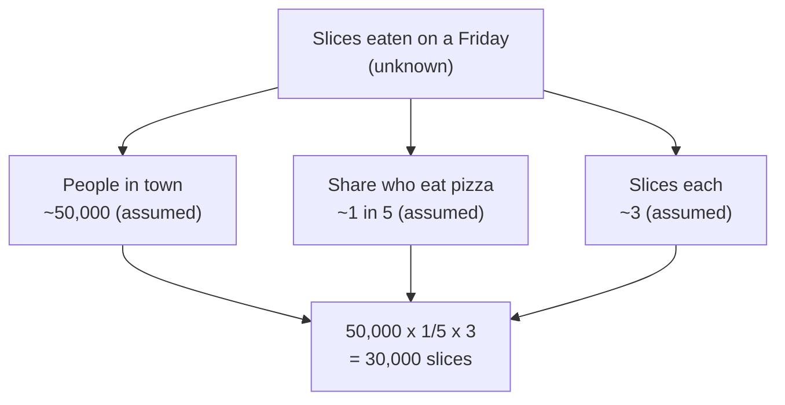

import Scenario from "../../../components/Scenario.astro";
import LevelIntro from "../../../components/LevelIntro.astro";
import PracticeCheck from "../../../components/PracticeCheck.astro";

export const unit = {
  track: "logic",
  unitSlug: "fermi-estimation",
};

<Scenario label="How many slices of pizza does a town eat on a Friday?">
  <Fragment slot="facts">
    

      
❓ <strong>The question</strong> — slices eaten in one town on one Friday; nobody has counted

      
🎲 <strong>Direct guess</strong> — "3,000? 300,000?" with nothing to hold on to

      
🧩 <strong>Split it</strong> — people x share who eat pizza x slices each

    

    

      

        
People in town (assumed)50,000

        

      

      

        
Eat pizza that night: 1 in 5 (assumed)10,000

        

      

      

        
Slices each: 3 (assumed)30,000 slices

        

      

    

  </Fragment>

A friend asks how many slices of pizza your town eats on a Friday night.
You have no sales records, no survey, and no way to get either today. Your
gut says "a few thousand?", and a minute later "maybe hundreds of
thousands?". **How do you turn a number you cannot look up into an answer
you can defend, when your direct guess could be off by a hundred times?**

Split the question instead of guessing it. The town has about 50,000
people (an assumption). Perhaps 1 in 5 of them eats pizza that night
(another assumption), and each of those eats about 3 slices (a third). That
is 50,000 x 1/5 x 3 = **30,000 slices** in under a minute. None of the
three inputs is known, yet each is much easier to reason about than the
total, and a wrong one is easy to spot and fix.

</Scenario>

<LevelIntro
  items={[
    "What a Fermi estimate is",
    "The decompose, estimate, multiply move",
    "Why the product beats one big guess",
  ]}
/>

## What did the split actually do?

**Why is "50,000 x 1/5 x 3" better than just saying 30,000?** Because the
second version is a number with nothing behind it, while the first is three
small claims you can each question: is the town really that size, do that
many people really eat pizza on a Friday, is three slices a fair average?
Each question connects to something you already roughly know. The technique
is called a **Fermi estimate**, after the physicist Enrico Fermi, who liked
to size questions with no data to hand.

| Step | Question to ask                                    | In the pizza example        |
| ---- | -------------------------------------------------- | --------------------------- |
| 1    | Which easier pieces multiply into the unknown?     | People, share, slices each  |
| 2    | What is a defensible guess for each piece?         | 50,000, 1 in 5, 3 (assumed) |
| 3    | What do the pieces multiply to?                    | 30,000 slices               |
| 4    | Does the result look right next to anything known? | Covered at the next level   |

## Key terms

- **Fermi estimate** — a quick, structured guess built by multiplying
  several individually estimated factors, instead of guessing the final
  number directly.
- **Order of magnitude** — which power of ten a number is near: closer to
  10, to 100, or to 1,000. The method asks you to get the order of
  magnitude right, not the last digit.
- **Factor** — one of the smaller quantities that get multiplied. Use exact
  facts exactly (days in a year is 365) and estimate only the rest.
- **Error cancellation** — why the product usually lands closer than the
  worst case suggests: factors that run too high and too low offset each
  other. L2 shows it with numbers.

If the real count later came in at 41,000 slices, the 30,000 estimate would
be about 27% low, in the right power of ten, and good enough for most
decisions that depend on "tens of thousands, not hundreds". That is the
whole bargain: **speed and a defensible order of magnitude in exchange for
exactness.**

<PracticeCheck
  track={unit.track}
  unitSlug={unit.unitSlug}
  topicId="decompose-and-multiply"
/>
