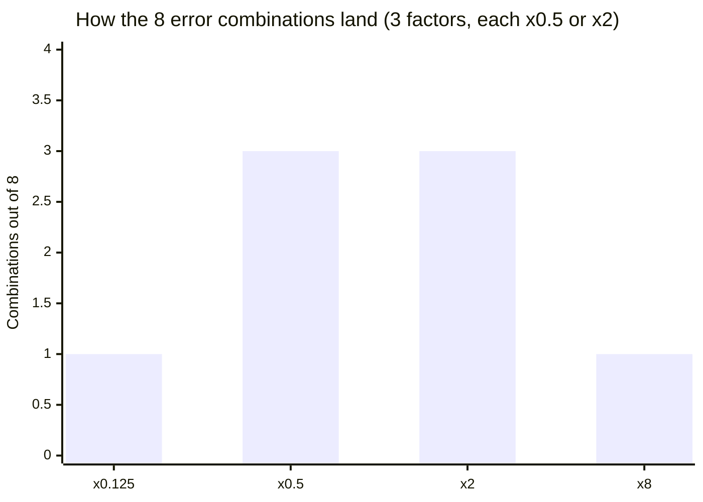
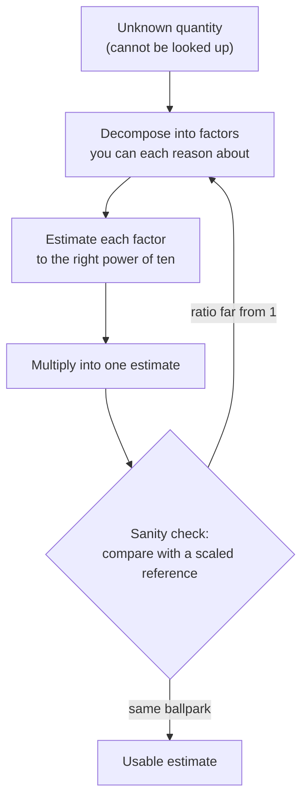

import LevelIntro from "../../../components/LevelIntro.astro";
import Checkpoint from "../../../components/Checkpoint.astro";
import PracticeCheck from "../../../components/PracticeCheck.astro";

export const unit = {
  track: "logic",
  unitSlug: "fermi-estimation",
};

L1 turned "how many slices does a town eat on a Friday?" into three rough
factors multiplied together. That raises an uncomfortable question: three
guesses are three chances to be wrong. This level explains why the product
is still trustworthy, and how to tell when it is not.

<LevelIntro
  items={[
    "Why errors partly cancel",
    "Sanity-checking against a reference",
    "When the method fits and when it does not",
  ]}
/>

## Isn't multiplying three guesses just stacking three chances to be wrong?

Suppose each of the three pizza factors could be off by a factor of 2
either way: half your guess or double it. **If all three are wrong, could
the final answer be off by 2 x 2 x 2 = 8 times?** Yes, in the single case
where all three are wrong in the same direction. How likely is that case?
List every way the three errors can fall (two options per factor, so
2 x 2 x 2 = 8 combinations):

| Factor 1 | Factor 2 | Factor 3 | Combined error   |
| -------- | -------- | -------- | ---------------- |
| x0.5     | x0.5     | x0.5     | x0.125 (all low) |
| x0.5     | x0.5     | x2       | x0.5             |
| x0.5     | x2       | x0.5     | x0.5             |
| x2       | x0.5     | x0.5     | x0.5             |
| x0.5     | x2       | x2       | x2               |
| x2       | x0.5     | x2       | x2               |
| x2       | x2       | x0.5     | x2               |
| x2       | x2       | x2       | x8 (all high)    |

Only 2 of the 8 combinations (25%) reach the extremes. The other 6 (75%)
land within a factor of 2 of the truth, because some factors ran high while
others ran low and the errors **partly cancelled** in the product. The
worst-case bound is real arithmetic, just not the typical outcome. Add more
independent factors and the extremes get rarer: with five factors only 2 of
32 combinations (about 6%) are all-high or all-low. The slider below on
this level lets you sweep the factor count and watch the typical spread
shrink as a share of the worst-case bound.

<Checkpoint question="A colleague says: 'If each of my four factors could be off by 2x, the answer could be off by 16x, so this method is useless for anything precise.' What is true and what is misleading?">

The 16x figure is correct arithmetic as an upper bound. What misleads is
treating it as typical. Reaching it needs all four independent guesses to
be wrong in the same direction at once, which is one pattern out of sixteen.
Most patterns mix highs and lows and partly cancel, so the usual estimate is
much closer than the bound suggests. The method never promised precision; it
promises a defensible order of magnitude, which is a more modest claim and
a much more believable one.

</Checkpoint>

## When does cancellation stop working?

**Cancellation assumes each factor's mistake has its own, unrelated cause.
What if two mistakes share one?** Say the share of people eating pizza and
the slices each person eats were both read off the same cheerful marketing
slide. If the slide is too optimistic, both factors run high together. They
are no longer two independent guesses; they behave like one guess written
twice.

| Case                                | Error patterns | Patterns that hit an extreme |
| ----------------------------------- | -------------- | ---------------------------- |
| 3 independent factors               | 8              | 2 of 8 (25%)                 |
| Factors 1 and 2 always err together | 4              | 2 of 4 (50%)                 |

Linked factors halve the number of distinct patterns and double the chance
of an extreme. This is the same "no two pieces counting the same cause"
test that `logic/problem-decomposition` asks of any split, applied to the
specific risk of correlated errors.

<Checkpoint question="You estimate a school's lunch sales from (a) number of students and (b) share buying lunch, but both numbers came from the same optimistic brochure. Do you still get the full cancellation benefit?">

Probably not. The cancellation argument relies on each factor being wrong
for its own reason, so highs and lows can offset. Here a single shared
source feeds both numbers, so if the brochure is too rosy both factors
tilt the same way and the errors compound instead of offsetting. The
product still comes out, but it no longer earns the "errors partly cancel"
claim. The remedy is to take at least one factor from a different source.

</Checkpoint>

<PracticeCheck
  track={unit.track}
  unitSlug={unit.unitSlug}
  topicId="error-cancellation"
/>

## How do you know the estimate is not off by a power of ten?

Cancellation handles ordinary slips of a factor of 2. It does nothing for a
slip of 10, such as a stray zero or a per-week rate treated as per-day. The
loop below adds the step that catches those.

A **reference point** is something similar whose real value you know,
scaled to the same size. If a town of 20,000 sold 8,000 slices on a typical
Friday (an assumption), a town of 50,000 predicts about 20,000. Your 30,000
is 1.5 times that: not identical, same ballpark, so it passes. A result of
360,000 would be 18 times the prediction and would send you back to look
for a slipped zero.

| Estimate vs scaled reference | Reading                                  |
| ---------------------------- | ---------------------------------------- |
| About 0.3x to 3x             | Same ballpark; passes the check          |
| Around 10x or more, or 0.1x  | A factor probably slipped a power of ten |

The check has a limit: two factors wrong by 10x in opposite directions would
cancel and still pass. A pass is evidence, not proof.

## When is this the right tool?

Use a Fermi estimate for fast sizing and go/no-go calls, where a rough
answer now beats a precise one late. Skip it when precision matters and a
real measurement is available in time, such as a figure written into a
contract. The test is two questions: how much error can the decision
tolerate, and can I actually get the real number before I must decide?

<PracticeCheck
  track={unit.track}
  unitSlug={unit.unitSlug}
  topicId="sanity-check-and-scope"
/>
