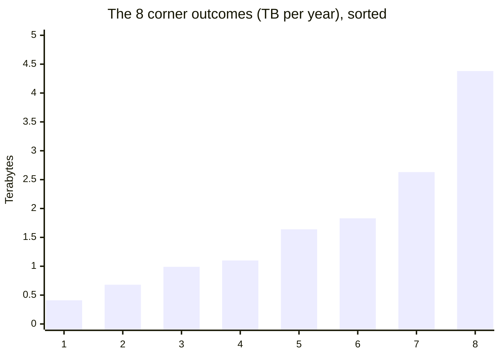

import Scenario from "../../../components/Scenario.astro";
import LevelIntro from "../../../components/LevelIntro.astro";
import Checkpoint from "../../../components/Checkpoint.astro";
import PracticeCheck from "../../../components/PracticeCheck.astro";

export const unit = {
  track: "logic",
  unitSlug: "fermi-estimation",
};

<Scenario label="A storage budget is due Friday and nothing has been measured">
  <Fragment slot="facts">
    <div class="not-prose flex flex-col gap-2 text-sm text-slate-700 dark:text-slate-300">
      <div class="flex items-center gap-1.5"><span>👥</span> <strong>Active users</strong> — 150,000 to 250,000 (assumed)</div>
      <div class="flex items-center gap-1.5"><span>🖱️</span> <strong>Events per user per day</strong> — 25 to 60 (assumed)</div>
      <div class="flex items-center gap-1.5"><span>📦</span> <strong>Bytes per event</strong> — 300 to 800 (assumed)</div>
      <div class="flex items-center gap-1.5"><span>📅</span> <strong>Days per year</strong> — 365, exact</div>
    </div>
    <div class="not-prose mt-3 flex flex-col gap-1.5 text-xs text-slate-700 dark:text-slate-300">
      <div>
        <div class="flex justify-between"><span>Naive bound (all lows to all highs)</span><span>0.41 to 4.38 TB</span></div>
        <div class="h-2 w-full overflow-hidden rounded-full bg-slate-200 dark:bg-slate-700"><div class="h-full rounded-full bg-rose-400 animate-fill-bar" style="--target-width: 100%"></div></div>
      </div>
      <div>
        <div class="flex justify-between"><span>Middle six corners</span><span>0.68 to 2.63 TB</span></div>
        <div class="h-2 w-full overflow-hidden rounded-full bg-slate-200 dark:bg-slate-700"><div class="h-full rounded-full bg-emerald-500 animate-fill-bar" style="--target-width: 60%"></div></div>
      </div>
    </div>
  </Fragment>

A team must say, by Friday, roughly how much storage a new activity log will
need in its first year. This is engineering sizing, so the domain is the
content here. Every input above is an **assumption** made for the exercise,
not a measured or published figure. The point estimate will be one number,
but a single number hides how unsure we are. **If each factor is a range
instead of a point, how wide does the combined answer have to be, and is the
widest possible answer the one to report?**

</Scenario>

<LevelIntro
  items={[
    "Ranges and the geometric mean",
    "The naive bound versus the corner band",
    "Reference checks and where this breaks",
  ]}
/>

## How do you turn a range into one best guess?

**Why not just average the low and the high?** Because uncertainty in an
estimate is multiplicative: the truth is as likely to be half your guess as
double it. On that scale the centre of 25 and 60 is the geometric mean, the
square root of 25 x 60, about 38.7, rather than the arithmetic average of
42.5.

```js
function pointEstimate(factors) {
  return factors.reduce((product, f) => {
    const mid = f.low === f.high ? f.low : Math.sqrt(f.low * f.high);
    return product * mid;
  }, 1);
}
```

Applied to the four factors, the geometric means are about 193,649 users,
38.7 events and 489.9 bytes, times 365 days: roughly 1.34 TB for the year
(1.34 x 10^12 bytes).

## Why is the widest bound the wrong thing to report?

Multiply every low together and every high together:

| Factor              | Low     | High    |
| ------------------- | ------- | ------- |
| Active users        | 150,000 | 250,000 |
| Events per user/day | 25      | 60      |
| Bytes per event     | 300     | 800     |
| Days per year       | 365     | 365     |
| **Product (TB)**    | 0.41    | 4.38    |

That is a spread of about 10.7x from bottom to top. It is true, but it
describes only two outcomes: every factor at its low end at once, and every
factor at its high end at once. The slider for this level changes each
factor's high-to-low multiple and shows how fast the naive spread grows when
three such factors multiply. Only three of the factors vary; days per year is
exact and adds no uncertainty.

Enumerating every low/high combination of the three varying factors gives
2 x 2 x 2 = 8 corners, cheap enough to check exhaustively:

```js
function cornerProducts(factors) {
  const ranged = factors.filter((f) => f.low !== f.high);
  const base = factors
    .filter((f) => f.low === f.high)
    .reduce((p, f) => p * f.low, 1);
  const out = [];
  for (let mask = 0; mask < 2 ** ranged.length; mask++) {
    let p = base;
    ranged.forEach((f, i) => (p *= (mask >> i) & 1 ? f.high : f.low));
    out.push(p);
  }
  return out.sort((a, b) => a - b);
}
```



Six of the eight corners (0.68 to 2.63 TB) fall within a factor of 2 of the
1.34 TB point estimate (the band is 0.67 to 2.68 TB). Only the all-low and
all-high corners leave it. The middle band spans about 3.8x, against the naive
10.7x. Nothing about any single factor got more certain; most combinations
simply do not point the same way, which is the L2 cancellation argument
checked on real ranges.

<Checkpoint question="The all-low and all-high corners are mathematically valid bounds. Why report the 0.68 to 2.63 TB band as the working range instead of 0.41 to 4.38 TB?">

The wide bound is correct but answers a different question: what could
possibly happen if every factor were as bad as it could be at once. The
corner check shows that outcome is the least likely of the eight, so
quoting it as "the" range tells decision makers that extreme and middle are
equally plausible. The narrower band reflects where most combinations land
and is tight enough to size a budget against. The honest report gives the
point value and the band, and mentions the bound as the outer limit.

</Checkpoint>

<PracticeCheck
  track={unit.track}
  unitSlug={unit.unitSlug}
  topicId="ranges-and-bounds"
/>

## Is the result in the right power of ten?

Suppose a similar feature is known to log about 1 GB a day per 100,000 users
(an assumption for this exercise). For 200,000 users that is 2 GB a day, or
about 0.73 TB a year. The point estimate of 1.34 TB is 1.84 times that,
which is the same ballpark.

| Quantity                        | Value (assumed or derived)               |
| ------------------------------- | ---------------------------------------- |
| Reference rate                  | 1 GB per day per 100,000 users (assumed) |
| Scaled to 200,000 users, a year | about 0.73 TB                            |
| Our point estimate              | about 1.34 TB                            |
| Ratio                           | about 1.84, plausible                    |

A ratio near 15 or 0.02 would be the real warning. Suppose, hypothetically,
the feature later measures 1.9 TB for the year. That sits inside the
0.68 to 2.63 TB band and about 29% above the point estimate: the band was
useful, and the naive 0.41 to 4.38 TB bound would also have contained it but
told far less.

<Checkpoint question="The ratio against the reference is 1.84, not 1.0. Why is that still a pass?">

The reference feature is not identical, with different event types and
usage, so some disagreement is normal. The check screens for a factor wrong
by ten times or more, such as a missing unit conversion, a forgotten day
count or a stray zero. Within roughly 0.3x to 3x says "same ballpark".
Insisting on exactly 1.0 would reject every sensible estimate and give a false
sense that the method needs precision it never promised.

</Checkpoint>

<PracticeCheck
  track={unit.track}
  unitSlug={unit.unitSlug}
  topicId="range-estimator"
/>

## Extend the example: this is one case, not the whole territory

The storage estimate is a worked case, not a recipe that covers every
situation. Take it somewhere new and see what changes.

- **What if events per user and bytes per event are both driven by the same
  rollout plan?** The corner enumeration runs identically, but the combinations
  where one is high and the other low become unlikely, pulling the effective
  spread back toward the naive bound. The fix is to revisit the
  decomposition, not the arithmetic.
- **What if the deadline were a contract clause instead of a budget line?**
  Which of the three tools (point estimate, corner band, real measurement) would you
  reach for, and why?
- **What if you were promised a 90% confidence interval?** Corners are two
  values per factor, not a probability distribution. A stated confidence level
  needs each factor modelled as a distribution and many random draws, with the
  5th and 95th percentiles read off the results.

## Failure modes

| Failure mode                                            | What it gets wrong                                            |
| ------------------------------------------------------- | ------------------------------------------------------------- |
| Reporting the naive bound as the answer                 | Presents the two least likely outcomes as typical             |
| Factors that secretly share a root assumption           | Breaks independence, so errors compound instead of cancelling |
| Skipping the reference check                            | A slipped power of ten hides inside a confident number        |
| Using an estimate where a real measurement was possible | Trades precision for speed when speed was not needed          |
| Quoting a point value without its range                 | Invites treating a rough guess as a measurement               |
