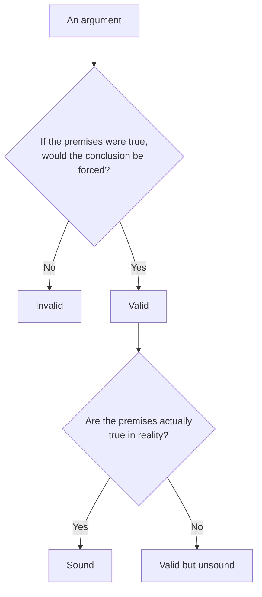

import Scenario from "../../../components/Scenario.astro";
import LevelIntro from "../../../components/LevelIntro.astro";
import PracticeCheck from "../../../components/PracticeCheck.astro";

export const unit = {
  track: "logic",
  unitSlug: "formal-informal-logic",
};

<Scenario label="The problem">
  <Fragment slot="facts">
    

      

        3 of 4
        recent Mondays it was closed
      

      

        

      

    

    

      
📋 A sign in the window reads "Closed Mondays"

      
🥐 One of the four visits found it open anyway

    

    
Voices outside the door

    

      
📋 "The sign says closed Mondays, so it's closed."

      
🔁 "We've checked three times, closed every time, so it's basically always closed."

      
🥐 "It was open that one time, so 'always closed' is just wrong."

    

  </Fragment>

Four friends walk up to their usual Monday brunch spot. The window sign says
"Closed Mondays." One friend has checked three separate Mondays before and
found it shut every time. Another remembers the one Monday, months ago, when
it was actually open. All three friends below are reasoning from real
evidence, not making anything up.

| What they said                                                                   | Good reasoning, bad reasoning, or something in between? |
| -------------------------------------------------------------------------------- | ------------------------------------------------------- |
| "The sign says closed Mondays, so it's closed."                                  | ?                                                       |
| "We've checked three times, closed every time, so it's basically always closed." | ?                                                       |
| "It was open that one time, so 'always closed' is just wrong."                   | ?                                                       |

**Before reading on: are these three arguments all the same kind of
reasoning, just with different amounts of evidence, or are they doing
fundamentally different things?**

</Scenario>

They are doing fundamentally different things, and telling them apart is the
whole point of this unit.

<LevelIntro
  items={[
    "Premise, conclusion, argument, counterexample",
    "Valid vs. sound vs. convincing",
    "Deductive certainty vs. inductive probability",
  ]}
/>

## What are the moving parts of an argument?

**When the friends "argue", what exactly is being passed back and forth?**
Four plain-language parts, kept separate, make every argument easier to
inspect.

| Term               | Plain meaning                                                                                                |
| ------------------ | ------------------------------------------------------------------------------------------------------------ |
| **Premise**        | A claim the argument asks you to accept as a starting point                                                  |
| **Conclusion**     | The claim the argument is trying to reach                                                                    |
| **Argument**       | Premises arranged so they are supposed to support a conclusion                                               |
| **Counterexample** | A possible case where the premises hold but the conclusion fails, or a real exception to an overstrong claim |

The sign argument also has a hidden premise that ordinary speech leaves
unstated: "if the bakery follows a current, reliable sign that says Closed
Mondays, then it is closed on Mondays." Without that reliability premise,
"the sign says it" is only evidence about a rule, not the rule itself.

<PracticeCheck
  track={unit.track}
  unitSlug={unit.unitSlug}
  topicId="argument-parts"
/>

## What do valid, sound, and convincing each ask?

**If an argument's conclusion is true, is the argument good?** Not
necessarily. Three different questions get blurred together in everyday
speech:

|                       | Premises true     | Premises false    |
| --------------------- | ----------------- | ----------------- |
| **Structure valid**   | Sound             | Valid but unsound |
| **Structure invalid** | Unsound (invalid) | Unsound (invalid) |

- **Validity** is a structural property: the conclusion _must_ be true
  whenever the premises are true, regardless of whether they actually are.
  "The sign says closed Mondays. Today is Monday. Therefore it's closed" is
  valid: grant both premises and the conclusion is forced.
- **Soundness** is valid structure plus premises that are actually true. If
  the sign is outdated, the argument stays valid but is not sound, and the
  false premise, not the logic, is the problem.
- **Convincing** answers a different question: did the argument feel
  persuasive to a human listener? A claim can be convincing but invalid, valid
  but unsound, or sound and yet stated in a dry, unpersuasive way.

<PracticeCheck
  track={unit.track}
  unitSlug={unit.unitSlug}
  topicId="valid-sound"
/>

## Which friends promised certainty, and which only placed a bet?

**Does one open Monday ruin every one of the three arguments equally?** No,
and that is the sorting step:

| Friend's claim                                 | Kind                         | What it promises                   | One exception does...         |
| ---------------------------------------------- | ---------------------------- | ---------------------------------- | ----------------------------- |
| "The sign says closed, so it's closed."        | Deductive                    | The conclusion, with certainty     | Break it: a premise was false |
| "Three closed Mondays, so basically always."   | Inductive                    | The conclusion is probable         | Weaken it, not refute it      |
| "Open once, so 'always closed' is just wrong." | Counter to a universal claim | Only works against "no exceptions" | Refute a universal rule       |

- **Deductive arguments** claim their conclusion follows _with certainty_.
  One counterexample breaks them.
- **Inductive arguments** claim only that the conclusion is _probable_. More
  consistent evidence makes them stronger but never certain.
- **The third friend's mistake** is treating the pattern "closed every time we
  checked" as if it had promised "closed every single Monday, no exceptions."
  It never did, so the open Monday weakens the pattern without demolishing it.
- **Formal logic** studies argument structure independent of content. The
  pattern "if P then Q; Q; therefore P" is invalid whatever fills in P and Q.
- **Informal logic** studies arguments as they actually occur in language,
  including ambiguity such as "basically always closed" versus "closed, no
  exceptions."

The practical skill: before agreeing or disagreeing with an argument, ask
which box it sits in, and whether it ever made a deductive promise or only an
inductive bet.

<PracticeCheck
  track={unit.track}
  unitSlug={unit.unitSlug}
  topicId="deductive-vs-inductive"
/>
