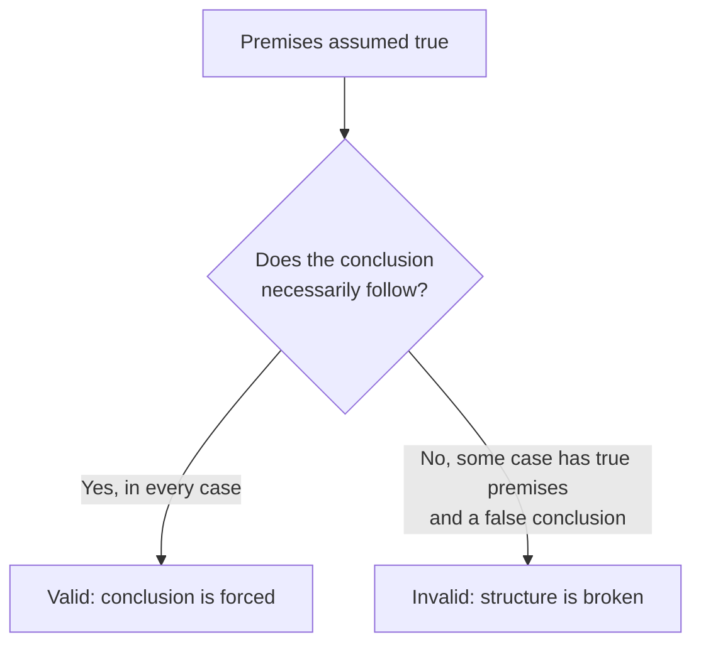
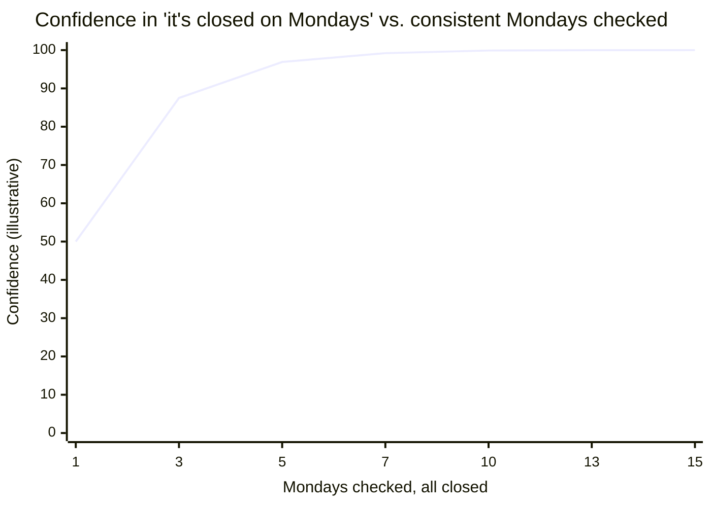

import LevelIntro from "../../../components/LevelIntro.astro";
import Checkpoint from "../../../components/Checkpoint.astro";
import PracticeCheck from "../../../components/PracticeCheck.astro";

export const unit = {
  track: "logic",
  unitSlug: "formal-informal-logic",
};

L1 sorted the bakery friends' claims into deductive and inductive, and named
validity, soundness, and convincingness as different questions. L2 works out
exactly what makes a deductive argument's structure valid or invalid, a
mechanical test rather than a feel, and where induction's evidence curve
actually goes.

<LevelIntro
  items={[
    "Valid conditional shapes vs. their look-alikes",
    "The one-way direction of if-then",
    "Why inductive strength never reaches certainty",
  ]}
/>

## If the lights are on, is the bakery open?

The bakery has a house rule: the lights are on whenever it is open. One
Monday a friend walks by, sees the lights on, and says "the lights are on, so
it's open." **Is that conclusion forced by the facts, the way "it's open, so
the lights are on" would be, or does it only sound that way?**

Validity never asks "is this true in reality?" It asks "if I grant the
premises, am I forced into the conclusion?" The shape "if P then Q" is
one-way unless the premise explicitly says otherwise:

| Symbol shape  | Spoken version                               |
| ------------- | -------------------------------------------- |
| `if P then Q` | If the condition happens, the result follows |
| `P`           | The condition happens                        |
| `Q`           | The result happens                           |
| `not Q`       | The result does not happen                   |

`P` is the **antecedent** (the condition) and `Q` is the **consequent** (what
follows). The habit that matters is checking which direction the rule
actually points.

Every version below starts from the same rule, "if the bakery is open, the
lights are on", and adds one more fact:

| Name                     | Added fact             | Conclusion             | Valid? |
| ------------------------ | ---------------------- | ---------------------- | ------ |
| Modus ponens             | The bakery is open     | The lights are on      | Yes    |
| Modus tollens            | The lights are not on  | The bakery is not open | Yes    |
| Affirming the consequent | The lights are on      | The bakery is open     | **No** |
| Denying the antecedent   | The bakery is not open | The lights are not on  | **No** |

Modus tollens is valid for a reason worth sitting with: if being open
guarantees the lights are on, then lights off guarantees it is not open.
The reverse fails because the rule never said lights-on happens _only_ while
open. Maybe the cleaning crew leaves them on early. Affirming the consequent
smuggles in an unstated assumption, that the rule works in both directions.

<Checkpoint question="A different house rule says 'the lights are on if and only if the bakery is open', a two-way rule. Under that stronger premise, is 'the lights are on, so it's open' now valid?">

Yes. An "if and only if" rule promises both directions at once: open implies
lights on, _and_ lights on implies open. Seeing the lights on now forces the
conclusion, because the rule itself rules out lights-on-while-closed. The
friend's reasoning was invalid earlier not because "lights on, therefore
open" can never be valid, but because the rule actually on the table only
granted one direction. Validity is always relative to the premises stated,
not to a stronger version that sounds similar.

</Checkpoint>

<PracticeCheck
  track={unit.track}
  unitSlug={unit.unitSlug}
  topicId="conditional-forms"
/>

## Does piling up consistent Mondays ever make the bet certain?

Modus ponens and its cousins assume a rule that holds with certainty. But
"we've checked three Mondays, closed every time" was never such a rule. It is
a generalization from observed cases to an unobserved one. **Does more
evidence make an inductive claim behave like a deductive one?**

Not exactly. It gets stronger, a better bet, but never becomes "no exception
is possible." One consistent Monday is weak evidence, ten is strong, a
thousand is very strong. None of them rule out an open Monday; they only make
it look less likely.

The curve climbs fast, then flattens, approaching but never touching 100%.
That gap is the difference between an inductive conclusion and a deductively
valid one. It is a simplified illustration (each consistent Monday halves the
remaining doubt), not a rigorous statistical model; the unit's slider lets you
drag it. For the real math of updating confidence from evidence, see
`applied-math/statistics`.

<Checkpoint question="Does the curve ever reach 100%, no matter how many consistent Mondays are added? What does that say about piling on evidence to make an inductive argument as good as a deductive one?">

No. The curve approaches 100% but never reaches it, and that is a structural
fact about induction, not a flaw in the illustration. A deductive conclusion
is guaranteed once the premises are granted; an inductive one is only made
more probable, because there is always a possible next case that breaks the
pattern. More consistent Mondays make the bet better, not certain. The two
answer different questions, "is this forced?" versus "is this likely?", so no
amount of the second converts into the first.

</Checkpoint>

Formal structure alone also does not explain the third friend's slip. "Closed
every Monday, no exceptions" and "closed most Mondays, usually" sound almost
interchangeable in casual speech, yet one exception does different damage to
each:

| Claim as stated            | Type                              | Does one exception refute it?                   |
| -------------------------- | --------------------------------- | ----------------------------------------------- |
| "It's closed every Monday" | Universal (deductive-style claim) | Yes: one open Monday makes it false             |
| "It's closed most Mondays" | Inductive generalization          | No: it weakens the pattern, doesn't disprove it |

Informal logic is the discipline of noticing _which_ of these someone meant,
often from tone and context rather than an explicit "every" or "most",
before deciding whether a counterexample settles the argument or only nudges
it. This is also where `logic/fallacies` becomes useful: many bad arguments
persuade through ambiguity, missing premises, or a word that shifts meaning
mid-conversation.

<PracticeCheck
  track={unit.track}
  unitSlug={unit.unitSlug}
  topicId="inductive-strength"
/>
