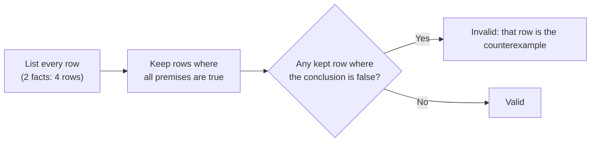

import Scenario from "../../../components/Scenario.astro";
import LevelIntro from "../../../components/LevelIntro.astro";
import Checkpoint from "../../../components/Checkpoint.astro";
import PracticeCheck from "../../../components/PracticeCheck.astro";

export const unit = {
  track: "logic",
  unitSlug: "formal-informal-logic",
};

<Scenario label="The scenario">
  <Fragment slot="facts">
    

      

        1 of 4
        rows of the truth table is a counterexample
      

      

        

      

    

    

      
📋 House rule: open implies lights on (one direction only)

      
🧹 Cleaning crew sometimes leaves lights on before opening

      
🥐 Priya: "lights on, so it's open"

    

  </Fragment>

Four friends stand outside the bakery on a Monday morning. The lights are on.
What follows is the actual conversation, argument by argument, before anyone
stepped back to ask which claims were forced by the evidence and which were
just good bets.

**Before reading on, predict: when Priya says "the lights are on, so it's
open", how many of the four possible combinations of open/closed and
lights-on/off would you need to look at to prove her argument broken?**

</Scenario>

<LevelIntro
  items={[
    "Checking a real conversation argument by argument",
    "Validity as a search for one counterexample row",
    "Where the deductive check hits a category boundary",
  ]}
/>

## How does the conversation hold up, argument by argument?

> **Priya:** "The lights are on, so it's open." _(Affirming the consequent: invalid. The house rule only says open implies lights-on, not the reverse. The cleaning crew is a real counterexample to the unstated assumption this needs.)_
>
> **Marcus:** "Wait, we've checked three Mondays and it was closed every single time. The lights thing doesn't override that." _(Correctly invokes an inductive pattern, but does not yet address whether it is strong enough to outweigh what is directly in front of them. Three past observations are evidence, not proof, about a different Monday.)_
>
> **Priya:** "Sure, but this is a different Monday, and today the lights are on. That's new information the pattern doesn't include." _(A fair point: a past pattern does not erase a direct observation about today, though "lights on" alone still does not validly prove "open".)_
>
> **Devon:** "Fine, let's just check the door instead of arguing about lights and patterns." _(Sidesteps the disagreement with a cheap, direct test, often the right move once an argument's structure is unclear.)_
>
> They try the door. It is unlocked. The crew is restocking early: lights on for that reason, door open for deliveries. Priya's conclusion turned out _true_, but her argument was still invalid. She got the right answer by luck, not by a structure that forced it.

## How can validity be checked without trusting a feeling?

**If Priya's argument is invalid, what is the smallest piece of evidence that
proves it?** Validity has a mechanical definition: there is no case where all
premises are true and the conclusion is false. With two yes/no facts there are
only four cases, so list them all. The rule is "if open, then lights on";
Priya adds "lights on" and concludes "open."

| Open  | LightsOn | Rule holds? | Added fact holds? | Conclusion "open" holds? | Verdict for this row           |
| ----- | -------- | ----------- | ----------------- | ------------------------ | ------------------------------ |
| true  | true     | Yes         | Yes               | Yes                      | Premises true, conclusion true |
| true  | false    | No          | No                | Yes                      | Premises not all true: ignore  |
| false | true     | Yes         | Yes               | **No**                   | **Counterexample**             |
| false | false    | Yes         | No                | No                       | Premises not all true: ignore  |

Only rows where every premise is true matter. Among them, the row
`Open = false, LightsOn = true` has true premises and a false conclusion. That
single row is the cleaning-crew case, and it alone proves the argument
invalid. The table knows nothing about bakeries; it checks only the _shape_,
which is what formal logic evaluates regardless of subject. In this unit's
notation, "if Open then LightsOn" is violated in exactly one row, open with
lights off. Boolean logic (`logic/boolean-logic`) explains why that reading
works; here you only need the table.

The same table settles modus tollens. Swap Priya's added fact for "lights off"
and the conclusion for "not open": the only row where the rule holds and the
lights are off is `Open = false, LightsOn = false`, where the conclusion is
true, so no counterexample exists and the argument is valid.

<Checkpoint question="The table's counterexample is Open = false, LightsOn = true. Why is one such row enough to call the whole argument invalid, however many other rows agree with Priya's conclusion?">

Validity claims the conclusion holds in _every_ case the premises allow, not
in most of them. The row `Open = false, LightsOn = true` satisfies the house
rule (it is not violated when the bakery is closed) and satisfies "lights on",
yet "open" is false. One row where the premises are true and the conclusion is
false breaks "necessarily true", just as one counterexample breaks any
universal claim. Validity does not average across rows.

</Checkpoint>

<PracticeCheck
  track={unit.track}
  unitSlug={unit.unitSlug}
  topicId="truth-table-check"
/>

## Where does the deductive check run out?

The table only evaluates claims that are genuinely deductive: a fixed rule, a
fixed set of added facts, true or false in each cell. Marcus's "closed three
Mondays running" is not that kind of claim. There is no yes/no premise that
forces "closed today" from "closed the last three visits", because inductive
strength is a matter of degree. That is a boundary of what validity checking
can evaluate, not a defect of the table.

A **category mistake** is like asking "how many kilograms is Tuesday?" Weight
is a real property and Tuesday is a real word, but they belong to different
kinds of questions. Validity is the wrong kind of test for an inductive
pattern.

<Checkpoint question="Someone proposes adding a column to the truth table for 'closed three Mondays running' so one table can rule on the whole conversation. What is wrong with that fix?">

It would build a category mistake into the table instead of solving one. The
method works by trying every true/false assignment and asking whether the
conclusion is ever false when the premises are true. That only makes sense for
fixed yes/no claims such as "the bakery is open today". Marcus's claim is
about the strength of a pattern across past days. Forcing it into a cell
would produce a valid/invalid verdict on a question the method was never built
for, which is worse than no verdict because it looks precise while meaning
nothing.

</Checkpoint>

## Failure modes

- **Confusing a true conclusion with a valid argument.** Priya was right that
  the bakery was open, but her argument was still invalid. A true conclusion
  does not retroactively fix a broken structure; it means the argument got
  lucky.
- **Treating "invalid" as an insult.** Calling the argument invalid is a narrow
  technical claim about structure, not an accusation. The useful move names the
  gap: "this affirms the consequent; lights on does not rule out the
  cleaning-crew case."
- **Applying deductive standards to an inductive claim, or vice versa.**
  Demanding certainty from Marcus's pattern misreads what it ever was.
  Equally wrong is calling Priya's argument "weak evidence needing more data":
  it is structurally invalid regardless of sample size.
- **Assuming a validity check settles what to do.** After correctly spotting an
  invalid argument, the friends still had a real decision, try the door or
  not, which the table says nothing about.

## Beyond this example

  🥐 This bakery conversation
  &rarr;
  💬 Any claim you're deciding whether to trust

This bakery morning is one small, fully worked case, not the whole territory.
Extend it yourself:

- What changes about Priya's argument if the rule were "the lights are on _if
  and only if_ it's open"? What real-world fact would you need to confirm
  before trusting that stronger premise?
- If Marcus's pattern were "closed the last _ten_ Mondays running", would it
  behave like a valid deductive argument, or just a much stronger inductive
  one? Why does the difference between "very strong" and "certain" matter
  when you decide what to act on?
- Think of a claim you accepted recently from a friend, an ad, or a headline.
  Was it a deductive promise (a rule plus a fact) or an inductive bet (a
  pattern from past cases)? If you cannot tell, what does that suggest about
  how it was phrased?
