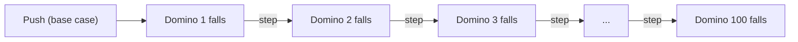

import Scenario from "../../../components/Scenario.astro";
import LevelIntro from "../../../components/LevelIntro.astro";
import PracticeCheck from "../../../components/PracticeCheck.astro";

export const unit = {
  track: "logic",
  unitSlug: "induction",
};

<Scenario label="You pushed three dominoes in a row of a hundred. Do you now know all hundred will fall?">
  <Fragment slot="facts">
    

      
🎲 <strong>The row</strong> — 100 dominoes standing in a line

      
👆 <strong>What you tried</strong> — pushed the first one; the next 2 fell too

      
❓ <strong>What you want</strong> — certainty about the other 97, without pushing each one

    

    

      

        
Checked by watching3 of 100

        

      

    

  </Fragment>

You line up a hundred dominoes and push the first. The second falls, then
the third. Three down, and every one worked. **Does that tell you the
hundredth will fall? What would you need to know about the row to be sure,
without standing there watching all hundred?**

Watching three falls tells you about three dominoes. It says nothing about
whether domino 58 is placed too far from domino 59. What would actually
settle it is a single fact about _every_ neighbouring pair, plus one push.

</Scenario>

<LevelIntro
  items={[
    "Base case and inductive step",
    "Why watching examples is not proof",
    "The same idea in recursive code",
  ]}
/>

## What two facts guarantee the whole chain?

**If you cannot watch every domino, what is the smallest set of facts that
still covers all of them?** Exactly two:

1. **The first domino falls.** Someone pushes it. This is the **base case**.
2. **Whenever a domino falls, it knocks over the next one.** This is the
   **inductive step**.

Together they cover the whole row. Domino 1 falls (fact 1). So domino 2 falls
(fact 2 applied to domino 1). So domino 3 falls (fact 2 applied to domino 2),
and so on to the end, however long the row is.

Drop either fact and the guarantee disappears:

| What is missing  | What you can still say                                       |
| ---------------- | ------------------------------------------------------------ |
| The push (base)  | Nothing falls, however well they are spaced                  |
| One gap (step)   | Everything before the gap falls, nothing after is guaranteed |
| Both are present | Every domino in the row falls                                |

<PracticeCheck
  track={unit.track}
  unitSlug={unit.unitSlug}
  topicId="base-and-step"
/>

## Where does this show up in code?

A **recursive function** solves a big input by calling itself on smaller
pieces of that input. A folder is the classic example: a folder contains
files and other folders, so its total size is the sum of its children's
sizes.

| Item          | What it contains            | Total size   |
| ------------- | --------------------------- | ------------ |
| `photo.jpg`   | just itself                 | 4 MB         |
| `trip-folder` | `photo.jpg` + `map.pdf`     | 4 + 1 = 5 MB |
| `archive`     | `trip-folder` + `notes.txt` | 5 + 2 = 7 MB |

The dominoes map directly onto it. A file is the **base case**: it needs no
further calls. A folder is the **inductive step**: if the function already
gives the right total for each smaller child, adding those totals gives the
right total for the folder. **Tracing** a few example folders by hand is
watching three dominoes fall. An inductive argument is checking the spacing of
every pair once.

## Key terms

- **Base case** — the simplest input, handled directly with no further
  recursion (a file; an empty list).
- **Inductive step** — assuming the answer is right for smaller inputs, show it
  is right for the current one.
- **Inductive hypothesis** — that assumption itself: "this works for every
  smaller input."
- **Recursion trace** — following the actual calls for one specific input.
  Useful for debugging one case, not a proof for all of them.

The word is overloaded. This unit uses **mathematical induction**, the base
case plus step proof pattern. It is different from the everyday "inductive
argument" in `logic/formal-informal-logic`, where evidence makes a conclusion
more likely without proving it.

## What the next levels cover

L2 explains why this beats tracing and what hidden conditions the guarantee
depends on. L3 applies it to real folder code, diagnoses a genuine bug by
asking which of the two facts it breaks, and writes recursive functions the
same way.
