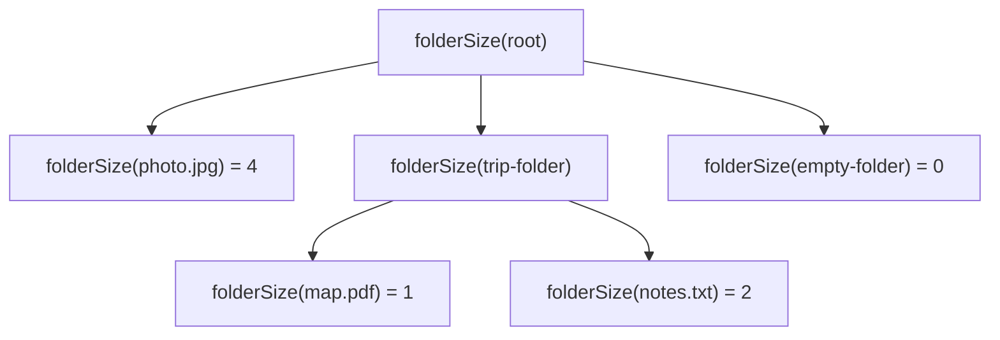
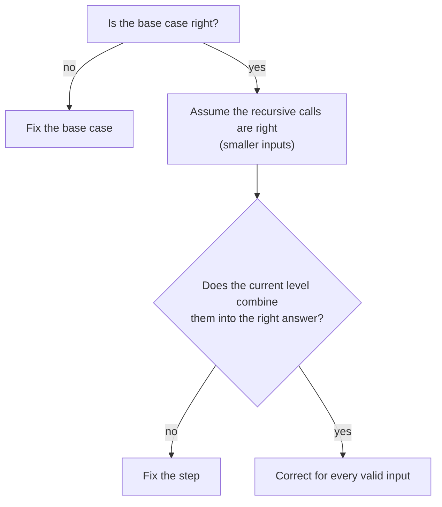

import LevelIntro from "../../../components/LevelIntro.astro";
import Checkpoint from "../../../components/Checkpoint.astro";
import PracticeCheck from "../../../components/PracticeCheck.astro";

export const unit = {
  track: "logic",
  unitSlug: "induction",
};

L1 gave the two facts that cover a whole chain: a base case and an inductive
step. L2 shows why that is a stronger guarantee than watching examples, why
the step is allowed to assume its smaller input already works, and what
hidden conditions the guarantee quietly depends on.

<LevelIntro
  items={[
    "Why tracing gets worse as inputs grow",
    "Why assuming the smaller case works is not circular",
    "The hidden conditions behind the guarantee",
  ]}
/>

## Why does tracing get worse exactly as the problem gets realistic?

**If three traced examples all worked, why isn't that enough to ship?**
Because the number of distinct inputs grows explosively with depth and
branching. For a tree where every folder has the same number of children, the
number of leaves is the branching factor raised to the depth:

| Shape                          | Leaves a trace would cover |
| ------------------------------ | -------------------------- |
| 2 children per folder, depth 3 | 8                          |
| 3 children per folder, depth 5 | 243                        |
| 4 children per folder, depth 6 | 4,096                      |

The interactive demo below lets you move both sliders and watch the count
climb. Real folders are not this regular, but each extra level and each extra
branch still multiplies the paths a trace must cover. For the counting
intuition, see `applied-math/combinatorics`.

A trace of one tree looks like this, a call per node:

That diagram is one tree. The inductive argument is about every tree at once.

## What does an inductive argument check instead?

**If tracing cannot cover every case, what can?** Two checks, neither of which
enumerates inputs:

1. **Base case.** Is the function right for the simplest input, the one with
   no recursive call?
2. **Inductive step.** _Assuming_ the function is right for every smaller
   input (the **inductive hypothesis**), is the way the current level combines
   those answers right?

**Isn't "assume the recursive call already works" circular?** No. The
assumption is only ever made about a **strictly smaller** input. A folder's
total depends on its _children_, which are smaller than the folder. Every path
of smaller inputs eventually bottoms out at the base case, so the assumption
always ends up resting on something verified.

That is also why you may treat the recursive call as a trusted black box while
checking one level. The reasoning at each level is the same fixed-size
argument, however deep the real tree is.

| Method    | What it checks                     | What it cannot guarantee by itself              |
| --------- | ---------------------------------- | ----------------------------------------------- |
| Tracing   | One concrete input path            | Every untraced shape                            |
| Testing   | Many selected examples             | Every possible valid input                      |
| Induction | The base case and the general step | Inputs that break the proof's hidden conditions |

<Checkpoint question="A recursive function passes every test you tried but fails on one tree you did not. Treating the recursive call as a trusted black box, where must the bug be?">

In one of exactly two places: the base case, or the way the current level
combines its children's answers. If smaller inputs really are handled
correctly, nothing deeper in the recursion can be the cause, because that
depth is just the same two checks applied again. You do not have to re-trace
every layer below the failure, which is the practical payoff of the
argument's structure.

</Checkpoint>

<PracticeCheck
  track={unit.track}
  unitSlug={unit.unitSlug}
  topicId="tracing-vs-induction"
/>

## What hidden conditions does the guarantee depend on?

**When can "base case plus step" still fail to guarantee anything?** When the
input is not the kind of thing the argument was about:

| Condition                           | Why it matters                                           |
| ----------------------------------- | -------------------------------------------------------- |
| Inputs match the expected shape     | The proof is about files and folders, not broken objects |
| The structure is finite             | Every path must eventually end at a base case            |
| There are no cycles                 | A folder cannot contain itself through a chain of links  |
| Calls are on strictly smaller input | Each call must move closer to a base case                |

If a condition fails, the right move is not to patch the proof. It is to reject
or repair the input first, then apply the proof.

<Checkpoint question="A link makes a folder contain one of its own ancestors. Which conditions break, and does 'base case plus step' still guarantee a correct total?">

"No cycles" breaks, and with it "calls on strictly smaller input": following
the link leads back to a folder already being processed, so the chain of calls
never gets closer to a base case. The step's assumption that a smaller input
is already correct stops being true, because there is no smaller input on that
path, only an endless call chain. The guarantee does not hold; the cycle has to
be detected or rejected before the proof is applied.

</Checkpoint>

<PracticeCheck
  track={unit.track}
  unitSlug={unit.unitSlug}
  topicId="hidden-conditions"
/>

## Failure modes at this level

- **Treating a handful of traced examples as proof.** Evidence about the
  inputs tried, nothing about other shapes.
- **Right step, no base case.** Combining smaller results correctly still
  fails if the simplest input is not handled.
- **A hypothesis about an input that is not smaller.** If a call can receive
  the same or a bigger input, the descent to a base case breaks.

This is a cousin of `logic/problem-decomposition`: a big recursive problem
becomes "prove the smallest piece" plus "prove how pieces combine."
