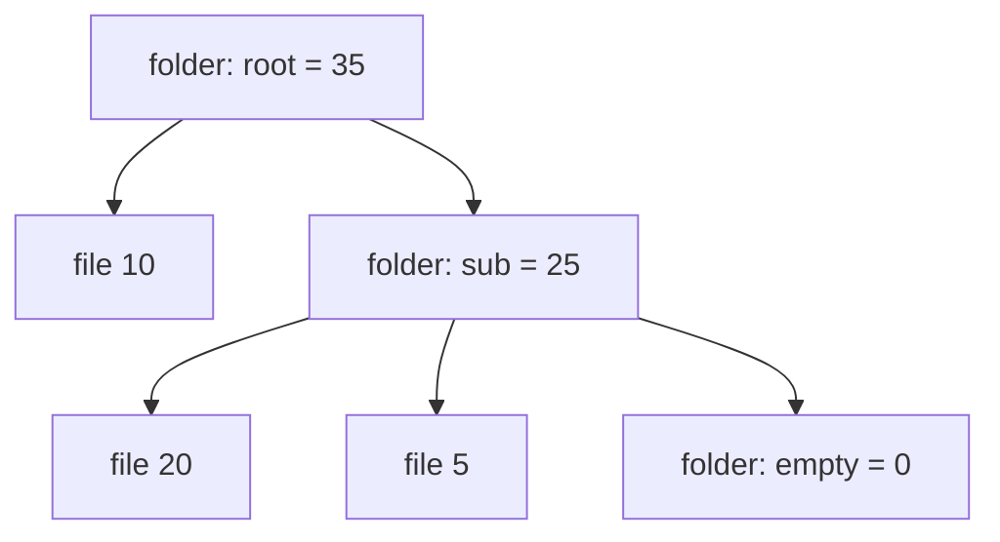

import Scenario from "../../../components/Scenario.astro";
import LevelIntro from "../../../components/LevelIntro.astro";
import Checkpoint from "../../../components/Checkpoint.astro";
import PracticeCheck from "../../../components/PracticeCheck.astro";

export const unit = {
  track: "logic",
  unitSlug: "induction",
};

<Scenario label="The folder-size function works on every tree in the test suite, and crashes for one customer.">
  <Fragment slot="facts">
    <div class="not-prose flex flex-col gap-2 text-sm text-slate-700 dark:text-slate-300">
      <div class="flex items-center gap-1.5"><span>✅</span> <strong>Tests</strong> — three hand-built trees, all totals right</div>
      <div class="flex items-center gap-1.5"><span>💥</span> <strong>Production</strong> — one customer's account throws an error</div>
      <div class="flex items-center gap-1.5"><span>🔎</span> <strong>The clue</strong> — that account has an empty folder somewhere</div>
    </div>
  </Fragment>

The function sums a nested folder. The tests were three trees, each traced by
hand, and every total matched. Then one customer's account throws an error.
Re-tracing the function from the top shows nothing wrong. **If the tests
passed and the logic reads correctly, what does the base case and step
structure let you ask that re-tracing does not?**

</Scenario>

<LevelIntro
  items={[
    "The proof applied to real code",
    "Diagnosing a bug by which part breaks",
    "Writing recursion from the two facts",
  ]}
/>

## What are the base case and step in the real function?

**Here is the function. Where, concretely, are the two facts?** The data model
is intentionally small: a file is `type: "file"` with a `size`, and a folder is
`type: "folder"` with a `children` array.

```js
function folderSize(node) {
  if (node.type === "file") return node.size; // base case
  return node.children.reduce((sum, child) => sum + folderSize(child), 0); // step
}
```

**Base case:** a file has no children, so it returns its size with no
recursion. **Inductive step:** for a folder, assume each child's call already
returns that child's correct total; the sum of correct sub-totals is the
correct total for the folder. That argument never mentions how deep any
particular child is.

For this tree the call structure is:



Result: `10 + (20 + 5 + 0) = 35`. The proof did not need that trace; 35 falls out
as one instance of the general guarantee.

<Checkpoint question="This tree contains an empty folder. From the base case and step alone, what must folderSize return for it, and why?">

It must return `0`. An empty folder has zero children, so the step sums zero
sub-totals, and a sum of nothing is `0`, the same way an empty cart totals
nothing. This is not a special case added to the proof; it falls straight out of
"sum the children's correct totals" with an empty list of children. Any
implementation that does not return `0` is violating the step itself.

</Checkpoint>

## Which part of the argument does the bug break?

**The customer's account crashes. Which of the two facts is it violating?**

```js
function folderSizeBuggy(node) {
  if (node.type === "file") return node.size;
  return node.children.reduce((sum, child) => sum + folderSizeBuggy(child));
}
```

The only difference is the missing `0` after the callback. With no initial
value, `reduce` on an empty array throws "Reduce of empty array with no initial
value." Trees with no empty folder never reach that line, which is exactly why
hand-picked examples missed it.

Asking "which part breaks?" finds it immediately. The combining logic is fine.
What is missing is the behavior for a folder with zero children: a base case
hiding inside what looked like the step. Adding the `0` fixes both the crash and
the proof.

| Symptom                                | Part of the argument to inspect         |
| -------------------------------------- | --------------------------------------- |
| Wrong on the smallest inputs           | Base case                               |
| Right on small inputs, wrong on bigger | The step that combines child results    |
| Never terminates                       | Strictly smaller calls / finiteness     |
| Wrong only on oddly shaped input       | Hidden conditions about the input shape |

<Checkpoint question="A function finds the deepest nesting level: 0 for a file, and for a folder 1 + Math.max over its children's depths. What does it return for an empty folder, and which part of the argument is at fault?">

`Math.max()` with no arguments returns `-Infinity`, so an empty folder computes
`1 + -Infinity`, which is `-Infinity`, silently wrong rather than a crash. An
empty folder is one level deep, so the right answer is `1`. It is the same
failure category as the `reduce` bug: an empty-children base case was assumed
to be covered by the general combining logic when it needed its own explicit
answer.

</Checkpoint>

<PracticeCheck
  track={unit.track}
  unitSlug={unit.unitSlug}
  topicId="diagnose-with-induction"
/>

## How do you write a recursive function from the two facts?

**If the proof pattern is "base case plus step," can you run it backwards to
write the code?** Yes, and it is the reliable way to write recursion without
tracing. Ask two questions in order:

1. **What is the simplest input, and what is the answer for it?** That is the
   base case. Include "nothing there" inputs: empty folder, empty list, zero.
2. **If a call on every smaller piece already returns the right answer, how do I
   combine those answers into mine?** That is the step.

For the deepest-level function above, the two answers are: a file is `0`; a
folder is `1` more than its deepest child, and `1` alone when there are no
children. Written down, the second answer needs its own line:

```js
function maxDepth(node) {
  if (node.type === "file") return 0;
  if (node.children.length === 0) return 1; // the hidden base case
  return 1 + Math.max(...node.children.map(maxDepth));
}
```

Each recursive call takes a child, which is strictly smaller than `node`, so
the descent ends at files and empty folders.

<PracticeCheck
  track={unit.track}
  unitSlug={unit.unitSlug}
  topicId="recursive-code"
/>

## When does induction not apply yet?

Sometimes the conclusion is not "the proof failed" but "the input model is not
ready for this proof."

| Input problem                               | What must happen first                                 |
| ------------------------------------------- | ------------------------------------------------------ |
| A folder can reference one of its ancestors | Detect or reject cycles, or change the algorithm       |
| A node has no `type`                        | Validate the data before calling `folderSize`          |
| A file is missing `size`                    | Define how invalid files are handled (it yields `NaN`) |
| Children can be generated forever           | Add a finite stopping rule before claiming correctness |

This connects to `logic/state-machines`: good models make invalid shapes
impossible or explicit instead of letting the algorithm find them by accident.

## This is a case, not the whole territory

The worked example is one data model. The lesson that generalizes is that a
base case and a step, each checked once, scale to any depth, and that a bug is
found fastest by asking which of the two it violates. What is specific here is
the shape: files as leaves and folders as sums. A structure where a child can
be shared between two parents needs a different argument, and one that allows
cycles may have no valid induction at all.

**Try extending it yourself.** What if the question were "how many folders are
in this tree," not "how big is it"? What are the base case and the step, and does
an empty folder count? What if a link could point back to an ancestor: which
part of "strictly smaller" breaks, and what would you add to restore it?

## Failure modes

| Failure mode                                           | What it gets wrong                                                           |
| ------------------------------------------------------ | ---------------------------------------------------------------------------- |
| Treating traced examples as a proof                    | Tracing covers only the inputs tried                                         |
| Re-tracing from scratch to debug                       | Asking which part breaks narrows the search to the base case or the step     |
| Missing a base case hidden inside ordinary logic       | Empty collections and zero-length inputs are base cases in disguise          |
| Applying the proof to inputs that break its conditions | Cycles, infinite structures and malformed nodes need fixing before the proof |
