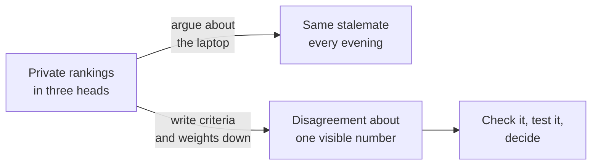

import Scenario from "../../../components/Scenario.astro";
import LevelIntro from "../../../components/LevelIntro.astro";
import PracticeCheck from "../../../components/PracticeCheck.astro";

export const unit = {
  track: "logic",
  unitSlug: "multi-criteria-decisions-under-ambiguity",
};

<Scenario label="Three friends, one laptop, one stuck evening">
  <Fragment slot="facts">
    

      
💸 <strong>Ana</strong> — protects the price (never says so)

      
🔋 <strong>Ben</strong> — protects battery life (never says so)

      
🎒 <strong>Cleo</strong> — protects low weight for carrying (never says so)

      
🔁 <strong>Evenings spent</strong> — 3, same arguments each time

    

  </Fragment>

Sam needs a new laptop and asks three friends. Ana says "get the Budget
one, the Ultralight costs far too much." Ben says "the Budget one dies
by lunchtime." Cleo says "the Budget one is a brick in a bag." Three
evenings later nobody has changed their mind, and each friend is sure
the others are being unreasonable. Every one of them is correct about
what they are saying. **So what is actually stuck: the choice of
laptop, or something underneath it that nobody has said out loud?**

Sam tries one new question: "If you could only protect one thing, which
would it be?" Ana says price. Ben says battery. Cleo says weight. The
argument was never about the laptops. It was about **which of several
things matters most, and by how much**, and nobody had asked. Once the
three priorities are written on one page, the fight becomes "should
price count for more than weight?", a small question with an answer
that Sam can actually decide.

</Scenario>

<LevelIntro
  items={[
    "Why several competing factors stall a decision",
    "Naming criteria and weights in writing",
    "How this differs from one uncertain number",
  ]}
/>

## What kind of problem is this?

**Why can't Sam just add up "dollars" and "hours of battery" and pick
the smaller total?** Because they are different currencies. No exchange
rate says one extra hour of battery is worth exactly some number of
dollars. A decision with several such factors is a **multi-criteria
decision**, and the factors are called **criteria**. The trouble is not
that Sam lacks information. The trouble is that each criterion pulls
toward a different laptop and people weigh them differently.

| Laptop     | Price   | Battery | Weight to carry | Who is happy       |
| ---------- | ------- | ------- | --------------- | ------------------ |
| Budget     | lowest  | short   | heavy           | Ana                |
| Ultralight | highest | long    | light           | Ben and Cleo       |
| Workhorse  | middle  | middle  | heavy, fast     | nobody in the room |

This is a different problem from the one in `expected-value`, where the
difficulty is a single quantity (such as a payoff) whose outcome is
uncertain. Here nothing is uncertain about the price tag. What is
missing is agreement on how much each factor counts.

## What does naming the weights change?

The written list also surfaced a fourth criterion nobody was arguing
for: raw speed. Writing it down did two jobs at once. It exposed what
had been left out, and it turned "you are wrong" into "I think price
should count more than weight, and here is why." Level 2 turns the
written list into a score; level 3 shows how fragile that score can be
on a real engineering decision.

## Key terms

- **Multi-criteria decision**: a choice among options where several
  distinct factors bear on which is best and no single number captures
  them all.
- **Criterion**: one named factor the decision depends on (price,
  battery, weight, speed).
- **Weight**: how much a criterion counts relative to the others, said
  out loud as a number instead of kept as a private priority.
- **Incommensurable**: not convertible to a common unit; battery hours
  are not "worth" a fixed number of dollars.
- **Weighted-scoring matrix**: a table that combines weighted criteria
  into one comparable score per option (L2, L3).
- **Sensitivity analysis**: re-checking whether the winner survives
  other reasonable weightings (L2, L3).
- **Tie-breaker judgment**: deciding on reversibility, who bears the
  cost of being wrong, or regret when the score gap is too thin to
  trust.

<PracticeCheck
  track={unit.track}
  unitSlug={unit.unitSlug}
  topicId="unstated-priorities"
/>
