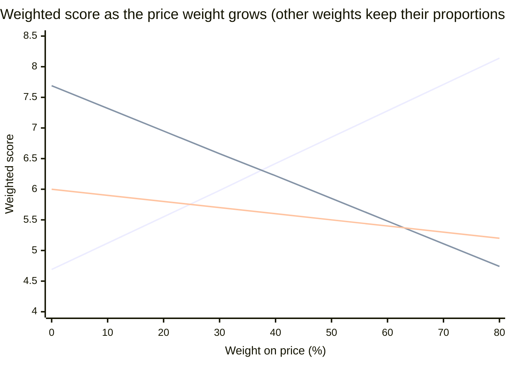
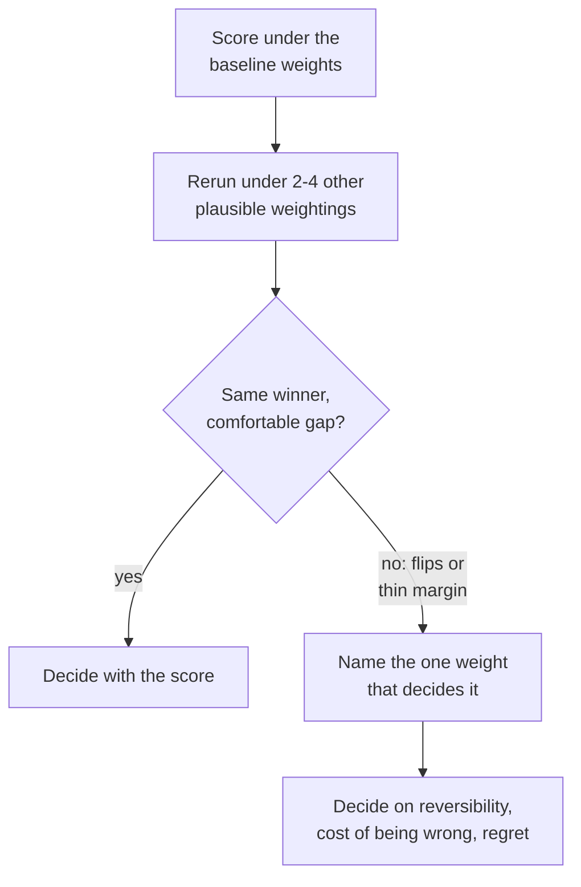

import LevelIntro from "../../../components/LevelIntro.astro";
import Checkpoint from "../../../components/Checkpoint.astro";
import PracticeCheck from "../../../components/PracticeCheck.astro";

export const unit = {
  track: "logic",
  unitSlug: "multi-criteria-decisions-under-ambiguity",
};

L1 ended with Sam's three friends finally naming what each of them
protects. Naming is only half the job: Sam still has three laptops and
four criteria to combine. This level builds the table that does the
combining, then asks the more important question of how far its answer
can be trusted.

<LevelIntro
  items={[
    "The matrix: options, criteria, weights, one score",
    "Sensitivity: does the winner survive other weightings?",
    "Thin margins and what decides them",
  ]}
/>

## How do you compare three laptops on four criteria at once?

**Ana says price, Ben says battery, Cleo says weight, and a fourth
criterion, speed, joined the list. How do all four count at the same
time instead of being argued one by one?** Give every criterion a
weight (a share of 100%), give every option a 1 to 10 score on every
criterion, and add up score times weight.

| Criterion (weight)    | Budget  | Ultralight | Workhorse |
| --------------------- | :-----: | :--------: | :-------: |
| Price (35%)           |    9    |     4      |     5     |
| Battery (25%)         |    5    |     8      |     6     |
| Weight to carry (20%) |    5    |     9      |     3     |
| Speed (20%)           |    4    |     6      |     9     |
| **Weighted score**    | **6.2** |  **6.4**   | **5.65**  |

Every score and every weight here is an **assumption** chosen for the
example, not a measurement. The arithmetic for Budget is
9 x 0.35 + 5 x 0.25 + 5 x 0.20 + 4 x 0.20 = 3.15 + 1.25 + 1.00 + 0.80 = 6.2.

Ultralight wins, but by 0.2 points out of 6.4, about 3%. Hold that
thought: it is the whole second half of this level.

<Checkpoint question="Two people agree the table above is added up correctly, yet one still says the 6.4 versus 6.2 result is shaky. What is true regardless of how carefully the sums were done?">

The weights and the 1 to 10 scores are honest guesses, so careful
arithmetic on guesses gives a guess that merely looks precise. The
matrix does not remove judgment from the decision; it makes each
judgment call visible, so a person can say "I think the battery score
for Budget should be 3, not 5" instead of "I just do not like it." That
visibility, not the final number, is the matrix's main value.

</Checkpoint>

<PracticeCheck
  track={unit.track}
  unitSlug={unit.unitSlug}
  topicId="weighted-matrix"
/>

## What if Ana had been given a bigger say?

**Suppose Ana's concern about price counted for 50% instead of 35%. Does
Ultralight still win?** Re-run the same scores under other weightings a
real person might argue for. That re-run is **sensitivity analysis**.

| Weighting (price / battery / weight / speed) | Winner     | Gap over second place |
| -------------------------------------------- | ---------- | :-------------------: |
| Baseline (35 / 25 / 20 / 20)                 | Ultralight |         0.20          |
| Price-first (50 / 20 / 15 / 15)              | Budget     |         1.00          |
| Travel-first (15 / 25 / 40 / 20)             | Ultralight |         2.00          |
| Speed-first (20 / 15 / 10 / 55)              | Workhorse  |         0.95          |

Three different winners from four plausible weightings. The baseline
answer was a product of one set of guesses, not a stable fact. The chart
below sweeps the price weight on its own (the other three keep their
relative proportions) and shows exactly where the lead changes hands.

The rising line is Budget, the falling line is Ultralight, the flat one
is Workhorse. Budget overtakes Ultralight at a price weight of exactly
37.5%, only 2.5 points above the 35% baseline. A small nudge to one
weight changes the winner.

<Checkpoint question="A colleague points at the chart and says the decision is 'just whichever line is highest, so Ultralight.' What does the chart say that the single baseline number did not?">

It says how close the call is. The two top lines cross only 2.5 points
of weight away from the baseline, so someone who values price slightly
more than Sam does would honestly reach the opposite answer. The
baseline number alone hid that, because 6.4 versus 6.2 looks like a
clear ordering. The chart shows the ordering depends on one weight that
was itself a rough guess.

</Checkpoint>

<PracticeCheck
  track={unit.track}
  unitSlug={unit.unitSlug}
  topicId="sensitivity-check"
/>

## When the numbers cannot settle it, what does?

For Sam, the crux is now a single question: does price deserve more or
less than about 37.5%? The follow-up is not "compute harder". It is
different in kind. Can the laptop be returned within a store's trial
window (an assumption)? If so, picking either one is cheap to undo, and
the thin margin matters little. That is a **tie-breaker judgment**, and
level 3 develops it on a heavier decision.
