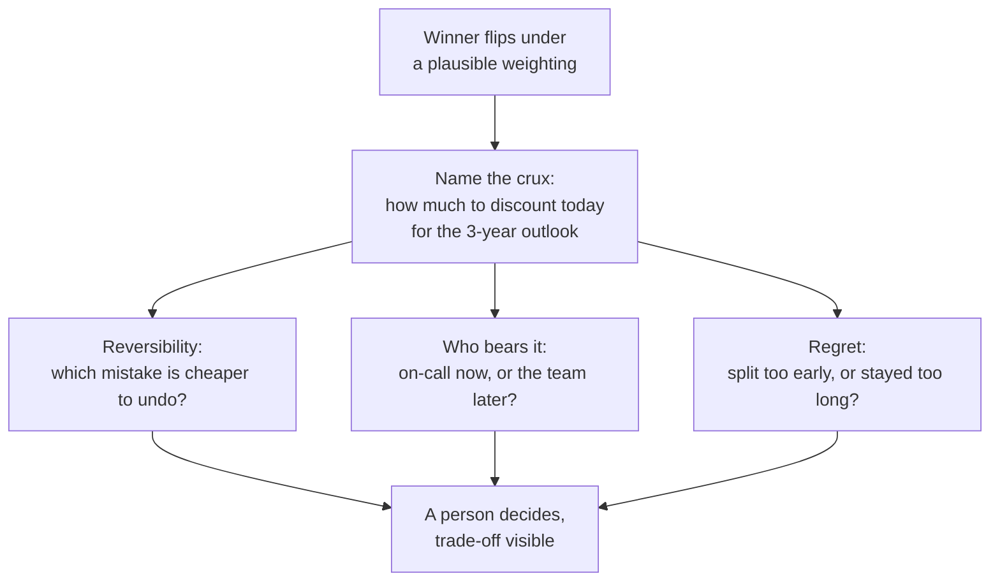

import Scenario from "../../../components/Scenario.astro";
import LevelIntro from "../../../components/LevelIntro.astro";
import Checkpoint from "../../../components/Checkpoint.astro";
import PracticeCheck from "../../../components/PracticeCheck.astro";

export const unit = {
  track: "logic",
  unitSlug: "multi-criteria-decisions-under-ambiguity",
};

<Scenario label="Keep one deployable app, or split it into services?">
  <Fragment slot="facts">
    <div class="not-prose flex flex-col gap-2 text-sm text-slate-700 dark:text-slate-300">
      <div class="flex items-center gap-1.5"><span>🏗️</span> <strong>Options</strong> — stay monolith (modular), extract 2 services now, full microservices migration</div>
      <div class="flex items-center gap-1.5"><span>📏</span> <strong>Criteria</strong> — operational risk, team familiarity, maintainability, time-to-value, cost</div>
      <div class="flex items-center gap-1.5"><span>⚖️</span> <strong>4 weightings tried</strong> — baseline, risk-averse, onboarding-first, 3-year outlook</div>
      <div class="flex items-center gap-1.5"><span>❓</span> <strong>Open question</strong> — does the same option win under all four?</div>
    </div>
  </Fragment>

A software team has argued about this for weeks. One person wants faster
independent releases, one worries about on-call risk, one worries about
how long new hires take to become productive. Like Sam's friends, they
are really arguing about weights. Every score and every weight below is
an **assumption** written down for the exercise, not a measurement.
L2's laptop table gave a winner by a thin 0.2. **Here the baseline
winner leads by a wide 2.05. Is a wide lead on one weighting enough to
trust, or does it still need the re-check?**

</Scenario>

<LevelIntro
  items={[
    "A five-criterion matrix on a real trade-off",
    "A sensitivity check where the winner flips",
    "Resolving the flip without more arithmetic",
  ]}
/>

## What does the baseline matrix say?

| Criterion (baseline weight) | Stay monolith, modular | Extract 2 services now | Full microservices |
| --------------------------- | :--------------------: | :--------------------: | :----------------: |
| Operational risk (30%)      |           8            |           5            |         2          |
| Team familiarity (25%)      |           9            |           5            |         2          |
| Maintainability (20%)       |           4            |           9            |         8          |
| Time-to-value (15%)         |           9            |           4            |         2          |
| Cost (10%)                  |           8            |           4            |         2          |
| **Weighted score**          |        **7.6**         |        **5.55**        |      **3.2**       |

Monolith: 8 x 0.30 + 9 x 0.25 + 4 x 0.20 + 9 x 0.15 + 8 x 0.10 =
2.4 + 2.25 + 0.8 + 1.35 + 0.8 = 7.6. The lead over second place is
2.05, far wider than the laptop's 0.2. **If the team stopped here, what
would they be trusting: the decision, or one person's first guess at how
much operational risk should count?**

## Does the winner survive other people's weights?

Nobody's weighting is uniquely correct, so rerun the same scores under
several that real teammates would argue for.

| Weighting (risk / familiarity / maintainability / time / cost) | Monolith | Extract 2 | Winner    | Gap  |
| -------------------------------------------------------------- | :------: | :-------: | --------- | :--: |
| Baseline (30 / 25 / 20 / 15 / 10)                              |   7.6    |   5.55    | Monolith  | 2.05 |
| Risk-averse (40 / 20 / 20 / 10 / 10)                           |   7.5    |    5.6    | Monolith  | 1.90 |
| Onboarding-first (20 / 40 / 15 / 15 / 10)                      |   7.95   |   5.35    | Monolith  | 2.60 |
| 3-year outlook (15 / 10 / 50 / 15 / 10)                        |   6.25   |   6.75    | Extract 2 | 0.50 |

Three weightings agree, including the two most associated with the
people who feared splitting. The fourth, someone arguing "optimise for
the system we will have in three years," flips the winner, and the gap
(0.50 out of 6.75, about 7%) is small. The same check in code is short,
because it is just the baseline arithmetic repeated per weighting:

```js
function weightedScore(scores, weights) {
  // weights are whole percentages that sum to 100
  let total = 0;
  for (const criterion in weights) {
    total += scores[criterion] * weights[criterion];
  }
  return total / 100;
}

function winnersByWeighting(options, weightSets) {
  return weightSets.map(({ label, weights }) => {
    const ranked = options
      .map((o) => ({ name: o.name, score: weightedScore(o.scores, weights) }))
      .sort((a, b) => b.score - a.score);
    return { label, winner: ranked[0].name };
  });
}
```

<Checkpoint question="If a weighting object accidentally summed to 130 instead of 100, would the code above still name the correct winner for that weighting, and could its scores be compared with the other weightings' scores?">

The winner would usually be unchanged, because every option's score is
inflated by the same factor, so the order between options is preserved.
The absolute scores, however, stop being comparable across weightings: a
score of 7.6 under weights that sum to 130 is not the same kind of number
as 7.6 under weights that sum to 100. That breaks gap comparisons, which
is why every weighting should be normalised to the same total first.

</Checkpoint>

<PracticeCheck
  track={unit.track}
  unitSlug={unit.unitSlug}
  topicId="scoring-in-code"
/>

The interactive demo for this unit varies the maintainability weight on its own while the
other four keep their baseline proportions (0.125, 0.375, 0.3125 and
0.1875 of whatever is left). At the default of 20% the score gap is
-2.05, matching the table, and the lead changes hands at roughly 43%.
That is a different slice of the weight space than the 3-year row above,
and the difference is itself a lesson: where the flip happens depends on
which other weights you move alongside the one you are watching.

## When the winner flips, what decides it?



The tempting move is to argue about the second decimal of the
maintainability weight. That is wasted effort, because the weights were
never that precise. Three different questions do the work instead:

- **Reversibility.** Extracting two services can be partly folded back
  if it goes badly. Staying put and delaying the split gets more costly
  to undo as the code grows around the current boundaries. Which mistake
  is cheaper to fix a year from now?
- **Who bears the cost of being wrong.** Under-weighted risk lands on
  the on-call rotation, at night. Under-weighted maintainability lands
  on whoever changes the code six months later. Which of those is the
  team more willing to impose?
- **Regret.** A year on, would the team be more upset about paying an
  operations tax too early, or a bigger migration bill too late?

None of the three has a formula, and none needs one. The matrix narrowed
a weeks-long argument to a single named crux; the choice is still made by
a person, on purpose.

<Checkpoint question="After the check, the team extracts two services, citing reversibility and the 3-year outlook rather than the baseline score. Was building the matrix wasted effort?">

No. The matrix did its load-bearing work even though its top-line number
was not the final word. Without it the team would still be arguing
three unstated priorities against each other. With it, the disagreement
became "how much should today's comfort be discounted for a longer
horizon," and the sensitivity check is what revealed that crux in the
first place, instead of letting the team ship the baseline answer
without knowing how fragile it was. The score not deciding is the
framework working as designed.

</Checkpoint>

<PracticeCheck
  track={unit.track}
  unitSlug={unit.unitSlug}
  topicId="flips-and-tiebreakers"
/>

## This is one case, not the whole territory

This worked example held two things fixed that real decisions rarely do:
the list of criteria and everyone's raw scores. Try extending it
yourself before reading on.

- **What changes if a new criterion appears mid-decision?** Say a
  compliance requirement surfaces three weeks in. Rerunning the old
  weightings with that criterion simply missing from them shortchanges
  whichever option happens to be strong on it. The honest response is to
  go back to listing criteria and re-weight everything, because every
  existing weight was set against an incomplete list.
- **What changes if the dispute is about a score, not a weight?** If one
  person rates "extract 2 services" a 5 on operational risk and an
  engineer who ran the last migration says 2, sensitivity analysis on
  weights does not touch it. Settle it by asking who has better
  evidence, such as incident history, rather than by running more
  weightings.
- **What if the lead were wide under every weighting you tried?** Would
  that prove the decision? Or only that the options, scores and
  weightings you thought of agree?

Then try the same exercise on a decision from your own life: three
options, four criteria, and a weighting for each person who would have an
opinion.
