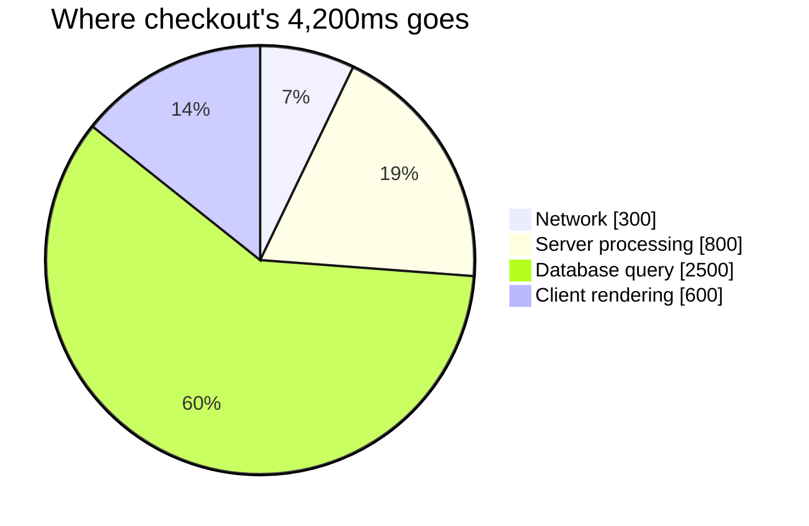

import Scenario from "../../../components/Scenario.astro";
import LevelIntro from "../../../components/LevelIntro.astro";
import PracticeCheck from "../../../components/PracticeCheck.astro";

export const unit = {
  track: "logic",
  unitSlug: "problem-decomposition",
};

<Scenario label="'Make checkout faster' — where do you even start?">
  <Fragment slot="facts">
    

      
🐌 <strong>The complaint</strong> — paying takes 4.2 seconds; people give up and leave

      
❓ <strong>The ask</strong> — "make checkout faster"

    

    

      

        
Waiting on the network300ms

        

      

      

        
Server working800ms

        

      

      

        
Looking up stored data2,500ms

        

      

      

        
Drawing the screen600ms

        

      

    

  </Fragment>

"Make checkout faster" isn't a task anyone can start on Monday morning.
There is no single line of work called "make it faster." **What has to
happen before this vague request becomes something one person can pick
up?**

Measuring where the 4.2 seconds goes turns one unworkable request into four
small, specific ones: 300ms of network, 800ms of server work, 2,500ms of
data lookup and 600ms of drawing the screen. **Only one of those four
numbers deserves attention this week. Which one, and how would you have
known without splitting?**

</Scenario>

<LevelIntro
  items={[
    "Why a vague ask is not unsolvable",
    "What a decomposition is (and must cover)",
    "How split pieces show where to focus",
  ]}
/>

## Why is a vague ask not the same as an impossible one?

**If nobody can start on "make checkout faster," is the problem too hard?**
No. It is too coarse. "Make checkout faster" and "cut the data lookup from
2,500ms to under 500ms" aim at the same goal, but only the second one names
a piece a person can work on today.

| Term                | Plain meaning                                           |
| ------------------- | ------------------------------------------------------- |
| `checkout`          | The step where someone confirms and pays for a purchase |
| `ms`                | Milliseconds; 1,000ms is one second                     |
| `network`           | Time spent sending data across the internet             |
| `server processing` | Time spent on the computer that receives the request    |
| `database query`    | Time spent looking up or saving stored data             |
| `client rendering`  | Time the browser spends drawing the final screen        |

- **Decomposition** means splitting a problem into pieces that are each
  smaller, well defined, and workable on their own. Chopping one sentence
  into shorter sentences does not count.
- **"I don't know where to start" is a signal to split**, not a signal that
  the problem is too hard.

<PracticeCheck
  track={unit.track}
  unitSlug={unit.unitSlug}
  topicId="vague-to-pieces"
/>

## What must a split get right to be trustworthy?

- **It covers the whole problem.** If the pieces don't add up to the
  original, something is missing.
- **No two pieces count the same cause.** Otherwise fixing one makes the
  other look better while nothing real changed.
- **Focus follows from the split.** Before measuring, "everything" seemed
  equally worth fixing. After measuring, trimming the 300ms of network would
  barely register, while the 2,500ms lookup (nearly 60% of the total) is the
  problem in miniature. The slider below lets you shrink that lookup and
  watch its share fall.

The same pattern works far from software. "My morning is chaotic" can be
split into waking up, getting ready, breakfast, finding keys and getting to
the bus. Once the pieces are named, you can ask which one actually causes
the delay instead of trying to fix the whole morning at once.

|                                 | Before splitting                 | After splitting                                         |
| ------------------------------- | -------------------------------- | ------------------------------------------------------- |
| What you know                   | Checkout takes 4.2 seconds total | Network 300ms, server 800ms, lookup 2,500ms, draw 600ms |
| What you can start on           | Nothing specific                 | The lookup, the dominant and separable piece            |
| How you would know a fix worked | "Does it feel faster?"           | "Did the lookup's 2,500ms actually drop?"               |
