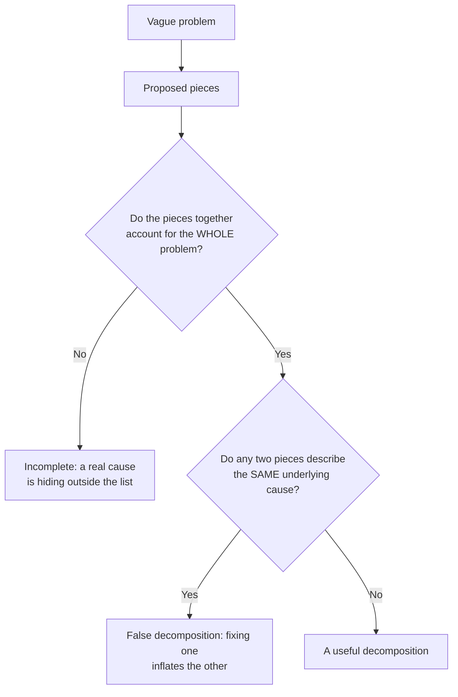
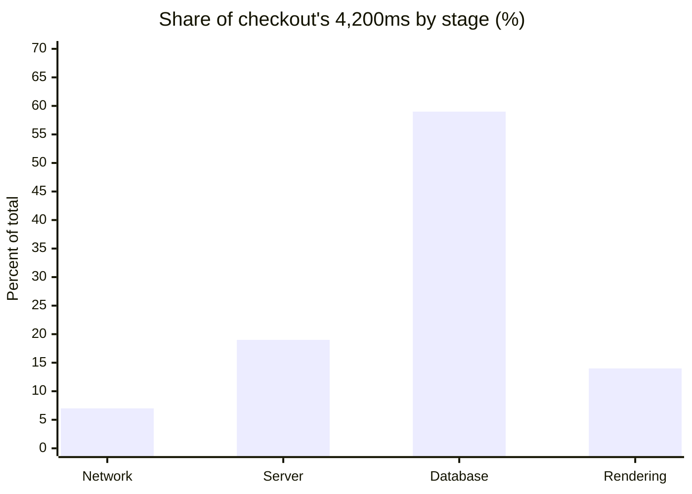

import LevelIntro from "../../../components/LevelIntro.astro";
import Checkpoint from "../../../components/Checkpoint.astro";
import PracticeCheck from "../../../components/PracticeCheck.astro";

export const unit = {
  track: "logic",
  unitSlug: "problem-decomposition",
};

L1 turned "make checkout faster" into four measured stages. Not every way of
chopping a problem is that trustworthy, though. L2 gives the checkable
properties that separate a useful split from one that only looks like
progress.

<LevelIntro
  items={[
    "The exhaustive and non-overlapping tests",
    "Independence: can a piece stand alone?",
    "Why a split also reveals priority",
  ]}
/>

## Can any split into smaller pieces be trusted?

Take a plain case first. A trip to school takes 60 minutes. Someone splits
it into walking 10, waiting for the bus 20, riding the bus 30, and
"commuting" 60. **Before reading on: what is wrong with that list?**

"Commuting" already contains the other three, so adding all four gives 120
minutes for a 60-minute trip. The sum disagreeing with the real total is the
tell. A good split must pass two checks:

| Check               | Plain version      | Question to ask                                     |
| ------------------- | ------------------ | --------------------------------------------------- |
| **Exhaustive**      | Complete           | Did we leave part of the original problem outside?  |
| **Non-overlapping** | Not counting twice | Do two pieces name the same cause under two labels? |

For times, money and distances, completeness can be checked by addition.
Checkout's 300 + 800 + 2,500 + 600 does equal 4,200ms. For messier human
problems the check is causal: do the pieces cover the main reasons the
problem happens, and is each reason listed once?

| Sum of pieces versus the real total | What it signals                       |
| ----------------------------------- | ------------------------------------- |
| Equal                               | Probably complete, still check causes |
| Smaller                             | Something is missing                  |
| Larger                              | Something is counted twice            |

<Checkpoint question="Someone splits 'checkout is slow' into network (300ms), rendering (600ms), 'server processing' (800ms) and 'total backend time' (3,300ms). Does this pass both tests?">

It fails non-overlapping. "Total backend time" almost certainly already
contains the server processing and the data lookup, so one piece is a
superset of another wearing a different label. Adding all four would
double-count whatever the backend total contains, and a sum larger than the
true 4,200ms is exactly the symptom that exposes it.

</Checkpoint>

<PracticeCheck
  track={unit.track}
  unitSlug={unit.unitSlug}
  topicId="exhaustive-non-overlapping"
/>

## Can a piece be worked on without solving the others first?

**Beyond complete and non-repeating, is there a third property to check?**
Yes: independence. The data lookup and the screen drawing are independent;
one person can speed up the lookup without touching the drawing code. A
badly drawn split like "reduce server-side time" and "reduce end-to-end
time" fails, because end-to-end time is partly made of server-side time, so
you can't work on the second without understanding the first.

Independent does not mean the pieces can never affect each other. It means
the piece is specific enough that someone can measure it and test an idea
about it without first solving all the others.

## Once the pieces are sound, which one matters?

**What is the next question after a clean split?** Which piece is worth the
effort. Splitting 4,200ms into four numbers is only half the value. The
other half is that the numbers show the data lookup (about 59%) dwarfing the
network (about 7%).

| Piece             | Share of total | Worth attention this week?               |
| ----------------- | -------------- | ---------------------------------------- |
| Network           | 7%             | No: trimming it barely moves the total   |
| Server processing | 19%            | Maybe, after the bigger piece is handled |
| Database query    | 59%            | Yes: it is most of the actual problem    |
| Client rendering  | 14%            | Maybe, after the bigger piece is handled |

<Checkpoint question="A split of 'onboarding is confusing' gives three sound, independent pieces that each affect about a third of new users. With no dominant piece, has decomposition still helped?">

Yes. Its value was never limited to finding one giant piece. Even split
evenly, it turns one unworkable complaint into three specific, assignable
problems, each checkable on its own evidence. Only the ranking step
changes: instead of "start with the biggest," you ask which piece is
cheapest to fix or helps the most valuable users first.

</Checkpoint>

Share tells you how far the total can move; it does not tell you what the
fix costs. Decomposition supplies the first number, and judgment supplies the
second.

<PracticeCheck
  track={unit.track}
  unitSlug={unit.unitSlug}
  topicId="independence-priority"
/>

If the request is vague because the requirements are vague, pair this with
`product-domain/requirements-gathering`: turn the ask into observable
behavior before choosing what to work on.
