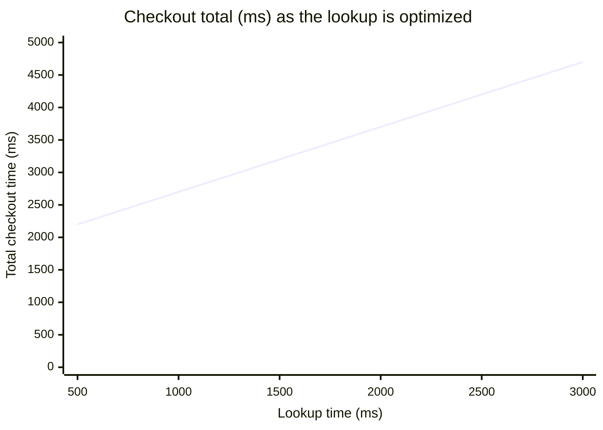

import Scenario from "../../../components/Scenario.astro";
import LevelIntro from "../../../components/LevelIntro.astro";
import Checkpoint from "../../../components/Checkpoint.astro";
import PracticeCheck from "../../../components/PracticeCheck.astro";

export const unit = {
  track: "logic",
  unitSlug: "problem-decomposition",
};

<Scenario label="Four numbers instead of one vague complaint">
  <Fragment slot="facts">
    <div class="not-prose flex flex-col gap-2 text-sm text-slate-700 dark:text-slate-300">
      <div class="flex items-center gap-1.5"><span>⏱️</span> <strong>Total</strong> — 4,200ms measured checkout time</div>
      <div class="flex items-center gap-1.5"><span>📊</span> <strong>Stages</strong> — network 300ms, server 800ms, lookup 2,500ms, rendering 600ms</div>
      <div class="flex items-center gap-1.5"><span>🔧</span> <strong>The fix</strong> — only the lookup is being optimized</div>
    </div>
  </Fragment>

Someone reports that the lookup dropped from 2,500ms to 1,000ms and the other
three stages are unchanged. **Before reading on, predict: what is the new
total, and is the lookup still the biggest piece?**

</Scenario>

<LevelIntro
  items={[
    "Auditing a split against the true total",
    "How the bottleneck moves after a fix",
    "Splits that are not simple sums",
  ]}
/>

## How do you audit a split against the real total?

**What can you check mechanically once the stages have names?** One
comparison: the sum of the pieces against an independently measured total.

| Sum compared with the measured total | Verdict  | What to do next                      |
| ------------------------------------ | -------- | ------------------------------------ |
| Equal                                | Complete | Still check that no cause repeats    |
| Smaller                              | Missing  | Hunt for the unmeasured contributor  |
| Larger                               | Overlap  | Find the piece that contains another |

This is one of the rare spots where code is the clearest vehicle, because
the audit is a single small rule that is easy to get subtly wrong (which way
does the gap point?).

```js
function auditDecomposition(stages, measuredTotal) {
  const sum = stages.reduce((total, stage) => total + stage.ms, 0);
  if (sum === measuredTotal) return "complete";
  return sum < measuredTotal ? "missing" : "overlap";
}
```

With the real four stages and a total of 4,200 it answers "complete". With
a total of 5,000 it answers "missing", because 800ms is unaccounted for. With
the overlapping list from L2 (3,300 + 2,500 + 300 + 600 = 6,700 against
4,200) it answers "overlap".

<Checkpoint question="The audit returns 'missing' for a total of 5,000ms. Does it tell you which stage is wrong?">

No. It only says the pieces fall 800ms short of the whole. It compares a
sum with a total and has no way to attribute the gap to any stage. The
finding starts an investigation (a retry, a cache miss, a stage nobody
thought to time) rather than ending one, much like a receipt that doesn't
match your list tells you something is missing without saying what.

</Checkpoint>

A caution in the other direction: a matching sum does not prove the split is
sound. One piece that is counted twice and one real piece that is missing can
cancel out numerically. The audit catches most accidents, and the causal
question "does any cause appear twice?" still has to be asked.

<PracticeCheck
  track={unit.track}
  unitSlug={unit.unitSlug}
  topicId="decomposition-audit"
/>

## Where does the bottleneck go after the biggest piece is fixed?

**If the lookup drops to 1,000ms, is the job done?** The total falls from
4,200ms to 2,700ms, and the lookup's share falls from about 59% to about
37%. It is still the biggest piece, but the margin over the server's 800ms
has shrunk. Push it to 500ms and the total is 2,200ms; now the server, at
about 36%, is bigger than the lookup at about 23%.



The chart is a straight line because the stages add. The share is what
bends: each fix to the same piece buys fewer percentage points than the one
before, and at some point the next piece has become the right target. The
demo above lets you drag the lookup yourself and watch its share fall.

<Checkpoint question="After the lookup is at 500ms, a teammate says 'keep going on the lookup, it was the problem.' What does the decomposition say?">

It says the problem moved. At 500ms the lookup is about 23% of a 2,200ms
total, while server processing is about 36%. The split that justified
working on the lookup is the same split that now points at the server, so
the decomposition should be re-read after each fix, not treated as a one-off
verdict.

</Checkpoint>

## What if the pieces are not simple sums?

**Checkout stages happen one after another, so they add up. What if a vaguer
problem's pieces can't be summed, or depend on each other?** Take "our
onboarding is confusing." There is no single total. A split into "confusing
for new users" and "confusing for returning users" looks independent, but if
one ambiguous button label confuses both groups, the two pieces share one
cause. Splitting by audience hid a repeated cause; splitting by journey step
would have exposed it.

| Step          | Who is affected     | Evidence              | Possible cause          | Check next            |
| ------------- | ------------------- | --------------------- | ----------------------- | --------------------- |
| Invite email  | New team members    | Low open rate         | Subject looks generic   | Test a new subject    |
| Profile setup | Non-technical users | Many abandoned forms  | Required fields unclear | Watch a setup session |
| First project | Managers            | Repeated help tickets | Button label ambiguous  | Rename in a prototype |

The same two questions still apply: does the table cover the whole journey,
and is each cause named once? What changes is that completeness is argued
from evidence and causes rather than checked by addition.

<PracticeCheck
  track={unit.track}
  unitSlug={unit.unitSlug}
  topicId="non-additive-decomposition"
/>

## Extend the example

The checkout case is one case, not the whole territory. Its stages are
sequential, measurable and additive, which made the checks easy. Try
extending it yourself:

- **What if the stages ran in parallel?** If the server and the lookup
  overlapped in time, the total would no longer be their sum. How would you
  audit completeness then?
- **What if the news were worse?** Suppose the sum came out 1,500ms above the
  measured total. Which stage would you suspect first, and what would you
  measure to confirm?
- **What if the audience were different?** Imagine "our team is always
  behind." Which splits (by project, by person, by week) risk repeating a
  cause, and which journey or cause-based split avoids it?

## Failure modes

| Failure mode                                           | What it gets wrong                                        |
| ------------------------------------------------------ | --------------------------------------------------------- |
| Reading "I don't know where to start" as unsolvable    | It usually means the problem hasn't been split yet        |
| Splitting without checking the pieces sum to the whole | A real cause can hide outside the named pieces            |
| Two pieces that count the same cause                   | Fixing one inflates the other's apparent improvement      |
| Trusting a matching sum as proof                       | An overlap and a gap can cancel out numerically           |
| Splitting by audience instead of cause                 | Different groups can share one root cause, counted twice  |
| Splitting once and never re-reading it                 | After a fix the biggest piece changes, as the chart shows |
