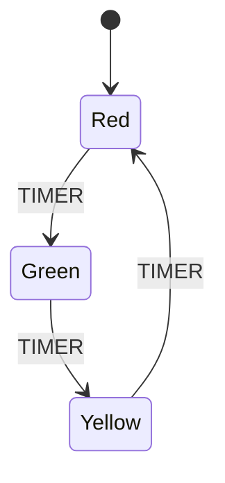

import Scenario from "../../../components/Scenario.astro";
import LevelIntro from "../../../components/LevelIntro.astro";
import PracticeCheck from "../../../components/PracticeCheck.astro";

export const unit = {
  track: "logic",
  unitSlug: "state-machines",
};

<Scenario label="The traffic light that showed red and green together">
  <Fragment slot="facts">
    

      
🚦 <strong>The controller</strong> — three separate on/off flags: <code>isRed</code>, <code>isYellow</code>, <code>isGreen</code>

      
🔢 <strong>Possible settings</strong> — 2 x 2 x 2 = 8

      
✅ <strong>Meant to happen</strong> — 3 (red, yellow, green)

      
🚫 <strong>Nonsense but reachable</strong> — 5

      

      
Green part: the 3 of 8 settings that make sense (37.5%).

    

  </Fragment>

A small crossing has a traffic light whose controller remembers the lamp with
three independent on/off switches: one for red, one for yellow, one for green.
After a power flicker, a driver sees the red lamp **and** the green lamp lit
together. Nobody wrote code that asks for that. Each switch simply holds its own
yes or no, and after the flicker two of them happened to say yes.

**Three switches can be set 8 different ways, but only 3 of those settings are
a real light. What was stopping the other 5 from happening?**

</Scenario>

<LevelIntro
  items={[
    "Why a few switches allow many settings",
    "State, event and transition",
    "How one named state shrinks the list",
  ]}
/>

## Why do a few independent switches allow so many settings?

**Is "red and green together" a rare freak accident, or a built-in possibility?**
It is built in. Every independent on/off switch doubles the number of settings
the whole group can be in, whether or not each setting means anything:

| Independent switches | Possible settings |
| -------------------- | ----------------- |
| 1                    | 2                 |
| 2                    | 4                 |
| 3                    | 8                 |
| 4                    | 16                |

For the three lamps, only three rows describe a real light:

| isRed | isYellow | isGreen | Makes sense?         |
| ----- | -------- | ------- | -------------------- |
| true  | false    | false   | yes, red             |
| false | true     | false   | yes, yellow          |
| false | false    | true    | yes, green           |
| false | false    | false   | no, a dark lamp      |
| true  | true     | false   | no, two lamps lit    |
| true  | false    | true    | no, the flicker case |
| false | true     | true    | no, two lamps lit    |
| true  | true     | true    | no, every lamp lit   |

The answer to the opening question is: **nothing**. The switches know nothing
about each other, so the only thing keeping the other 5 rows from happening is
that nobody has caused them yet.

<PracticeCheck
  track={unit.track}
  unitSlug={unit.unitSlug}
  topicId="combination-explosion"
/>

## What changes when one named state replaces the switches?

**What if the controller held one value, "which lamp is lit", instead of three
yes/no answers?** Then there is nothing to combine. The value is Red, Yellow or
Green, and the only question left is how it moves from one to the next:

Three words from the diagram carry the whole idea:

| Word           | Meaning                                      | In the light                                       |
| -------------- | -------------------------------------------- | -------------------------------------------------- |
| **State**      | The one named condition it is in right now   | Red                                                |
| **Event**      | Something that happens and may cause a move  | TIMER                                              |
| **Transition** | A rule: from this state, this event, go here | Red, on TIMER, goes to Green                       |
| **Illegal**    | A state and event pair with no rule          | Red, on a BUTTON event this diagram never mentions |

There is no arrow from Red straight to Yellow, so that jump cannot occur. A
model made of exactly one state at a time, plus a closed list of transitions,
is a **state machine**.

<PracticeCheck
  track={unit.track}
  unitSlug={unit.unitSlug}
  topicId="states-events-transitions"
/>

## What this unit covers

- **Combination count**: `n` independent flags allow `2^n` settings, but only a
  handful are meaningful.
- **State machine**: one named state at a time, moving only along listed
  transitions.
- **L2**: a worked comparison of four flags versus one state, and how to read a
  diagram arrow by arrow.
- **L3**: the same machine as a lookup table in code, and what happens when a
  rule needs memory (a retry limit).
