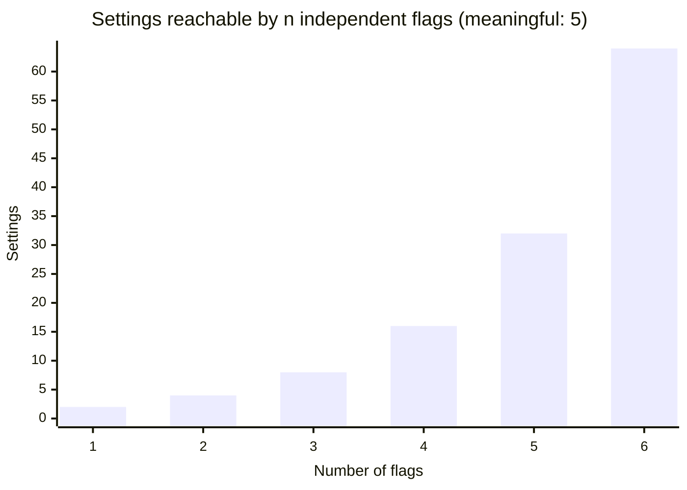
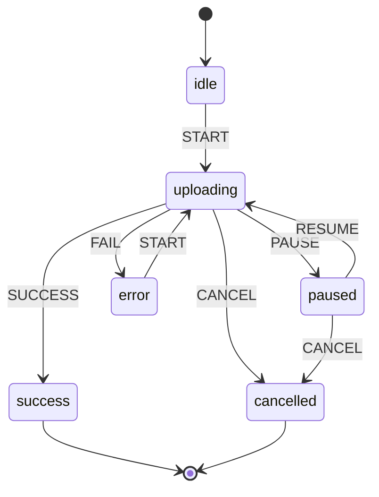

import LevelIntro from "../../../components/LevelIntro.astro";
import Checkpoint from "../../../components/Checkpoint.astro";
import PracticeCheck from "../../../components/PracticeCheck.astro";

export const unit = {
  track: "logic",
  unitSlug: "state-machines",
};

L1 used a traffic light to show that independent switches allow settings nobody
meant. L2 moves to a case where the stakes are easier to measure: a file upload
widget in an app. It is tracked with four flags (`isUploading`, `isPaused`,
`isSuccess`, `isError`), and the question is what the same widget looks like as
one named state.

<LevelIntro
  items={[
    "Counting meaningful settings against all settings",
    "Reading a state diagram arrow by arrow",
    "Designing a machine from a list of states and events",
  ]}
/>

## How many of the four flags' settings are actually meaningful?

**If the widget uses four independent flags, how many settings can the code
reach, and how many does the product mean to have?** Four flags give
`2^4 = 16` settings. The product means 5 of them:

| isUploading | isPaused | isSuccess | isError | Meaning                          |
| ----------- | -------- | --------- | ------- | -------------------------------- |
| false       | false    | false     | false   | idle                             |
| true        | false    | false     | false   | uploading                        |
| false       | true     | false     | false   | paused                           |
| false       | false    | true      | false   | success                          |
| false       | false    | false     | true    | error                            |
| true        | false    | true      | false   | the real bug: uploading and done |

The other 11 settings are reachable by accident, such as a `SUCCESS` handler
that sets `isSuccess` but forgets to clear `isUploading`. At four flags,
5 of 16 is **31.25%** meaningful. The chart shows how fast the total grows while
the meaningful count stays put:

Drag the slider in the demo below to see the meaningful share fall as flags are
added.

<Checkpoint question="A fifth flag, isRetrying, is added. How many settings can the widget now reach, and must the meaningful count grow to match?">

The reachable total doubles to `2^5 = 32`, because every extra independent flag
doubles it whatever it means. The meaningful count does not have to grow at all:
`isRetrying` may only make sense in one existing state. So the share of
meaningful settings falls (5 of 32 is about 15.6%), which is the trend a state
machine is built to stop.

</Checkpoint>

**What happens if one named state replaces all four flags?** There is a single
variable, so only the named values can exist. Counting a new `cancelled` state,
that is 6 values and no accidental ones:

| Question                                   | Four flags                                  | One named state                    |
| ------------------------------------------ | ------------------------------------------- | ---------------------------------- |
| How many settings can be represented?      | 16, always `2^n`                            | Exactly as many as are named (6)   |
| How many are meaningful?                   | 5, the rest are accidents waiting to happen | All of them, by construction       |
| What rejects a nonsense setting?           | Nothing, unless every handler is perfect    | There is no value for it to take   |
| What does a new handler have to get right? | Every flag it did not touch                 | Only which states it may fire from |
| What does one more feature cost?           | Doubles the settings                        | Adds one named state               |

<PracticeCheck
  track={unit.track}
  unitSlug={unit.unitSlug}
  topicId="machine-vs-flags"
/>

## How do you read the machine for the upload widget?

**Given the diagram, which events are allowed right now?** Read it like a map:
each word is a state, each arrow a permitted move, each label the event that
causes it. No arrow means that event is not allowed from there.

The same information as a table, one row per state:

| State       | Events that are allowed      | Dead end? |
| ----------- | ---------------------------- | --------- |
| `idle`      | START                        | no        |
| `uploading` | PAUSE, SUCCESS, FAIL, CANCEL | no        |
| `paused`    | RESUME, CANCEL               | no        |
| `error`     | START (a retry)              | no        |
| `success`   | none                         | yes       |
| `cancelled` | none                         | yes       |

There are 6 states and 6 events, so 36 state-and-event pairs. Only 8 have an
arrow, which leaves **28 pairs that are rejected**. Each of those 28 is a case
the code no longer has to guess about.

<Checkpoint question="There is no arrow for PAUSE leaving success. If code fires PAUSE while the machine is in success, should it ignore the event, switch to some other state, or do something else?">

Neither of the first two. A missing entry means the request is outside the
machine, so the safe response is to refuse it loudly and keep the state exactly
as it was. Ignoring it silently hides a caller bug; guessing a next state
invents a transition nobody designed. L3 implements the refusal as a thrown
error.

</Checkpoint>

<PracticeCheck
  track={unit.track}
  unitSlug={unit.unitSlug}
  topicId="reading-diagram"
/>

## How do you design one from scratch?

**Where do you start when there is no diagram yet?** Four questions, in order:

1. Which distinct conditions can the thing really be in? These become states.
2. Which things can happen to it? These become events.
3. For each state, which events should move it, and to where? Draw only those
   arrows.
4. Which pairs are left over? Those are the rejections, and each deserves a
   deliberate decision.

The method is not tied to widgets. A food order is placed, preparing,
delivered or cancelled. A school application is draft, submitted, reviewed,
accepted or rejected. A TCP connection, an order lifecycle and a CI run all fit
the same four questions. If true and false still feel slippery, revisit
`logic/boolean-logic` first.
