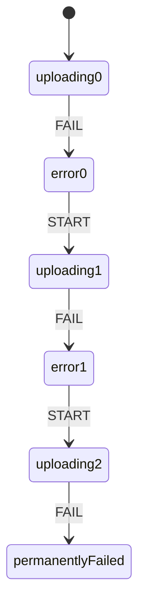

import Scenario from "../../../components/Scenario.astro";
import LevelIntro from "../../../components/LevelIntro.astro";
import Checkpoint from "../../../components/Checkpoint.astro";
import PracticeCheck from "../../../components/PracticeCheck.astro";

export const unit = {
  track: "logic",
  unitSlug: "state-machines",
};

<Scenario label="Same two events, two implementations">
  <Fragment slot="facts">
    <div class="not-prose flex flex-col gap-2 text-sm text-slate-700 dark:text-slate-300">
      <div class="flex items-center gap-1.5"><span>🐛</span> <strong>Flag version</strong> — 4 booleans, each handler edits some of them</div>
      <div class="flex items-center gap-1.5"><span>📋</span> <strong>Machine version</strong> — 1 state value and a lookup table</div>
      <div class="flex items-center gap-1.5"><span>▶️</span> <strong>The run</strong> — START, then SUCCESS, on both</div>
      <div class="flex items-center gap-1.5"><span>🎯</span> <strong>Question</strong> — can the machine version even express the bug?</div>
    </div>
  </Fragment>

The upload widget from L2 is implemented twice. The flag version has a
`SUCCESS` handler that forgets to clear `isUploading`. The machine version
replaces the four flags with one value and a table of allowed moves.

**Will the machine version have "the same bug, written differently", or is there
no place in it to write that mistake at all?**

</Scenario>

<LevelIntro
  items={[
    "The flag bug reproduced in real code",
    "A lookup table that rejects illegal events",
    "Giving a rule memory, such as a retry limit",
  ]}
/>

## What does the flag version actually do?

Code is worth reading here because the bug only exists as running behaviour.
Each branch edits some flags and trusts the others to stay sensible:

```js
function legacyHandleEvent(state, event) {
  const next = { ...state };
  if (event === "START") next.isUploading = true;
  else if (event === "SUCCESS") next.isSuccess = true; // forgets isUploading
  return next;
}

let s = {
  isUploading: false,
  isPaused: false,
  isSuccess: false,
  isError: false,
};
s = legacyHandleEvent(s, "START");
s = legacyHandleEvent(s, "SUCCESS");
// { isUploading: true, isPaused: false, isSuccess: true, isError: false }
```

After START then SUCCESS, both `isUploading` and `isSuccess` are `true`: the
impossible setting from L1 and L2. One missing line in an otherwise reasonable
function produced it, which is why it ships.

## How does the lookup table remove that mistake?

**What would the same two events look like if the diagram itself were the code?**
The table has one row per state and one entry per allowed event:

```js
const transitions = {
  idle: { START: "uploading" },
  uploading: {
    PAUSE: "paused",
    SUCCESS: "success",
    FAIL: "error",
    CANCEL: "cancelled",
  },
  paused: { RESUME: "uploading", CANCEL: "cancelled" },
  error: { START: "uploading" },
  success: {},
  cancelled: {},
};

function transition(state, event) {
  const next = transitions[state] && transitions[state][event];
  if (!next) throw new Error(`Invalid transition: ${event} from ${state}`);
  return next;
}
```

START then SUCCESS returns `"success"`. There is no `isUploading` left over,
because there is no `isUploading`. And `transition("success", "PAUSE")` throws
instead of producing a new impossible setting, which is exactly the 28 rejected
pairs from L2 made executable.

<Checkpoint question="The flag handler forgot to reset isUploading. Could the same kind of mistake, editing one value and forgetting a related one, happen inside transition()?">

Not in that shape. `legacyHandleEvent` edits several independent fields, so
leaving one stale is a matter of remembering. `transition` does one thing: it
looks up a single value and returns it, and that value is the entire state.
A mistake can still exist in the table itself, such as a wrong or missing entry,
but that is a visible line in a short table, far easier to review than a missing
line buried in a multi-branch handler.

</Checkpoint>

<PracticeCheck
  track={unit.track}
  unitSlug={unit.unitSlug}
  topicId="transition-lookup"
/>

## What happens when a rule needs memory?

**Suppose the rule is "allow at most 2 retries after a failure, then stop for
good". Can the table still say it, using only current state and event?** Not as
written: two visits to `error` must behave differently, yet `error` looks the
same both times. There are two honest ways out.



| Approach                        | How memory is kept                                     | Cost                                                               |
| ------------------------------- | ------------------------------------------------------ | ------------------------------------------------------------------ |
| Put the count in the state name | `uploading0`, `error0`, `uploading1`, ... are distinct | More states: for N retries, N+1 uploading, N error, 1 final = 2N+2 |
| Keep a counter beside the state | A separate number, checked by a guard on FAIL          | The counter can drift from the state if updated carelessly         |

With 2 retries the first approach needs 6 states (3 uploading, 2 error, 1
permanently failed). Adding pause would multiply again, because `paused` must
remember which attempt it paused, giving 3 paused states. Use the counter when
it is only displayed; use separate states when different counts allow different
next steps.

<Checkpoint question="Why does the count-in-the-state-name design need three uploading states for 2 retries, not two?">

Because the first attempt is not a retry. With 2 retries there are 3 attempts
in total, so there must be a distinct state for the initial attempt, for retry 1
and for retry 2. Only after the third attempt fails does the machine move to
`permanentlyFailed`.

</Checkpoint>

<PracticeCheck
  track={unit.track}
  unitSlug={unit.unitSlug}
  topicId="retry-limit-states"
/>

## A case, not the whole territory

The upload widget is one worked case. Extend it yourself:

- **What if the news were worse?** Suppose a SUCCESS event can arrive twice
  because the network repeats messages. Should the table reject the second one,
  or accept it as harmless? What does your answer cost the caller?
- **What if the audience were different?** Redo the table for a vending
  machine: which states, which events, and which pairs would you deliberately
  reject?
- **What if two machines must agree?** A page shows an upload and a "Submit"
  button. How would you stop the button being enabled while the upload is not in
  `success`, without adding a new independent flag?

## Failure modes

| Failure mode                                   | What goes wrong                                                                 |
| ---------------------------------------------- | ------------------------------------------------------------------------------- |
| Adding one more boolean beside the machine     | The flag combines with every state and reopens the independent-settings problem |
| Silently ignoring a rejected event             | A caller bug stays hidden; the machine looks healthy                            |
| Treating the diagram as documentation only     | Code and diagram drift; the table should be the source of truth                 |
| Letting a counter live outside the transitions | The counter and the state can disagree in ways the table never modelled         |
