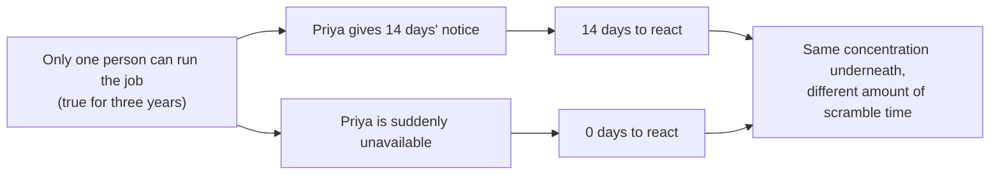

import Scenario from "../../../components/Scenario.astro";
import LevelIntro from "../../../components/LevelIntro.astro";
import PracticeCheck from "../../../components/PracticeCheck.astro";

export const unit = {
  track: "people-management",
  unitSlug: "bus-factor",
};

<Scenario label="The problem">
  <Fragment slot="facts">
    

      

        1 of 4
        people who can run the billing job alone
      

      

        🧑‍💻
        🧑‍💻
        🧑‍💻
        🧑‍💻
      

    

    

      
🧾 The job: nightly billing reconciliation, in production for three years

      
📄 The runbook: three sentences long

      
📅 The clock: 14 days of notice, no handoff started

    

  </Fragment>

Marcus manages a four-person team: Priya, Dan, Wren and Sam. Priya just gave
two weeks' notice. She is the only person who really understands the nightly
billing reconciliation job. She wrote it, she gets paged when it breaks, and
its runbook is three sentences long because she never needed more than that
herself. Dan has never touched it, Sam has never touched it, and Wren has
watched it run once.

Marcus's first thought is relief: two weeks is enough for a proper handoff.
His second thought lands harder.

**If Priya had been hospitalized yesterday instead of handing in a resignation
today, the team would have had zero days, not fourteen. What exactly changed
about the risk between those two versions?**

</Scenario>

The answer is: nothing. The notice changed how much time Marcus has to react.
It did not change the fact that one head holds the knowledge, and that fact
was true long before Priya typed her resignation. This unit is about seeing
that risk early, while it is still quiet, instead of during a countdown.

<LevelIntro
  items={[
    "What bus factor counts, and the words around it",
    "Why notice changes time, not risk",
    "Why this is about design, not distrust",
  ]}
/>

## What does "bus factor" actually count?

**If Marcus had to put one number on how exposed the billing job is, what
would he count?** Not how skilled the team is, and not how long the job has
run. He would count how many people could go missing before nobody is left who
can do it.

- **Bus factor** is the smallest number of people who would have to become
  unavailable (quit, fall ill, go on leave, or literally be hit by a bus)
  before a piece of critical work has nobody left who can do it. A bus factor
  of one means a single absence is a crisis.
- It is measured **per responsibility**, not per team. One team can have a
  comfortable bus factor on the on-call rota and a bus factor of one on the
  billing job.
- It is not only about quitting. Any time one person is the only route to
  getting something done (the only approver of a deploy, the only one who
  remembers why a workaround exists), the same risk is present.

Here is the billing job as the team stands today. "Score" runs from 0 (no
exposure) to 3 (could run it fully alone); L2 defines the scale properly.

| Person | Score on the billing job | Could run it alone?  |
| ------ | :----------------------: | -------------------- |
| Priya  |            3             | Yes                  |
| Dan    |            0             | No                   |
| Wren   |            1             | No, has only seen it |
| Sam    |            0             | No                   |

One person can run it alone, so its bus factor is **one**.

| Term                    | Simple meaning                                                       |
| ----------------------- | -------------------------------------------------------------------- |
| Bus factor              | How many people can vanish before a critical job has nobody left     |
| Knowledge concentration | Understanding of a system living mostly in one person's head         |
| Succession              | Having someone who could plausibly step into a role with some notice |
| Knowledge distribution  | Deliberately spreading understanding across more than one person     |

<PracticeCheck
  track={unit.track}
  unitSlug={unit.unitSlug}
  topicId="bus-factor-meaning"
/>

## Why do a resignation and an emergency expose the same risk?

**Priya gave notice; a different Priya might not have been able to. If the
outcomes differ so much, how can the risk be the same?** Because the outcomes
differ in time to react, and the risk was never about time.

- The notice period is a bonus, not a safeguard. A team whose resilience
  depends on every departure coming with warning has not fixed anything; it
  has only been lucky so far.
- Raising bus factor is not distrust of any one person. No team can guarantee
  that everyone stays forever, so the honest design question is whether the
  team survives someone leaving, not whether they will.
- The best moment to find this risk is **before** anyone leaves, when the
  expert is happy, available and has time to teach.

<PracticeCheck
  track={unit.track}
  unitSlug={unit.unitSlug}
  topicId="notice-vs-risk"
/>

## What this unit covers

L2 shows how a manager finds low bus factor before a crisis (a knowledge map)
and the four practices that raise it, plus the cost of overdoing it. L3 walks
Marcus through Priya's fourteen days: what gets triaged, what the transfer
plan looks like, and what changes afterward.
