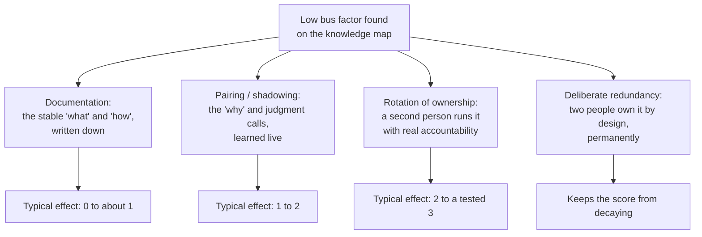
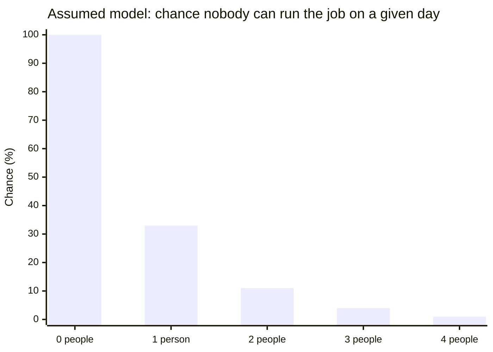

import LevelIntro from "../../../components/LevelIntro.astro";
import Checkpoint from "../../../components/Checkpoint.astro";
import PracticeCheck from "../../../components/PracticeCheck.astro";

export const unit = {
  track: "people-management",
  unitSlug: "bus-factor",
};

L1 showed that a resignation and an emergency expose the same concentration of
knowledge, and that Marcus only saw it once Priya gave notice. L2 works out
how a manager can see it earlier, what moves a low score upward, and why the
answer cannot simply be "make everything redundant."

<LevelIntro
  items={[
    "How to map who can really run what",
    "The four practices and what each one moves",
    "Why redundancy has a cost that must be bounded",
  ]}
/>

## How does a manager find the risk instead of sensing it?

**Marcus "had a feeling" that Priya knew a lot. Why is a feeling not enough to
act on?** Because a feeling does not say which responsibility, how fragile, or
who the second person would be. The tool that answers those is a knowledge map:
responsibilities down one side, people across the top, each cell scored by how
independently that person could run it.

| Responsibility               | Priya | Dan | Wren | Sam |
| ---------------------------- | :---: | :-: | :--: | :-: |
| Billing reconciliation job   |   3   |  0  |  1   |  0  |
| On-call incident triage      |   3   |  2  |  3   |  2  |
| Deploy approval for payments |   3   |  1  |  0   |  0  |
| Onboarding new hires         |   2   |  3  |  1   |  1  |

The scale: **0** no exposure, **1** has seen it but could not run it
unsupervised, **2** could run it with some support, **3** fully independent. A
row where exactly one person scores 3 and everyone else scores 0 or 1 **is** a
bus factor of one. The map does not create that risk; it makes an existing one
visible.

**Why not simply ask each person "could you cover for Priya?"** Because
self-assessment is where concentration hides. Dan may honestly believe he
"kind of knows" the billing job from watching Priya, but a 1 (seen it, could
not run it) is a very different number from a 3, and the difference only shows
once both scores sit next to each other.

<Checkpoint question="Looking at the table, which row has the lowest bus factor, and what does that number mean in practice?">

Deploy approval for payments. Only Priya scores 3; Dan scores 1 and Wren and
Sam score 0. That is a bus factor of one for that responsibility: if Priya is
unavailable, payment deploys either stop or someone approves them without real
independent competence. It is the L1 scramble again, for a different piece of
work than the billing job.

</Checkpoint>

<PracticeCheck
  track={unit.track}
  unitSlug={unit.unitSlug}
  topicId="knowledge-map"
/>

## What actually moves a score upward?

**Once a low row is found, what lifts a 0 or 1 toward a 2 or 3?** No single
practice does all of it, because each one closes a different gap.

| Practice              | What it transfers                            | What it cannot do alone                               |
| --------------------- | -------------------------------------------- | ----------------------------------------------------- |
| Documentation         | Stable steps, written and self-serve         | Judgment calls nobody made explicit                   |
| Pairing / shadowing   | Reasoning during a real piece of work        | Prove the learner can do it without the expert nearby |
| Rotation of ownership | Real practice under real accountability      | Make the arrangement permanent                        |
| Deliberate redundancy | A standing rule: never fewer than two owners | Come free: it costs time every week                   |

**Why not pick the cheapest one, documentation, and stop?** Because a reader
who has never run the job can follow the steps on paper but has not met the
failure the runbook did not anticipate. That is a better position than L1's
three-sentence runbook, and still not a raised bus factor.

<Checkpoint question="A manager writes a thorough runbook for the billing job, but nobody besides Priya has ever run it. Has the bus factor been raised?">

Only a little. The knowledge now exists on paper as well as in Priya's head,
which lifts the floor of how bad a sudden absence would be. But the judgment
calls that appear when the job breaks in a way the runbook did not predict
still live with Priya. Raising a score to a real 2 needs someone to handle an
actual instance of the work with her; a real 3 needs them to own it.

</Checkpoint>

<PracticeCheck
  track={unit.track}
  unitSlug={unit.unitSlug}
  topicId="four-practices"
/>

## If redundancy is the strongest fix, why not use it everywhere?

**A director says: "Make everything two-deep and we never worry again." What is
wrong with that?** Redundancy is paid for every week, by every person involved:
two people spending time to be able to do one thing. Applied to everything, a
team does less new work and the risk is still there, only spread out less
visibly. The honest move is to ask, for each row, how bad a bus factor of one
would actually be.

The unit's demo uses an assumed teaching model: each extra independently
trained person cuts the chance that nobody is available on a given day to a
third. These are illustrative numbers, not measurements of any real team.

The shape is the lesson: the first extra trained person removes most of the
risk (33 down to 11), while the fourth removes almost none (4 down to 1). That
is why redundancy belongs where the stakes are high enough to pay for it, and
documentation plus some pairing is enough where they are not.

| Responsibility                          | Is the cost of redundancy worth it? | Why                                                     |
| --------------------------------------- | ----------------------------------- | ------------------------------------------------------- |
| Payment deploy approval                 | Yes                                 | Outage or fraud risk if the one approver is out         |
| Security-critical access decisions      | Yes                                 | Same reasoning, plus exposure if access stalls          |
| Onboarding new hires                    | Partly                              | A second trained person is enough; full two-deep is not |
| A rarely used internal reporting script | Usually not                         | Document it; a slow fix if it breaks costs little       |

<PracticeCheck
  track={unit.track}
  unitSlug={unit.unitSlug}
  topicId="redundancy-cost"
/>

## Failure modes at this level

- **Building the map once.** It goes stale the moment people or systems
  change, so it needs a recurring review.
- **Scoring "was in the room" as a 2 or 3.** Having seen the work is a 1. The
  map only helps if the scores are earned.
- **Redundancy by habit instead of by stakes.** Choosing rows by cost of
  failure is not optional.
