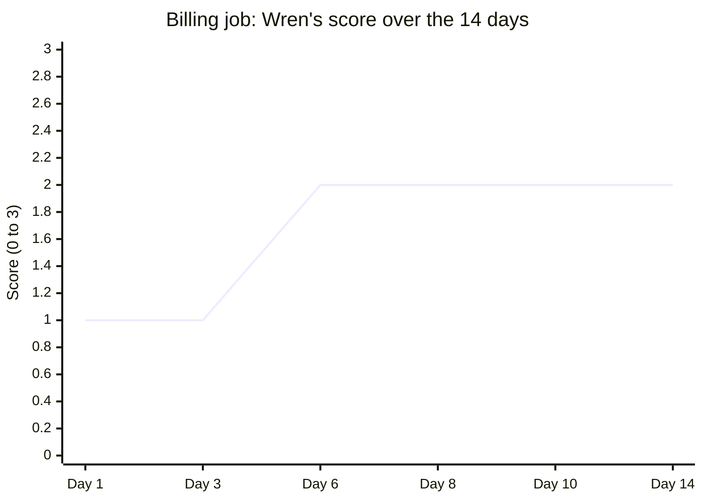

import Scenario from "../../../components/Scenario.astro";
import LevelIntro from "../../../components/LevelIntro.astro";
import Checkpoint from "../../../components/Checkpoint.astro";
import PracticeCheck from "../../../components/PracticeCheck.astro";

export const unit = {
  track: "people-management",
  unitSlug: "bus-factor",
};

<Scenario label="The scenario">
  <Fragment slot="facts">
    

      
👤 <strong>Marcus</strong> manages Priya, Dan, Wren and Sam

      
📅 14 days of notice; last day is day 14

      
🧾 Billing job: team scores 0 / 1 / 0 (Dan / Wren / Sam)

      
💳 Payment deploy approval: 1 / 0 / 0

      
⏱️ Pairing time with Priya: enough for two responsibilities, not four

    

  </Fragment>

Same team and facts as L1 and L2. Marcus has fourteen days, a knowledge map he
never built, and Priya's attention for only part of each day. He cannot raise
everything to a fully independent 3 in two weeks.

**Before reading on: if you could only fully work through two of Priya's four
responsibilities, which two would you pick, and what would you do about the
other two?**

</Scenario>

<LevelIntro
  items={[
    "Triage: what gets scarce time first",
    "The day-by-day plan and its honest ceiling",
    "What changes afterward, and what if there were no notice",
  ]}
/>

## Day 1: where does Marcus start?

**Not with the runbook. Why not?** Because two weeks cannot transfer everything
at a 3, so the first real decision is which responsibilities must reach a 2,
and which can settle for good documentation. He builds the L2 map
retroactively, scoped to what Priya touches.

| Responsibility                          | Dan / Wren / Sam | Cost if Priya is gone                 | Triage decision                             |
| --------------------------------------- | ---------------- | ------------------------------------- | ------------------------------------------- |
| Billing reconciliation job              | 0 / 1 / 0        | Nightly job breaks, nobody can fix it | First priority: needs a real 2 by day 14    |
| Payment deploy approval                 | 1 / 0 / 0        | Deploys stall or go out unreviewed    | Second priority: needs a second approver    |
| Vendor relationship (payments provider) | 2 / 1 / 1        | Slower, but not urgent                | Document it and hand it to Dan, already a 2 |
| Quarterly reconciliation report         | 0 / 0 / 3        | Sam already owns it fully             | No action                                   |

**Why does the last row matter as much as the first two?** Because triage also
confirms where the team is already covered, so Marcus does not spend scarce
hours re-checking something that is fine. Pairing time spent on the vendor
relationship would come straight out of the two rows that need it.

<Checkpoint question="Marcus has pairing time for two rows only. Which two, and why not the vendor relationship?">

The billing job and payment deploy approval. Both start at 0 or 1 across the
rest of the team and both have severe, immediate consequences. The vendor
relationship already has Dan at a 2, so someone can run it with support today;
it needs a handoff document, not scarce one-on-one time with Priya.

</Checkpoint>

<PracticeCheck
  track={unit.track}
  unitSlug={unit.unitSlug}
  topicId="handoff-triage"
/>

## Days 2 to 10: what does the transfer actually look like?

**What does "raise a score from 0 or 1 to 2 in about a week" look like day by
day?** Marcus and Priya combine two of L2's practices instead of choosing one.

| Days | What happens                                                                                    | Practice used           |
| ---- | ----------------------------------------------------------------------------------------------- | ----------------------- |
| 2-3  | Priya writes the real runbook: every failure she has hit and what she checked, not "restart it" | Documentation           |
| 4-6  | Wren shadows live runs, including a vendor API timeout on day 5 that is not in the runbook      | Pairing / shadowing     |
| 7-8  | Dan reviews two real payment deploys beside Priya, then becomes a second approver               | Pairing, then authority |
| 9-10 | Wren runs the billing job solo while Priya watches without helping                              | Rotation (a first run)  |

Two details carry the most weight. On day 5, Priya shows the exact judgment
call (retry twice, then escalate rather than reconcile by hand) and it goes
into the runbook that afternoon: pairing caught something documentation had
not yet captured. And Dan's approval authority arrives only **after** two real
reviews, because authority without practiced judgment is the same trap as a
runbook nobody has run.

**Why does the solo run matter if Wren already followed a real failure?**
Shadowing tests whether Wren can follow the reasoning when Priya supplies it.
A solo run tests whether Wren can produce that reasoning without her, which is
the gap between a 2 and a 3.

<PracticeCheck
  track={unit.track}
  unitSlug={unit.unitSlug}
  topicId="transfer-plan"
/>

## Day 14: what is still unfinished, and who knows?

**Not everything reaches a clean 3. What does Marcus do about the gap that
remains?** He is explicit about it. Wren is a genuine 2 on the billing job
(independent with some support, not yet proven in a real crisis), and Dan's
approval is a practiced but thin 2.

Read the chart for what it does not show as much as what it does. The
runbook on day 3 did not move Wren's score (documentation alone leaves a
reader at a 1). The shadowed failure by day 6 did. And the solo run confirmed
a 2 rather than producing a 3, because a 3 needs the job to survive a real
crisis without Priya behind it.

Marcus tells Wren and Dan which of their responsibilities are still fragile,
books a 30-day check-in for another live test, and tells his own manager the
real state of the risk instead of reporting "handoff complete."

**Why is that last step part of the handoff?** Because a gap known only to
Marcus is the original problem again in a quieter form: risk-awareness
concentrated in one head instead of system knowledge.

<Checkpoint question="Marcus tells his manager the handoff is complete, because both successors are at a 2 and the notes are written. What did he just recreate?">

A smaller version of the unit's own problem. Both people are at a 2, not a 3,
so the arrangement is still fragile, but Marcus has now told the only person
who could ask about it that it is solved. If the billing job breaks in an
unusual way next month, the surprise lands on a team and a manager who had
been told there was nothing to watch. Naming the gap turns an unplanned
incident into a planned check-in.

</Checkpoint>

<PracticeCheck
  track={unit.track}
  unitSlug={unit.unitSlug}
  topicId="honest-gap"
/>

## What changes afterward, and what if there had been no notice?

**Priya is gone. What does Marcus change so the next departure, planned or
not, is not another two-week scramble?** Three concrete things:

- **The day-1 map becomes a recurring review**, once a quarter, with any
  critical row at 0 or 1 flagged in his own planning before anyone resigns.
- **The billing job gets a standing monthly live run by someone other than its
  main owner.** L2's cost table rates this kind of row as partial, so the
  answer is not permanent two-deep staffing; it is a rule that stops the score
  from decaying through disuse.
- **Payment deploy approval is made redundant by design**, with two trained
  approvers at all times, because the fraud and outage stakes justify the
  ongoing cost.

**This whole example assumed fourteen days. What if Priya had been hospitalized
with none?** The triage table and the priority order do not change: the
billing job and payment approval are still the rows that matter most. What
disappears is the transfer plan from day 4 onward: no shadowing, no day-5
walkthrough, no chance for her to say aloud the judgment she never wrote down.
Marcus would work from the three-sentence runbook plus whatever Dan and Wren
could reconstruct from logs and past incident notes, and the billing job would
likely break at least once before anyone reached even a 2. The notice period
never created the risk; it only bought time to react to it.

This is one worked case, not the whole territory. To stretch it, try these:

- What changes if the team has only two people and the departing one is the
  other half?
- What changes if the person with concentrated knowledge is the manager?
- What changes if Priya is staying but has stopped answering questions
  because she is overloaded?

For each one, ask which row of the map moves, which practice is still
available, and what would have to have been done a quarter earlier.

<PracticeCheck
  track={unit.track}
  unitSlug={unit.unitSlug}
  topicId="afterward-and-extend"
/>

## Failure modes at this level

- **Assuming fourteen days is enough to reach a 3 everywhere.** Some rows will
  stop at a 2; reporting otherwise sets up the next person.
- **Skipping the unassisted run because the pairing looked smooth.** The two
  test different things.
- **Fixing only the departure in front of you.** A plan that does not update
  the standing map or the redundancy decisions guarantees the same scramble
  for the next person who leaves.
