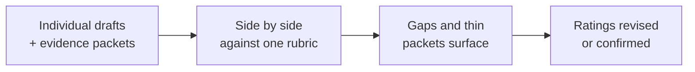

import Scenario from "../../../components/Scenario.astro";
import LevelIntro from "../../../components/LevelIntro.astro";
import PracticeCheck from "../../../components/PracticeCheck.astro";

export const unit = {
  track: "people-management",
  unitSlug: "calibration",
};

<Scenario label="The problem">
  <Fragment slot="facts">
    

      

        86% vs 22%
        modeled chance each piece of work is cited unprompted in December
      

      
November launch (1 month old)

      

        

      

      
February fix (10 months old)

      

        

      

    

    

      
🚀 Wren: a visible launch in November

      
🛠️ Sam: a quiet fix in February that prevented a bad incident

      
📝 Two managers, two sincere drafts, one unfair gap

    

  </Fragment>

It is December and two managers are writing year-end reviews. Priya manages
Wren, who shipped a checkout redesign last month: it is fresh, easy to
describe, and already has numbers behind it. Dan manages Sam, who spent
February quietly catching a flaw that would have corrupted customer records
and fixing it before anyone noticed. Nothing broke, so nobody outside the team
ever heard about it, and ten months later Dan can barely recall the details.

Priya writes a glowing review. Dan writes "solid, reliable, meets
expectations." Every sentence in both reviews is true. **So why does the pair
add up to something unfair, and what could fix it when neither manager did
anything dishonest?**

</Scenario>

The percentages in the facts panel come from this unit's teaching model of how
recall fades with time (the same model as the demo below). It is an
illustration, not a measurement of real managers. The direction is what
matters: the older and quieter the work, the less likely a manager is to
produce it from memory.

<LevelIntro
  items={[
    "What calibration is and what it compares",
    "Recency, halo and leniency as distinct distortions",
    "Why evidence beats impressions",
  ]}
/>

## What is calibration, and what does it add to a single manager's review?

**If each review is honest on its own, what does a group of managers add?**
A comparison. One manager cannot see their own distortion from the inside,
but five managers' drafts side by side can reveal it.

- **Calibration** is a structured session where managers compare draft ratings
  for their reports against each other and against a shared rubric, before any
  rating is final.
- A **calibration packet** is the written evidence a manager brings: specific
  examples, dates and outcomes, as opposed to a general impression.
- The goal is consistency: the same quality of work should earn the same
  rating no matter whose team it happened on.

<PracticeCheck
  track={unit.track}
  unitSlug={unit.unitSlug}
  topicId="calibration-purpose"
/>

## Which distortions is it correcting?

**Dan and Priya are both sincere. What exactly goes wrong in their heads?**
Three different things can, and they look different from outside.

| Bias                        | What it does                                                    | How it shows up in a draft                                  |
| --------------------------- | --------------------------------------------------------------- | ----------------------------------------------------------- |
| Recency bias                | Recent events outweigh older ones regardless of importance      | Detailed recent examples, nothing from earlier              |
| Halo effect                 | One strong trait or result inflates everything else             | High marks on areas the manager never observed              |
| Leniency / central tendency | A personal habit of rating high, or of clustering at the middle | One manager's ratings are tighter or higher than all others |

- Recency bias is the Scenario: the November launch crowds out February.
- The halo effect would show up if Priya also rated Wren highly on mentoring
  without ever having seen Wren mentor anyone.
- Leniency or central tendency is about the manager, not the person: it would
  appear if Dan rated everyone on his team a 3 to avoid hard conversations.

<PracticeCheck
  track={unit.track}
  unitSlug={unit.unitSlug}
  topicId="three-biases"
/>

## What this unit covers

L2 works out how a calibration session turns individually biased drafts into
consistent ratings, and why one shared bar breaks down when people have
different scopes of work. L3 runs a full session on Wren and Sam, then asks
what breaks downstream if nobody catches the gap.
