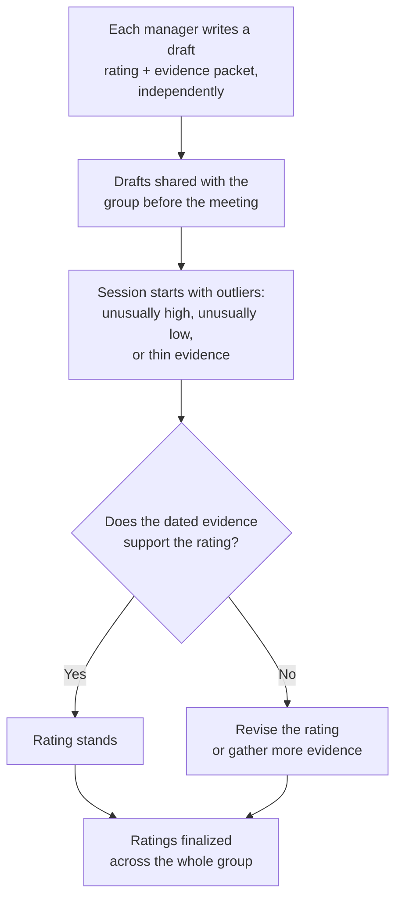

import LevelIntro from "../../../components/LevelIntro.astro";
import Checkpoint from "../../../components/Checkpoint.astro";
import PracticeCheck from "../../../components/PracticeCheck.astro";

export const unit = {
  track: "people-management",
  unitSlug: "calibration",
};

L1 showed Priya and Dan writing honest reviews that still added up to an
unfair gap between Wren and Sam, and named the distortions behind it. L2
works out the mechanism calibration uses to catch them, and why a single
"did great work" bar fails once people have different scopes of work.

<LevelIntro
  items={[
    "Why 'just be objective' cannot work",
    "Independent drafts, then evidence before numbers",
    "A rubric that names what is measured at each scope",
  ]}
/>

## Why does "just be objective" not fix this?

**Suppose Dan is told to be more objective and sits down to rewrite Sam's
review. What changes?** Probably nothing. None of the biases feel like bias
from inside: Dan genuinely believes he is describing Sam's year, because what
he can recall is what he writes. Trying harder does not retrieve a memory that
has faded.

Calibration does not ask anyone to be less biased. It moves the check outside
the one head that cannot see the problem, so a distortion invisible to one
person shows up as an inconsistency between people.

| Bias                        | From inside the manager's head                    | What calibration exposes                                |
| --------------------------- | ------------------------------------------------- | ------------------------------------------------------- |
| Recency bias                | "Here is what I remember about their year"        | A rating with no cited evidence from most of the period |
| Halo effect                 | "They are clearly excellent, look at that result" | A rating on a dimension nobody actually observed        |
| Leniency / central tendency | "Everyone on my team is doing fine"               | One manager's ratings cluster apart from all the others |

## How does a room turn biased drafts into consistent ratings?

**Five managers each bring a draft. What order of steps lets the room find
problems instead of just trading opinions?**

Two choices do most of the work.

1. **Drafts are written independently, before the session.** A manager commits
   to a rating and its evidence before hearing anyone else, so the room sees
   real disagreement instead of everyone anchoring on whoever spoke first.
2. **Discussion starts from evidence, not from the number.** The question is
   not "do we agree this is a 4" but "what specific, dated example supports a 4
   rather than a 3." A packet full of November detail and nothing from February
   is visibly thin the moment someone asks for it.

<Checkpoint question="Two drafts, a 3 and a 4, for two people who both did good work. Why does the session ask for the evidence behind the thinner packet first instead of debating which number is right?">

Debating the number turns the room into a negotiation between two sets of gut
impressions, and whoever argues better or carries more weight tends to win
regardless of what happened. Asking for the dated evidence turns the same
conversation into a fact-check: either the examples exist and the rating holds,
or their absence is itself the signal that something, most often recency,
shaped the draft. Starting from evidence is what lets the room catch a
distortion the author could not see in themselves.

</Checkpoint>

<PracticeCheck
  track={unit.track}
  unitSlug={unit.unitSlug}
  topicId="independent-first"
/>

## Why does one shared bar break down across different scopes?

**Wren and Sam do similar work. What happens when the room must compare an
engineer executing small assigned tasks with one who finds problems nobody
assigned?** If the bar is just "did great work," it quietly measures raw output
and visible impact, and the wider the scope, the more of both a person produces.
The comparison becomes "who did more," which the wider scope always wins.

A calibration rubric therefore names what "meets expectations" actually
measures at each scope band, so each person is judged against their own bar.

| Scope band                | What meeting expectations measures                             |
| ------------------------- | -------------------------------------------------------------- |
| Well-defined tasks        | Delivers scoped work reliably; asks for help at the right time |
| Owns a feature end to end | Scopes their own smaller tasks and sees them through           |
| Shapes the problem itself | Spots problems nobody assigned; unblocks others, not only self |

This unit only names scope bands descriptively. Real organizations use their
own career ladders, and a rubric should come from that ladder rather than from
a generic table like this one.

<Checkpoint question="A room compares two engineers using one bar: 'did great work.' One has a narrow assigned scope, the other a wide self-directed one. What goes wrong, specifically?">

The shared bar measures raw output or visible impact, and the wider scope
produces more of both simply by being wider. So the comparison turns into "who
did more" rather than "who met the bar for their own role." That is unfair in
both directions: the narrower-scope engineer's excellent, well-scoped work looks
thin, and the wider-scope engineer can coast on scale instead of delivering what
a wider scope is supposed to add, like finding unassigned problems. A rubric per
scope band fixes it by comparing each person to their own bar.

</Checkpoint>

<PracticeCheck
  track={unit.track}
  unitSlug={unit.unitSlug}
  topicId="scope-rubric"
/>

## Failure modes at this level

- **Skipping the independent draft and discussing as a group from the start.**
  The first speaker anchors everyone else and the session catches less.
- **Debating the number before the evidence.** "Is it a 3 or a 4" invites
  negotiation; "what is the dated example" invites a fact-check.
- **One bar for every scope.** It rewards scale and visibility instead of
  measuring whether someone met the bar for their own role.
