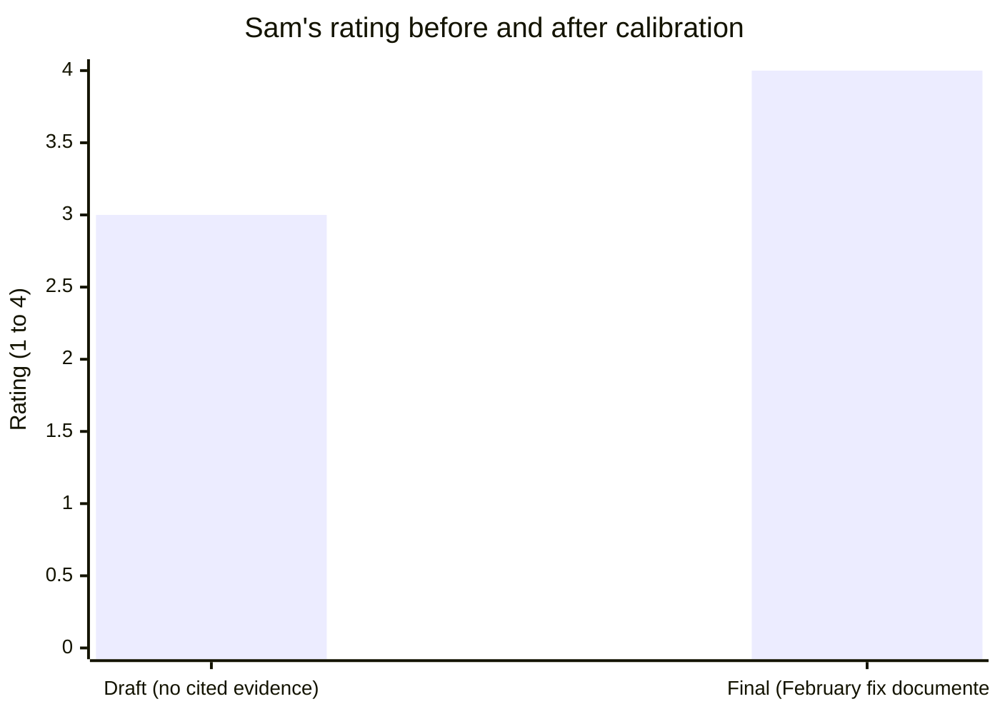

import Scenario from "../../../components/Scenario.astro";
import LevelIntro from "../../../components/LevelIntro.astro";
import Checkpoint from "../../../components/Checkpoint.astro";
import PracticeCheck from "../../../components/PracticeCheck.astro";

export const unit = {
  track: "people-management",
  unitSlug: "calibration",
};

<Scenario label="The session">
  <Fragment slot="facts">
    

      
🗓️ Review period: January to December. Scale: 1 (below) to 4 (well above)

      
🚀 Wren (Priya): November launch, draft 4

      
🛠️ Sam (Dan): February fix, draft 3, no example cited

      
⚖️ Assumed for this case: Dan's team has 8 engineers and a cap of 2 fours

    

  </Fragment>

Priya and Dan walk into calibration with the drafts from L1. Priya proposes a
4 for Wren, backed by a launch with early numbers. Dan proposes a 3 for Sam,
backed by the sentence "solid, reliable, nothing stands out." The group has
the same four-point scale and the per-scope rubric from L2.

**Nothing in either draft is false. What does the room actually do, and what
would it cost if it simply accepted both drafts?**

</Scenario>

L2 worked out the mechanism: independent drafts, evidence before the number, a
rubric per scope band. L3 runs it end to end on this case and then pushes past
it into what goes wrong when the gap is not caught.

<LevelIntro
  items={[
    "Reading a thin packet in the room",
    "Revising a rating against a shared rubric",
    "What a missed gap costs afterwards",
  ]}
/>

## What does the room do with a draft that is true but thin?

**Dan's packet is honest. Why is it the first one the group looks at?** The
group starts with the thinnest packet, not the most surprising number. A true
summary impression ("solid, reliable") names no example, no date and no
outcome, which is exactly the shape a recency-biased rating takes: not a false
claim but a faint one, because the memory it came from has faded.

The question to Dan is simple: what specific, dated evidence is behind Sam's 3?
After a pause, Dan remembers. In February Sam noticed that a scheduled
database migration would have silently corrupted some customer records, wrote
a corrected version and tested it against a snapshot of production data. No
outage happened, no customer saw anything, and so almost nobody heard about it.

The room then gives Wren's packet the same fact-check. Priya confirms the early
conversion data supports the claim, so the evidence holds once asked for.

| Engineer | Draft | Evidence in the draft                       | After the fact-check                       |
| -------- | ----- | ------------------------------------------- | ------------------------------------------ |
| Wren     | 4     | Visible launch; impact confirmed when asked | Evidence holds, rating stands              |
| Sam      | 3     | General impression, no example              | Dan recalls and documents the February fix |

<Checkpoint question="Dan's draft for Sam is entirely true. What exactly is calibration going to flag about it?">

Calibration is not checking honesty, it is checking whether the draft is backed
by specific, dated evidence, and Dan's is not. "Solid, nothing stands out" is a
true impression with no example behind it, which is precisely what a recency-
biased draft looks like from the outside: faint rather than false. Only when
someone asks for the example does the gap become visible, which is why the
session asks every packet for evidence and not just the surprising ones.

</Checkpoint>

<PracticeCheck
  track={unit.track}
  unitSlug={unit.unitSlug}
  topicId="thin-packet"
/>

## How does the group move Sam's rating?

**Sam's fix and Wren's launch look nothing alike. What makes them comparable?**
Neither is compared to the other. Both are measured against the same rubric
line for their scope band: spots problems nobody assigned and prevents costly
outcomes. Sam's fix is a textbook match, since nobody asked for the
investigation and it avoided a damaging incident. Wren's launch matches the
ownership expectations just as well. Judged against the rubric rather than
against memorability, both land at a 4.

Dan's revised packet for Sam now reads: in February, Sam independently
identified that a scheduled migration would corrupt some production customer
records, wrote and tested a fix, and prevented a significant incident, work
nobody assigned and few people knew about. The rating changes because the
evidence changed, not because anyone argued louder.

## What would it have cost if nobody caught it?

**If Dan's 3 had been accepted without discussion, what breaks beyond one
slightly low review?** The assumed rule for this case caps fours at 2 for
Dan's team of 8 (25 percent of 8 is 2). Suppose one slot is already taken. A
true 4 for Sam would use the last one, but a 3 leaves that slot to whoever has
the most memorable work. Sam loses a rating and anything attached to it, and
learns over several cycles that quiet preventive work is worth less than
visible launches, which is backwards for what a team needs.

<Checkpoint question="Why is the cost of not catching Dan's thin packet larger than one understated review?">

Because the rating is an input to other things: a limited number of top
ratings, and whatever decisions follow from them. An understated rating can
cost Sam a slot that goes to someone else, and it also teaches Sam, cycle after
cycle, which kind of work gets recognized. The meeting is one extra hour;
catching the error early prevents a distortion that compounds across a career
and shapes what the team chooses to do.

</Checkpoint>

<PracticeCheck
  track={unit.track}
  unitSlug={unit.unitSlug}
  topicId="downstream-cost"
/>

## Extend it: this is a case, not the whole territory

Wren and Sam are one worked example with one cap rule and one bias. Try
changing a single fact and see which part of the mechanism carries the load.

- **What if the evidence had been missing, not just forgotten?** If Dan could
  not recall anything, would the room leave Sam at a 3, or ask Sam and Sam's
  collaborators for examples first? What would a fair "we do not have enough
  evidence yet" outcome look like?
- **What if Wren and Sam were on different teams calibrated by different
  groups that never talk?** One group could still be collectively lenient or
  harsh relative to the other even after each session went perfectly. What
  second pass would catch that?
- **What if the cap on fours were stricter, say 1 of 8?** A forced distribution
  is a budgeting tool, not a claim about how performance is distributed. Where
  does it start to reintroduce the unfairness calibration was meant to remove?
- **What if the news were worse and Wren's launch had failed in production?**
  Does the same rubric still protect Wren from a hindsight halo in the other
  direction?

## Failure modes at this level

- **Accepting a thin packet because the manager sounds confident.** Dan was
  sincere; confidence is not evidence, and only a rule of asking every packet
  for examples catches the ones nobody questioned.
- **Treating the session as a one-time fix.** Dan now has February on record,
  but next year's quiet contribution is just as invisible unless he writes
  evidence down when it happens.
- **Treating a fixed distribution as automatically fair.** Two excellent people
  competing for one slot is a budgeting artifact, not a measurement.
