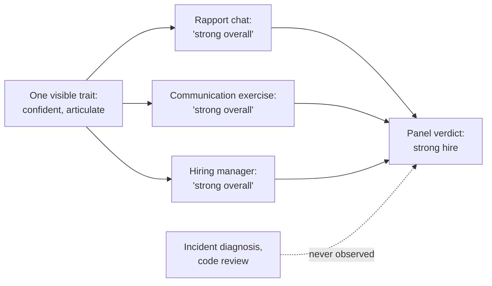

import Scenario from "../../../components/Scenario.astro";
import LevelIntro from "../../../components/LevelIntro.astro";
import PracticeCheck from "../../../components/PracticeCheck.astro";

export const unit = {
  track: "people-management",
  unitSlug: "defining-role",
};

<Scenario label="The problem">
  <Fragment slot="facts">
    

      

        1 of 3
        required signals actually tested before the offer
      

      

        

      

    

    

      
📋 Planned: 5 steps — a rapport chat, 3 exercises (one per signal), a debrief

      
✂️ Cut under pressure: the incident-diagnosis and code-review exercises

      
😃 Ran: the stakeholder-communication exercise, where the candidate shone

      
📉 Three months later: cannot diagnose an incident alone

    

  </Fragment>

A small platform team needs to hire an engineer, and it did one smart
thing first: it wrote down the three signals the role requires. One,
diagnose a production incident from partial, ambiguous logs. Two,
explain a trade-off so a non-technical stakeholder can decide. Three,
review a peer's code and name the one change that matters. The planned
loop had five steps: a rapport chat, one exercise per signal, and a
debrief.

Then the seat stayed empty for six weeks and the pressure rose. The
hiring manager cut the incident-diagnosis and code-review exercises
"to move faster." The one exercise that did run was stakeholder
communication, and the candidate, confident and articulate, was
excellent at it. Everyone who met them raved, and the offer went out the
next day. Three months in, the new hire still cannot diagnose a
production incident without help, the thing the team needed most.

**Everyone who met the candidate was impressed. So how did the skill the
team needed most never get checked?**

</Scenario>

The signals were written down, yet the gap still slipped through, for two
reasons that the rest of this unit separates. A cut that feels like "we've
seen enough" hides what was lost, and a strong impression from the one
exercise that ran spreads, in people's minds, to the ones that did not.

<LevelIntro
  items={[
    "Turning vague traits into checkable signals",
    "Why a strong impression is not evidence",
    "What a cut slot really removes",
  ]}
/>

## What does it mean to say a skill was "tested"?

**"Seems smart" and "good communicator" both feel like findings after an
interview. Why are neither of them something a loop can be designed around?**
Because nobody can say what a candidate would have to do to fail them.

- A **role definition** is the short written list of what this particular
  job needs to succeed, stated as things a candidate can demonstrate, not
  as adjectives.
- A **signal** is one observable piece of evidence that a requirement was
  met: the candidate did this, in front of an interviewer, on this task.
  It can be scored yes or no (or on a stated scale) from what was seen.
- A claim on a resume is not a signal. It is an assertion waiting for one.

| Vague trait         | Why it cannot be tested                     | Checkable signal instead                                                        |
| ------------------- | ------------------------------------------- | ------------------------------------------------------------------------------- |
| "Seems smart"       | No task, no pass or fail                    | Diagnoses an incident from partial logs and says why the other causes fit worse |
| "Good communicator" | Everyone rates it by feel                   | Explains a trade-off so a non-technical stakeholder can make the call           |
| "Good judgment"     | Means a different thing to each interviewer | Picks which of three proposed fixes addresses the root cause, not the symptom   |

<PracticeCheck
  track={unit.track}
  unitSlug={unit.unitSlug}
  topicId="role-definition-signals"
/>

## Why did five people raving not count as evidence?

**If everyone left impressed, what exactly were they impressed by?** By what
they saw. The candidate was confident and clear, and that is a real quality
that happened to be on display in the one exercise that ran.

- The **halo effect** is the tendency for one strong, visible trait to lift
  our rating of unrelated traits we never observed. A pleasant, articulate
  candidate gets credit for technical depth nobody checked.
- It works without anyone being careless. Each interviewer honestly reports
  how they felt, and the feeling is real. What is missing is the
  observation behind it.
- The defence is structural, not a matter of trying harder: give each
  slot one signal to look for, and score it before talking to anyone else.

<PracticeCheck
  track={unit.track}
  unitSlug={unit.unitSlug}
  topicId="halo-effect"
/>

## Key terms

| Term                | Simple meaning                                                           |
| ------------------- | ------------------------------------------------------------------------ |
| Role definition     | The written list of signals this job needs, before any interview happens |
| Signal              | One observable demonstration that a requirement was met                  |
| Halo effect         | One salient trait colouring ratings of traits nobody observed            |
| Structured loop     | Each slot targets one signal; scores are written down independently      |
| Independent scoring | Each interviewer records a score before hearing anyone else's view       |
