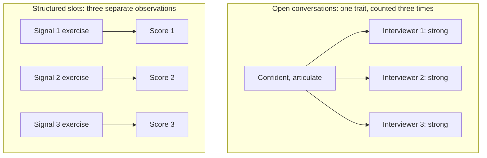

import LevelIntro from "../../../components/LevelIntro.astro";
import Checkpoint from "../../../components/Checkpoint.astro";
import PracticeCheck from "../../../components/PracticeCheck.astro";

export const unit = {
  track: "people-management",
  unitSlug: "defining-role",
};

L1 followed a platform team whose three-signal loop shrank to one exercise
under time pressure, and whose panel raved anyway. L2 works out the two
mechanisms underneath: why a room full of agreeing people can still be
holding almost no evidence, and what has to be true of a slot for it to
produce evidence at all.

<LevelIntro
  items={[
    "Counting independent observations, not opinions",
    "Scoring before talking",
    "What each slot needs in order to count",
  ]}
/>

## Does a room full of agreement add up to evidence?

Picture a bake-off with five judges. All five say the winning cake is
the best, and all five spent their time admiring the glossy decoration.
Nobody tasted it. **How many tastings does that verdict rest on?** Zero. The
judges agree, but they agree about the decoration. In hiring it is the same
shape: agreement is only as strong as the number of different things that
were looked at.

Three agreeing opinions on the left rest on one observation. Three scores
on the right rest on three. The number of interviewers is the same in both;
the amount of evidence is not.

**Does that make confidence a bad sign?** No. Confidence is real information
about one thing, probably the thing a communication exercise measures.
The mistake is letting it stand in for things it was never tested against.

<Checkpoint question="Four interviewers all rate a candidate 'strong overall' after open-ended conversations. A fifth, who ran a live diagnosis exercise, rates them 'weak on that task.' Which of the five reports carries the most information about whether the candidate can do that task?">

The fifth. The four open conversations never put the candidate in front of
the task, so their agreement is mostly shared reaction to how the candidate
came across. The fifth interviewer observed the actual behaviour. This is why
a tally of opinions is the wrong way to read a panel: one observation of the
right thing outweighs several impressions of the wrong thing.

</Checkpoint>

**Is it enough to run the right exercises?** Not if the interviewers talk
first. When the most enthusiastic person speaks first in a debrief, later
speakers tend to adjust toward them, and the independent observations get
pulled into one. So the order matters as much as the content: each
interviewer writes a score against their assigned signal, with the evidence
they saw, before anyone discusses anything.

The demo on this unit lets you cut slots from a three-signal loop and
count the signals left with no designed exercise. Dragging it makes the
point that every cut removes exactly one signal's worth of evidence, no
matter how good the remaining conversations felt.

<PracticeCheck
  track={unit.track}
  unitSlug={unit.unitSlug}
  topicId="independent-evidence"
/>

## What does a slot need in order to produce a signal?

**A signal is written down. How does it turn into a 45-minute slot that
yields evidence?** It needs four things, and a slot missing any one of them
drifts back into an open conversation.

| Part of the slot | Question it answers                             | Example for signal 1 (incident diagnosis)                       |
| ---------------- | ----------------------------------------------- | --------------------------------------------------------------- |
| The signal       | What single thing is this slot looking for?     | Diagnoses an incident from partial, ambiguous logs              |
| The task         | What does the candidate actually do?            | Work through a short log excerpt with three plausible causes    |
| What counts      | What would a yes look like, written in advance? | Picks the likeliest cause and explains why the others fit worse |
| Who scores, when | Who records it, and before what?                | The slot's interviewer, in writing, before the debrief          |

The role definition drives this, not the other way round. First the team
decides what the job needs; then it designs slots to observe those things.
A loop built first and justified afterwards usually tests whatever the
interviewers find easy to ask about.

<Checkpoint question="A team has 'strong ownership' as the single requirement for a role and assigns it to one interview slot. What is still missing before that slot can yield evidence?">

A task and a written definition of what counts. "Strong ownership" names no
behaviour a candidate could show in 45 minutes, so the interviewer will fall
back on a general impression, which is the halo effect's way in. The fix is
to restate it as something observable, such as describing a time they
followed a problem past their own part of it, and to write down in advance
what a convincing answer includes. Only then can the score mean something
beyond the interviewer's mood.

</Checkpoint>

**Does every slot need an exercise?** No. A rapport chat has a legitimate
job (making the candidate comfortable, checking basic fit) as long as the
team treats it as unscored on the required signals. The failure is not the
chat; it is counting the chat as evidence about signals it never observed.

<PracticeCheck
  track={unit.track}
  unitSlug={unit.unitSlug}
  topicId="signal-to-slot"
/>

## Failure modes at this level

- **Open conversations in every slot.** Each interviewer measures roughly
  the same thing, usually likability, so a five-step loop gives far less
  coverage than its length suggests.
- **Talking before scoring.** An enthusiastic first speaker anchors the
  rest, and the independent observations collapse into one.
- **Signals that read like adjectives.** If a slot's assignment is "judgment"
  or "ownership" with nothing to do and nothing written down to score
  against, impression fills the gap.
