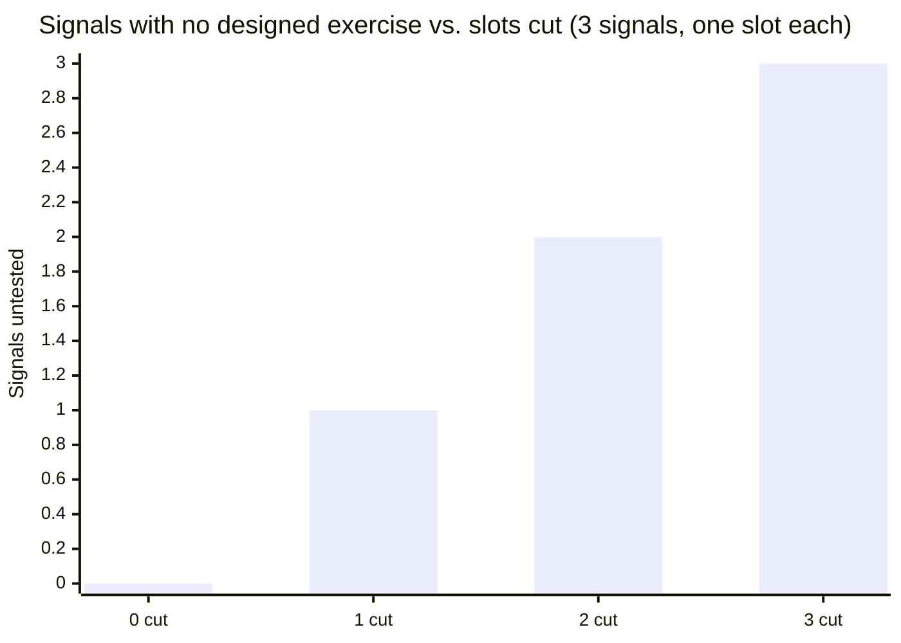

import LevelIntro from "../../../components/LevelIntro.astro";
import Checkpoint from "../../../components/Checkpoint.astro";
import PracticeCheck from "../../../components/PracticeCheck.astro";

export const unit = {
  track: "people-management",
  unitSlug: "defining-role",
};

L2 established that evidence comes from separate observations scored before
discussion, and that a slot needs a signal, a task, a written bar and a
scorer. This level replays the platform team's loop under time pressure: what
exactly each cut removed, what the hiring manager could have done instead,
and which parts of the case carry over to other decisions.

<LevelIntro
  items={[
    "Reading the loop slot by slot",
    "Three honest ways to respond to time pressure",
    "What carries over to other decisions, and what does not",
  ]}
/>

## What did each step of the loop actually give the team?

**The team planned five steps and ran three. What did that leave on the
table?** Lay the plan next to what happened.

| Step                     | Planned job                                  | Ran?     | Evidence it produced                    |
| ------------------------ | -------------------------------------------- | -------- | --------------------------------------- |
| 1 Rapport chat           | Comfort and basic fit, not scored on signals | Yes      | None on the three signals (by design)   |
| 2 Incident diagnosis     | Signal 1                                     | Cut      | None                                    |
| 3 Stakeholder trade-offs | Signal 2                                     | Yes      | A strong score                          |
| 4 Code review            | Signal 3                                     | Cut      | None                                    |
| 5 Debrief                | Independent scores shared, then discussed    | Informal | Impressions, not scores against signals |

Two of the three signal slots were cut, so two of three signals were never
observed. The counting is exact, and it is what the unit's demo shows:

The line is straight because each signal has exactly one slot. If a
signal were covered by two slots, cutting one would leave it partly covered,
and the picture would change. That is a design choice a team can make on
purpose, but only if it has the table above in front of it.

**Why did the surviving exercise make things worse and not just fail to
help?** It was the one slot where the candidate's visible strength was the
thing being measured. The strong score was accurate, and it was then read as
a verdict on the whole candidate, because no other observation existed to
push back against it.

<PracticeCheck
  track={unit.track}
  unitSlug={unit.unitSlug}
  topicId="loop-in-scenario"
/>

## What should the hiring manager have done when time ran short?

**Pressure was real. Was "cut and hope" the only move?** There were three
honest ones, and the difference between them is whether the loss is visible.

| Response                              | What it costs                                   | What it keeps                                         |
| ------------------------------------- | ----------------------------------------------- | ----------------------------------------------------- |
| Keep all three exercises, shorter     | Less depth per signal, possibly a thinner score | Every signal still observed at least once             |
| Cut one slot on purpose, name the gap | One signal has no evidence                      | Time saved, and a named gap to plan onboarding around |
| Cut slots and say nothing             | Signals untested and nobody knows               | Nothing, other than the feeling of speed              |

The team did the third. With the signals written down, the first two were
available: the manager could have looked at the table, seen that cutting
step 2 meant "we will hire without ever seeing this person diagnose an
incident," and decided whether that was acceptable for this role, whose
day-to-day centres on incidents.

<Checkpoint question="If the manager had cut only the code-review slot and kept incident diagnosis, would that have been the same mistake as the scenario's cuts?">

No. The mistake was not cutting; it was cutting the signal that matters most
for this role without noticing. Dropping the code-review exercise on purpose,
stating "we have no direct evidence on signal 3, so we will watch it in the
first weeks and pair on reviews," is a trade-off with its eyes open. The
scenario's version removed the incident signal silently, so the gap showed up
three months later as a production problem instead of at the offer stage as a
plan.

</Checkpoint>

## What would the debrief have sounded like?

**If step 2 had run, what would the interviewer have said?** Not "I thought
they were great," but something falsifiable: "Given a log with three
plausible causes, they picked the likeliest but could not explain why the
other two fit worse. That is a gap on signal 1." The hiring manager can weigh
that against the urgency of the seat.

**Does catching it guarantee a different decision?** No, and it should not.
The team might still hire, with a specific onboarding focus on incident
diagnosis. The value is in what the decision rests on: a named, observed gap
instead of an impression dominated by one trait. Same offer, very different
information going into it.

<Checkpoint question="If the structured loop would have ended in the same offer anyway, was running it worth it?">

Yes. The loop's output is not a different decision every time; it is a
decision that rests on what was observed. In the scenario the offer rested on
an impression and the gap surfaced on the job, at real cost. In the
structured version the same offer comes with a known gap and a plan for it
from day one.

</Checkpoint>

## What carries over, and what does not?

The core idea carries to any panel decision: promotion committees,
vendor selection, grant review. A strong joint impression only counts if each
person looked at something different and recorded it before the discussion.

What is specific to this case is the list itself. These three signals belong to
this role on this team; a different role needs its own equally specific list.
The scenario is a case, not the whole territory.

**Try extending it yourself.** If the same team were hiring a technical writer,
what three signals would the role definition hold, and which of the risks above
(a vivid trait spreading, a quiet cut, talking before scoring) would still
apply even though every skill being tested is different? And what would change
if the pressure came not from an empty seat but from a strong internal
candidate everyone already knows?

<PracticeCheck
  track={unit.track}
  unitSlug={unit.unitSlug}
  topicId="decision-basis"
/>

## Failure modes

| Failure mode                                        | What it gets wrong                                                                                                                                                                               |
| --------------------------------------------------- | ------------------------------------------------------------------------------------------------------------------------------------------------------------------------------------------------ |
| Cutting slots without checking which signal is lost | Speed can justify a trade-off, but only if the lost signal is named and its cost accepted                                                                                                        |
| Letting early feedback reach later interviewers     | Anchors the rest of the panel regardless of what they saw                                                                                                                                        |
| Never revisiting the role definition                | A role's real needs shift; a stale list tests what used to matter                                                                                                                                |
| Treating the loop as bureaucracy                    | It is risk management for exactly the gap in the scenario; overhead is the price                                                                                                                 |
| Vague criteria such as "culture fit"                | Leaves room for personal preference to stand in for job-related evidence; keep criteria tied to the job's actual signals, and check with HR or legal about what rules apply in your jurisdiction |
