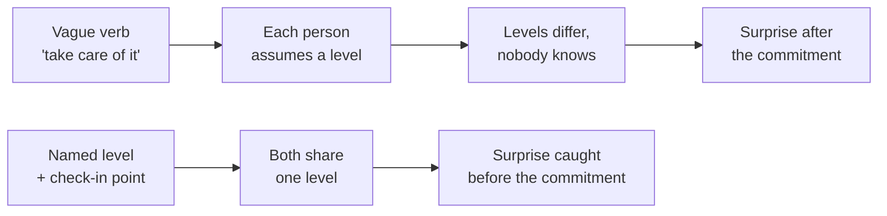

import Scenario from "../../../components/Scenario.astro";
import LevelIntro from "../../../components/LevelIntro.astro";
import PracticeCheck from "../../../components/PracticeCheck.astro";

export const unit = {
  track: "people-management",
  unitSlug: "delegation-levels",
};

<Scenario label="The problem">
  <Fragment slot="facts">
    

      
🗣️ <strong>Said</strong> — "Can you take care of picking a new CI vendor for the team?"

      
🧠 <strong>Manager meant</strong> — research, bring a recommendation, I approve before we commit

      
🧠 <strong>Report heard</strong> — pick one and set it up; "take care of it" means it is mine

    

    

      

        $10,000
        assumed cancellation fee: 20% of a $50,000 one-year contract
      

      

        

      

    

  </Fragment>

A manager asks a report to "take care of" finding a new CI vendor for the team. Two weeks
later the report announces, proudly, that a one-year contract is signed. The manager is
caught off guard: they expected to see a shortlist first, and one option they knew from
another team was never even considered. Walking the contract back means paying a
cancellation fee. (Illustrative numbers, assumed for this unit: a $50,000 contract with a
20% fee, so $10,000.) **Nobody was careless, and the report did real work. So what
actually went wrong?**

The words "take care of it" never said _how much authority_ came with the task, and each
person filled the gap with a different, reasonable assumption. The manager meant "bring me
a recommendation; I make the final call." The report heard "you own this end to end."
**Neither assumption was spoken, so the mismatch only surfaced after the contract was
signed.**

</Scenario>

<LevelIntro
  items={[
    "Delegation as a spectrum, not a binary",
    "Naming the level out loud",
    "Autonomy matched to the task, not maximized",
  ]}
/>

## What is the gap, exactly?

|                                          | Manager's mental model            | Report's mental model        |
| ---------------------------------------- | --------------------------------- | ---------------------------- |
| What was delegated                       | The research and a recommendation | The entire decision          |
| What "done" looks like                   | A shortlist, awaiting approval    | A signed contract            |
| When the manager expected to be involved | Before any commitment             | Only if something went wrong |

Both columns are internally reasonable. The incident came from nobody ever laying them
side by side before the work started.

## The shape of the answer

- **Delegation is a spectrum of autonomy, not a binary** between "I do it" and "it's
  yours." The range runs from "do exactly this" to "decide and act, no need to report."
- **The core skill is naming the level out loud, every time.** "Take care of it" is not a
  level. "Research options and bring me a recommendation before we commit" is.
- **Higher autonomy is not automatically better.** Full authority over a decision the
  delegate has no context for sets them up for an avoidable mistake.
- **"Trust but verify" is a middle ground.** One light check-in, such as "loop me in once
  you have two finalists," protects the decision without reviewing every step.

<PracticeCheck
  track={unit.track}
  unitSlug={unit.unitSlug}
  topicId="name-the-level"
/>

The practical rule this unit builds: before delegating anything non-trivial, say the
level out loud. State what the delegate can decide alone, what needs a check-in first, and
what is off the table.
