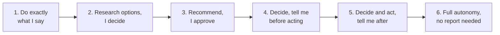
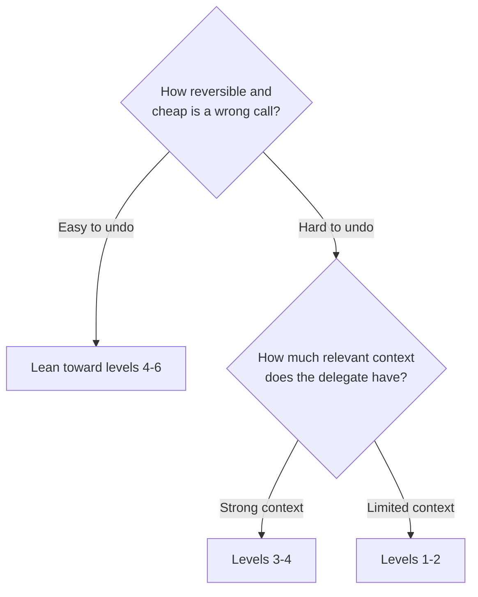

import LevelIntro from "../../../components/LevelIntro.astro";
import Checkpoint from "../../../components/Checkpoint.astro";
import PracticeCheck from "../../../components/PracticeCheck.astro";

export const unit = {
  track: "people-management",
  unitSlug: "delegation-levels",
};

L1 showed how the CI-vendor incident happened: two people silently assumed different
points on a spectrum of delegated authority. L2 makes that spectrum concrete and works out
how to pick a point on it on purpose.

<LevelIntro
  items={[
    "The six-level spectrum",
    "The two questions that pick a level",
    "A named check-in point",
  ]}
/>

## If "take care of it" and "do exactly this" are the two ends, what are the stops in between?

| Level | The delegate decides | The manager is involved   |
| ----- | -------------------- | ------------------------- |
| 1     | Nothing              | At every step             |
| 2     | Which options exist  | At the decision           |
| 3     | What to recommend    | At approval               |
| 4     | The decision         | Before the action         |
| 5     | The decision         | After the action          |
| 6     | The decision         | Only if the delegate asks |

The CI-vendor incident was a gap of two levels: the manager was at **Level 3** ("recommend,
I approve") and the report at **Level 5** ("decide and act, tell me after"). A two-level
gap on a cheap, reversible task might never matter. On a one-year contract it did.

<Checkpoint question="A two-level gap caused a real incident on a one-year vendor contract. Would the same Level 3 vs. Level 5 gap necessarily cause trouble when drafting a first version of an internal announcement?">

Not necessarily. What turned the gap into an incident was a wide gap _combined with_ a
decision that is hard to undo. A draft costs a round of edits to fix, so even a wide gap
mostly costs a little time. A level gap is a risk factor, not a guaranteed failure, and
it has to be read against how expensive a wrong call would be.

</Checkpoint>

<PracticeCheck
  track={unit.track}
  unitSlug={unit.unitSlug}
  topicId="six-levels"
/>

## Given six levels, what should decide which one fits this task?

Two questions, asked together, rather than one fixed policy applied to everything:

1. **How reversible is a wrong decision, and how costly is undoing it?** A contract with a
   cancellation fee and a year-long commitment sits differently than a draft that costs
   nothing to revise.
2. **How much relevant context does the delegate have for this specific decision?** Someone
   who has chosen CI vendors twice before brings real context. Someone doing it for the
   first time does not. The same person can sit at different levels for different tasks.

Apply it to the incident: a $50,000 contract with an assumed 20% cancellation fee puts
$10,000 on a wrong call, and the report was evaluating vendors for the first time. Both
factors point to Level 2 or 3, not the Level 5 the report assumed.

<PracticeCheck
  track={unit.track}
  unitSlug={unit.unitSlug}
  topicId="two-questions"
/>

## If naming the level is the fix, what does that sentence sound like?

Not a promise to "check in sometimes." A specific point:

> "Go ahead and research CI vendor options. Loop me in once you have it narrowed to two or
> three finalists, before you sign anything. I want to weigh in on the final call, but I
> don't need to be involved in the research itself."

That one sentence states the level (roughly Level 3), names the trigger for the check-in
(finalists, before signing), and frees the delegate from needing approval on the parts that
do not matter. Verification is scoped to one high-leverage moment instead of spread across
every step.

<Checkpoint question="Why is 'narrowed to finalists, before signing' a better check-in instruction than 'just keep me in the loop'?">

"Keep me in the loop" does not say when, so it moves the original ambiguity somewhere else.
The report must guess whether that means daily updates, a halfway note, or only trouble, and
a guess that differs from the manager's intent rebuilds the same mismatch. A trigger tied to
a decision point leaves one moment that both people can recognize when it arrives.

</Checkpoint>

<PracticeCheck
  track={unit.track}
  unitSlug={unit.unitSlug}
  topicId="named-checkin"
/>
