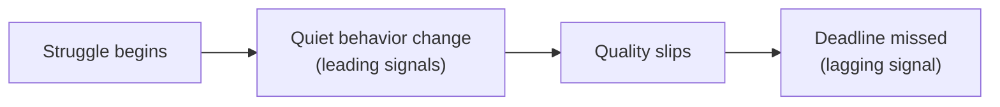

import Scenario from "../../../components/Scenario.astro";
import LevelIntro from "../../../components/LevelIntro.astro";
import PracticeCheck from "../../../components/PracticeCheck.astro";

export const unit = {
  track: "people-management",
  unitSlug: "early-signals",
};

<Scenario label="Two reports missed the same deadline. Only one surprised their manager.">
  <Fragment slot="facts">
    

      
🙋 <strong>Report A</strong>: flagged a blocker in week 2, got help, landed a few days late but expected

      
🤐 <strong>Report B</strong>: three quiet weeks, nothing said, deadline missed with no warning

      
😳 <strong>The manager</strong>: surprised by B, not by A

    

    
Weeks of warning the manager had

    

      
Report A

2 of 3

      
Report B

0 of 3

    

  </Fragment>

Two people on the same team miss the same deadline in the same week. Report A
flagged a blocker two weeks earlier, asked for help, and the manager already
knew the deadline was at risk. Report B said nothing the entire time: shorter
standup updates, camera off more often, no questions asked. The manager learned
something was wrong on the day the deadline passed.

**Both missed the deadline, and only one was a surprise. Was Report B's problem
newly arrived, or was it visible the whole time with nobody watching for it?**

</Scenario>

<LevelIntro
  items={[
    "Why a missed deadline is a lagging signal",
    "What quiet behavior change looks like",
    "How safety decides who speaks up",
  ]}
/>

## Why is the missed deadline the worst place to find out?

The deadline is the last event in a chain, not the first. Whatever caused it
was already underway weeks before. The timeline below shows where each kind of
signal sits:

- A **lagging signal** confirms a problem that already happened. A missed
  deadline is the clearest one, and also the latest possible one.
- A **leading signal** suggests a problem is building before output suffers:
  withdrawal, vaguer updates, slower replies.
- Waiting for the lagging signal means choosing to find out as late as it is
  possible to find out.

<PracticeCheck
  track={unit.track}
  unitSlug={unit.unitSlug}
  topicId="lagging-leading"
/>

## What does the quiet part look like, and what keeps it quiet?

Most of what precedes a crisis is the absence of things: fewer messages, fewer
questions, less presence. Absence does not demand attention the way a missed
deadline does, so it is easy to miss.

| Term                 | Meaning                                                                           |
| -------------------- | --------------------------------------------------------------------------------- |
| Early signal         | A behavioral change that precedes visible failure                                 |
| Psychological safety | The belief that admitting a struggle brings support, not judgment                 |
| Checking in          | A deliberate, regular question about a person's state, not just their task status |

Whether a person turns a struggle into words depends on whether they believe
saying it is safe. That belief decides if the manager ever gets an early signal
from the person, or only the late one from the calendar.

L2 works through the specific signals and the safety mechanism. L3 lays out
Report A's and Report B's weeks side by side and what a check-in that catches
this sounds like.
