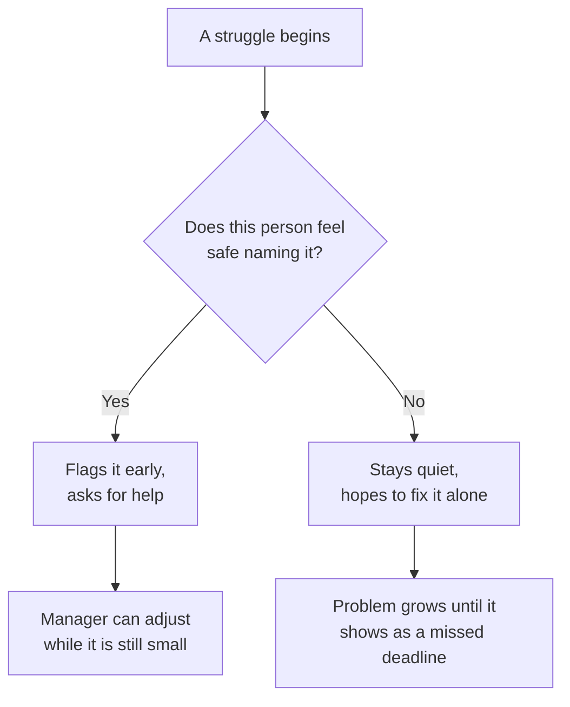

import LevelIntro from "../../../components/LevelIntro.astro";
import Checkpoint from "../../../components/Checkpoint.astro";
import PracticeCheck from "../../../components/PracticeCheck.astro";

export const unit = {
  track: "people-management",
  unitSlug: "early-signals",
};

L1 separated the lagging signal (the missed deadline) from the quieter leading
signals before it. L2 works out what those quiet signals look like, why one of
them alone proves nothing, and why psychological safety decides whether a
manager ever hears about the struggle from the person.

<LevelIntro
  items={[
    "Signals that precede a missed deadline",
    "Why safety decides who reports early",
    "What a specific check-in does differently",
  ]}
/>

## What actually comes before a missed deadline?

**If the deadline is the last thing to happen, what is the first?** Almost never
an announcement. Usually a series of small shifts, weeks earlier:

| Signal                                    | What it often means                                             |
| ----------------------------------------- | --------------------------------------------------------------- |
| Fewer or vaguer standup updates           | Something is not going well and they are not ready to say so    |
| Camera off more often                     | Withdrawal, low energy, or avoiding being seen while struggling |
| Fewer questions asked                     | Confidence, or a belief that asking no longer helps             |
| Quality dipping before the deadline slips | The work is already suffering; the date has not caught up yet   |
| Slower replies to messages                | Disengagement, or avoiding a backlog that feels overwhelming    |

None of these proves a crisis alone. A quiet week has plenty of ordinary
causes. What matters is a pattern: the same signal persisting, or several
signals together, in someone whose own baseline was different.

<Checkpoint question="One report has a noticeably shorter standup update this week and nothing else is out of the ordinary. Does that alone justify treating it as an early signal worth acting on?">

Not on its own. A single quiet week happens for ordinary reasons that have
nothing to do with a brewing problem. A signal earns a response when it
persists past a few days, or when it is joined by other signals in the same
person and the same direction. One shorter update is noise until it repeats or
is joined by something else.

</Checkpoint>

<PracticeCheck
  track={unit.track}
  unitSlug={unit.unitSlug}
  topicId="signal-pattern"
/>

## If the signals are visible, why do managers still find out late?

**Visibility and reporting are different things.** A manager can only act on
what they notice, and a struggling person decides whether to say it out loud
based on what they expect to happen next:

Psychological safety is the switch that picks the branch. In the quiet branch
the signals still exist, but nobody named them, so they only get understood in
hindsight.

| What happens                       | Low safety                                | High safety                                       |
| ---------------------------------- | ----------------------------------------- | ------------------------------------------------- |
| A blocker appears mid-task         | Handled alone, often too late to get help | Flagged within days, while there is time to adapt |
| A mistake is made                  | Hidden or minimized out of fear           | Disclosed, because hiding it costs more           |
| Manager asks "how is it going?"    | A reflexive "fine"                        | An honest answer, since honesty was not punished  |
| First time the manager hears of it | The missed deadline                       | Days or weeks earlier, from the person            |

The right-hand column is not a personality trait some teams happen to have.
It is built by how a manager responds the first few times someone takes the
risk of saying "I am struggling."

<Checkpoint question="A report says, for the first time, 'I am behind and may miss the deadline.' Manager X reacts with visible frustration about the date. Manager Y asks what would help. What is the longer-term difference beyond this one deadline?">

It is about whether this report, and anyone who hears how it went, ever
volunteers a disclosure like that again. X's frustration teaches that naming a
struggle brings a negative reaction, which pushes the next struggle into the
quiet branch where it is handled alone and surfaces late. Y's response teaches
that disclosure leads to support, which keeps safety high enough that people
keep choosing to flag problems early.

</Checkpoint>

<PracticeCheck
  track={unit.track}
  unitSlug={unit.unitSlug}
  topicId="safety-switch"
/>

## What is the manager supposed to do with this?

**If safety decides whether signals get reported, what is the practical lever?**
Checking in regularly and specifically. A generic "everything okay?" invites a
reflexive "yes, fine." A check-in that names an observed change ("your camera
has been off the last few calls") shows the manager is actually watching, and
that being seen is part of what makes an honest answer feel safe. L3 shows both
versions in a full example.
