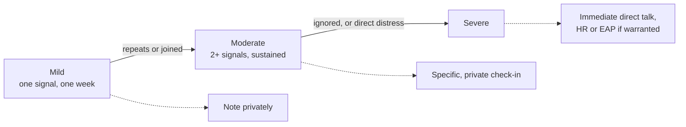

import Scenario from "../../../components/Scenario.astro";
import LevelIntro from "../../../components/LevelIntro.astro";
import Checkpoint from "../../../components/Checkpoint.astro";
import PracticeCheck from "../../../components/PracticeCheck.astro";

export const unit = {
  track: "people-management",
  unitSlug: "early-signals",
};

<Scenario label="Same three weeks, two very different paper trails">
  <Fragment slot="facts">
    

      
🙋 <strong>Report A</strong>: one spoken blocker in week 2, handled

      
🤐 <strong>Report B</strong>: five unspoken signals across three weeks

      
🎯 <strong>Goal</strong>: find the point B's problem was visible before anyone said it

    

  </Fragment>

Report A's blocker was flagged in words, in week 2. Report B never said anything.

**If a manager only listens for people saying "I am struggling," how much of
what happened to Report B would ever be seen?**

</Scenario>

<LevelIntro
  items={[
    "The two weeks, side by side",
    "The point a pattern becomes actionable",
    "What to do at each signal level",
  ]}
/>

## The three weeks, side by side

| Week     | Report A (flagged early)                            | Report B (said nothing)                                                    |
| -------- | --------------------------------------------------- | -------------------------------------------------------------------------- |
| 1        | Normal week, on track                               | Standup updates noticeably shorter; camera on                              |
| 2        | Hits a blocker, says so in standup, asks for help   | Camera off for the first time in weeks; two messages unanswered a full day |
| 3        | Unblocked with the manager's help, revised timeline | One day with no standup update; a code review comment sits 3 days          |
| Deadline | Lands a few days late, already accounted for        | Missed entirely; manager learns that morning                               |

A's row has one nameable event, spoken aloud. B's row has five separate
signals over three weeks (shorter updates, camera off, unanswered messages, a
stale review comment, plus a skipped update), and none was ever said. They were
only visible to someone watching for a change from B's own normal.

## When does Report B's pattern become worth acting on?

**Is week 1's shorter update enough to justify a conversation?** Probably not.
A single quieter week has many ordinary causes. Week 2 stacks a second and
third independent signal on top of week 1's, same person, same direction. That
stacking is where "maybe nothing" separates from "probably something."

<Checkpoint question="Week 1 and week 2 both contain behavioral signals. Why does week 2 cross into 'probably something' when week 1 did not?">

Week 2's signals are not individually more dramatic; a camera being off or two
unanswered messages could each be a busy stretch. What changes is that they
accumulate on top of a signal already present, in the same person and
direction. One signal is easy to explain away. Several persisting together are
much harder to explain as coincidence, so the pattern, not any single
observation, earns the response.

</Checkpoint>

<PracticeCheck
  track={unit.track}
  unitSlug={unit.unitSlug}
  topicId="signal-pattern"
/>

## What does a check-in that catches this sound like?

**Generic check-in, week 2:**

> Manager: "Hey, everything going okay?"
> Report B: "Yeah, all good, just busy."

It fails because it is answerable with a true-sounding "fine." Nothing in the
question shows anything specific was noticed, so nothing in the answer has to
address anything specific.

**Specific check-in, same week, same person:**

> Manager: "I noticed your camera has been off the last couple of calls, and
> I have not heard back from you on a couple of things. Is something going on,
> or is this just a busy stretch?"
> Report B: "Honestly, it has been a rough few weeks. I did not want to bring
> it up because everyone is busy."

The difference is specificity, not tone. Naming the observed change signals
real attention, which builds the safety to answer honestly, and it makes a
flat "fine" hard to give because there is now a concrete thing to explain.

<Checkpoint question="Why did naming the observed changes get Report B to open up when the same underlying question, asked generically, did not?">

A generic question leaves the report free to pick the safest, lowest-effort
answer, which is almost always "fine." Naming concrete changes removes that
escape: a flat "fine" does not address the camera or the unanswered messages,
so the report has to explain or acknowledge them. The specificity also shows
the manager is watching rather than performing concern, and being seen is part
of what makes the real answer feel safe.

</Checkpoint>

<PracticeCheck
  track={unit.track}
  unitSlug={unit.unitSlug}
  topicId="specific-checkin"
/>

## How do you decide how hard to respond?

The response should match the signal level, with a threshold at each step:

| Level                               | Looks like                                                                   | What to do                                                                                                                       |
| ----------------------------------- | ---------------------------------------------------------------------------- | -------------------------------------------------------------------------------------------------------------------------------- |
| Mild: one signal, one week          | Slightly shorter standup update, once                                        | Note it privately; just pay attention                                                                                            |
| Moderate: two or more, sustained    | Camera off, unanswered messages, shorter updates over 1 to 2 weeks           | Specific, observational check-in, in private                                                                                     |
| Severe: ignored, or direct distress | No response for days, visible quality drop, or an explicit "I am struggling" | Direct, immediate conversation; involve HR or the Employee Assistance Program (EAP, a confidential support service) if warranted |

Reacting at the mild level is often premature, and waiting for severe is often
too late. The real mistake is having no threshold at all, so every level gets
the same "check the task board" response, which catches none of them.

The interactive demo on this page makes the timing concrete under one stated
assumption: a pattern needs about a week to move from mild to moderate. With
check-ins every 21 days (Report B's cadence), the worst-case wait before a
quiet struggle could be caught is 21 days. Checking in more often than every 7
days does not shorten it further, because the pattern itself needs that week to
show.

<PracticeCheck
  track={unit.track}
  unitSlug={unit.unitSlug}
  topicId="signal-levels"
/>

## Extend it: this is a case, not the whole territory

This example assumed work overload. The same signals could mean a personal
issue, a conflict with a teammate, or burnout unrelated to this project.
**Does "moderate signal, then specific private check-in" still hold when the
cause is something the manager cannot fix?** Consider what changes about the
conversation (not the noticing) when the answer is outside work entirely, and
what would change if the quiet report were a new hire still learning the
team's norms.

## Failure modes

| Failure mode                                   | What it gets wrong                                                                      |
| ---------------------------------------------- | --------------------------------------------------------------------------------------- |
| Waiting for someone to say "I am struggling"   | Most people do not say it early; signals precede the words, often by weeks              |
| Treating a single quiet week as proof          | One signal is usually noise; the pattern is what to act on                              |
| Asking "everything okay?" and accepting "fine" | A generic question invites a generic, safe answer                                       |
| Assuming psychological safety is fixed         | It is built or eroded by how the manager reacts the first few times someone is honest   |
| Treating every signal level the same           | Reacting to a mild signal like a crisis erodes trust as surely as ignoring a severe one |
