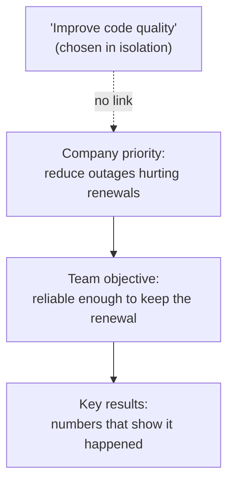

import Scenario from "../../../components/Scenario.astro";
import LevelIntro from "../../../components/LevelIntro.astro";
import PracticeCheck from "../../../components/PracticeCheck.astro";

export const unit = {
  track: "people-management",
  unitSlug: "goal-setting",
};

<Scenario label="A full quarter of work, aimed at the wrong thing">
  <Fragment slot="facts">
    

      
🎯 <strong>Team's goal</strong>: "improve code quality"

      
🏢 <strong>Company's priority</strong>: cut the outages that put an enterprise renewal at risk

      
📈 <strong>Effort</strong>: more tests, several refactors, all quarter

      
😕 <strong>Result</strong>: outages unchanged, leadership unhappy

    

  </Fragment>

A new manager sets their team's quarterly goal: "improve code quality." The
team works hard all quarter: more tests, cleaner code, several refactors. At
the quarter review, leadership is not pleased. The company's actual top
priority was reducing the outages threatening a major customer's renewal, and
none of the team's effort touched that problem. **The team was genuinely busy
and genuinely productive. Why did it still land as a disappointment?**

</Scenario>

Nothing in that quarter was lazy or careless. The goal itself was the
problem: it sounded worthwhile, but nobody could say what number would show
it had worked, and nobody had checked it against what the company needed. A
goal has to be aimed before it is worked on.

<LevelIntro
  items={[
    "Objective versus key result",
    "Cascading a goal from the level above",
    "Why effort alone proves nothing",
  ]}
/>

## What is the difference between an objective and a key result?

**"Improve code quality" felt like a goal. What was it missing?** A way to
tell, at the end of the quarter, whether it had happened.

- **Objective:** a qualitative statement of what success looks like.
  Motivating, but not directly measurable.
- **Key result:** a measurable, specific outcome that shows progress toward
  the objective. It turns a vibe into a number that either moved or did not.
- **OKR (Objectives and Key Results):** the common shorthand for an objective
  paired with the key results that measure it.

| Term       | Answers                 | Example                                           |
| ---------- | ----------------------- | ------------------------------------------------- |
| Objective  | Why does this matter?   | Make the service reliable enough to keep renewals |
| Key result | Did it actually happen? | P1 incidents from 8 per quarter to 2 or fewer     |

<PracticeCheck
  track={unit.track}
  unitSlug={unit.unitSlug}
  topicId="okr-split"
/>

## Where should a team's goal come from?

**Suppose the team had added a number to "improve code quality," such as "raise
test coverage by 10 points." Would that have fixed the quarter?** Not by
itself. A number makes the goal checkable, but it does not make it the right
goal. That depends on the level above.

- **Cascading goals:** translating a goal from one level of the organization
  down to the next, so a team's objective is a real contribution to what the
  level above needs rather than a disconnected local project.
- The question to ask first is "what does the organization need from this team
  right now?" and only then "what can we measure?"
- **Effort is not evidence.** Leadership judges whether the organization's
  actual problem moved, not how busy the team looked.

Related term, covered in L2: **skill gap analysis** is naming the difference
between what the team can do today and what a goal requires, so the plan
accounts for what has to be learned, not just effort spent.

<PracticeCheck
  track={unit.track}
  unitSlug={unit.unitSlug}
  topicId="cascade-trace"
/>

## What comes next

L2 gives the two-question test any goal should pass and the skill-gap check
that follows it. L3 rebuilds this exact quarter's goal from the real company
priority and shows what makes it accountable.
