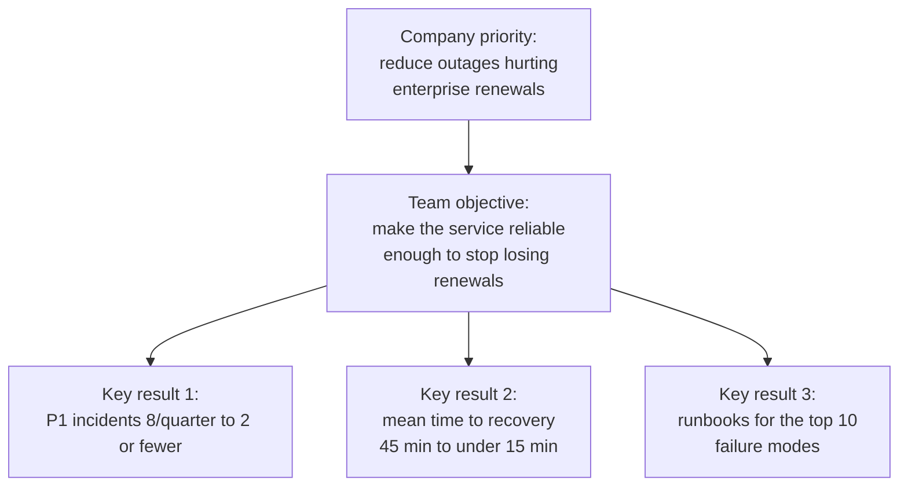

import LevelIntro from "../../../components/LevelIntro.astro";
import Checkpoint from "../../../components/Checkpoint.astro";
import PracticeCheck from "../../../components/PracticeCheck.astro";

export const unit = {
  track: "people-management",
  unitSlug: "goal-setting",
};

L1 named the two things "improve code quality" was missing: a measurable key
result and a traceable link to a real company need. L2 works out what a goal
looks like when it has both, and how to tell whether the team can actually
deliver what a key result requires.

<LevelIntro
  items={[
    "The two-question test for any goal",
    "Objective and key results, traced from a company priority",
    "Naming a skill gap before it becomes a delivery risk",
  ]}
/>

## Why can "improve code quality" not be held to account?

**It is specific enough to work on, so what exactly is wrong with it?** Two
separate things, and a goal can fail either one on its own.

| Question                                | "Improve code quality"                  | A goal that passes                      |
| --------------------------------------- | --------------------------------------- | --------------------------------------- |
| What number will tell us this happened? | None defined, so people argue about it  | A count or duration checkable on a date |
| What does this connect to one level up? | Nothing; it was never derived from need | A named company priority                |

"Improve code quality" fails both at once, which is why a quarter of real work
was invisible to leadership. The chain a passing goal follows looks like this.

("P1" is short for priority-1, the highest-severity tier of incident, the kind
that actually threatens a renewal, as opposed to a minor bug.)

**Does every team goal have to trace to a company priority like this?** In
spirit, yes. Even goals about internal tooling or team health should trace to
something the organization needs, such as delivery speed, retention or reduced
risk. The chain does not have to be one hop; it has to exist and be
explainable.

<Checkpoint question="A team sets the goal 'reduce P1 incidents from 8 per quarter to 2 or fewer, tied to the company's uptime-driven renewal priority.' Does it pass the two tests that 'improve code quality' failed?">

Yes, on both counts. It has a real key result, a count that lands at 2 or
fewer by quarter end or does not, with no room to argue about whether it
happened. And it traces upward: it exists because the company's stated
priority is reducing outages that threaten a specific renewal, not because
the team picked something that sounded worthwhile. The second part is the one
"improve code quality" never had. A number alone is not enough if it does not
connect to what the organization needed that quarter.

</Checkpoint>

<PracticeCheck
  track={unit.track}
  unitSlug={unit.unitSlug}
  topicId="two-question-test"
/>

## Does the team have what the key results require?

**Suppose the key results are set. Is the goal-setting work done?** Not yet.
The next question is whether the team currently has the skills and tools to
hit them, or whether the plan must include building those first.

- **Skill gap analysis:** identifying the specific difference between what the
  team can do now and what the goal requires.
- If nobody on the team has ever written an incident runbook, "runbooks for
  the top 10 failure modes" implicitly includes learning how to write a good
  one. A real plan names that gap instead of assuming effort closes it.
- An unnamed gap turns into a delivery risk: the key result is attempted, then
  quietly missed or met only on paper.

<Checkpoint question="A team sets 'write runbooks for the top 10 failure modes' as a key result, but nobody on the team has ever written one. What does a skill gap analysis add that the key result alone does not capture?">

The key result only says what should exist by quarter end. It says nothing
about whether the team knows how to produce it well. Writing ten documents is
easy to do badly, and a runbook nobody trusts during a 2am incident has not
really delivered the key result even if it technically exists. Naming the gap
up front lets the plan account for it, for example by pairing the first
attempt with someone experienced and reviewing it against what makes a runbook
usable under pressure, instead of discovering at quarter end that the box was
checked but the need was not met.

</Checkpoint>

<PracticeCheck
  track={unit.track}
  unitSlug={unit.unitSlug}
  topicId="skill-gap"
/>

## Is this only about engineering teams and outages?

No. The same two failure modes, no measurable key result and no traceable link
to a real need, can hit a goal in a support team, a design team or a sales
team. Whenever a goal is set, ask what number will tell us this happened and
what it connects to one level up. A goal that cannot answer both is a good
intention, not yet a goal.
