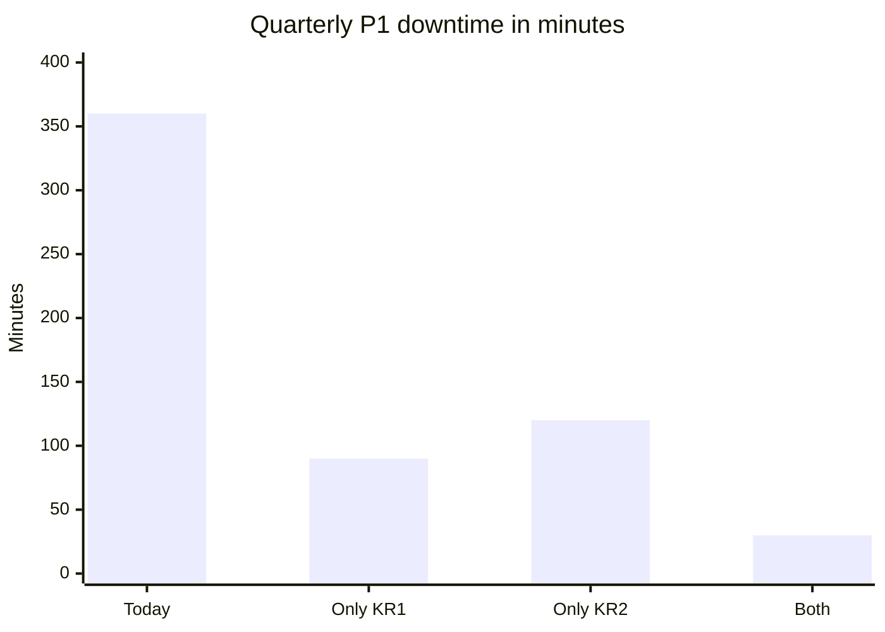

import Scenario from "../../../components/Scenario.astro";
import LevelIntro from "../../../components/LevelIntro.astro";
import Checkpoint from "../../../components/Checkpoint.astro";
import PracticeCheck from "../../../components/PracticeCheck.astro";

export const unit = {
  track: "people-management",
  unitSlug: "goal-setting",
};

<Scenario label="Same team, same quarter, rebuilt goal">
  <Fragment slot="facts">
    

      
🏢 <strong>Company priority</strong>: reach 99.9% uptime to save a major enterprise renewal

      
👥 <strong>Team's control</strong>: the service behind the outages is entirely this team's

      
📊 <strong>Starting point</strong>: 8 P1 incidents per quarter, 45 minutes to recover, 0 runbooks

    

  </Fragment>

Same team and quarter as L1 and L2. **Before reading on, predict: what would a
properly cascaded objective and set of key results look like, and what would
make them different from "improve code quality" in a way a reader could point
to, not just a feeling of "better"?**

</Scenario>

<LevelIntro
  items={[
    "Deriving key results from a company priority",
    "Checking each key result against three questions",
    "Why two key results beat one for the same outcome",
  ]}
/>

## Step 1: Start from what the organization needs, then what the team controls

The leadership planning doc says the company must hit 99.9% uptime this
quarter, because a major enterprise customer's renewal depends on reliability
improving. Every team goal should trace back to this, connected rather than
restated. The service causing the outages is owned entirely by this team, with
no other team as a blocker, which is what makes it a legitimate team-level
objective.

## Step 2: Draft the objective and key results

- **Objective:** make the service reliable enough to stop being the reason
  this renewal is at risk.
- **Key result 1:** reduce P1 incidents from 8 per quarter to 2 or fewer.
- **Key result 2:** reduce mean time to recovery from 45 minutes to under 15.
- **Key result 3:** write incident runbooks covering the top 10 historical
  failure modes (0 written today).

## Step 3: Does each key result survive three questions?

**How do we know these three are good key results and not just plausible
ones?** Check each against the same three questions.

| Key result                   | Measurable?                          | Within the team's control?              | Traces to the objective?                               |
| ---------------------------- | ------------------------------------ | --------------------------------------- | ------------------------------------------------------ |
| P1 incidents 8 to 2 or fewer | Yes, a count at quarter end          | Yes, root causes are in the team's code | Yes, fewer P1s is what "reliable" means here           |
| MTTR 45 min to under 15 min  | Yes, a duration logged automatically | Yes, response process is the team's     | Yes, faster recovery cuts customer-visible impact      |
| Runbooks for top 10 modes    | Yes, a checklist, complete or not    | Yes, needs no other team                | Partially, it enables faster MTTR, not fewer incidents |

The third key result is weaker on tracing. It is an enabler for key result 2
rather than a direct measure of reliability. That is a judgment call worth
naming, not a reason to drop it.

<Checkpoint question="The runbook key result scored only 'partially' on tracing to the objective. Does that mean it should be dropped?">

No. A weaker score on one question is information to weigh, not automatic
disqualification. The runbook key result passes the other two cleanly: it is
measurable and fully within the team's control. Its role is different from the
other two. It is an enabler that makes faster recovery achievable, not a
direct measure of reliability. Saying so explicitly lets the team and
leadership understand why it is there without mistaking it for a fourth,
independent measure of what the first two already capture.

</Checkpoint>

<PracticeCheck
  track={unit.track}
  unitSlug={unit.unitSlug}
  topicId="kr-three-questions"
/>

## Step 4: Why two key results for the same outcome?

**Key results 1 and 2 both target outages. Is one redundant?** No. What
customers feel is total downtime, which is incidents multiplied by how long
each lasts. Each key result pulls one lever on the same product. These figures
assume a 90-day quarter (129,600 minutes) and count only P1 downtime, so 99.9%
uptime allows about 130 minutes.

| Scenario              | Incidents | Recovery (min) | Downtime (min) | Uptime  |
| --------------------- | --------- | -------------- | -------------- | ------- |
| Today                 | 8         | 45             | 360            | 99.722% |
| Only key result 1 hit | 2         | 45             | 90             | 99.931% |
| Only key result 2 hit | 8         | 15             | 120            | 99.907% |
| Both hit              | 2         | 15             | 30             | 99.977% |

Hitting either one alone just clears the 130-minute allowance, with little
margin. Hitting both leaves a real buffer, and one key result still hedges
against the other slipping. The slider-driven demo for this unit lets you drag
incident count and recovery time and watch the product move.

<Checkpoint question="If the team hits key result 2 (recovery under 15 minutes) but incidents stay at 8, what is the quarter's P1 downtime, and does the uptime target hold?">

At 8 incidents of 15 minutes each, downtime is 120 minutes. That is under the
roughly 130-minute allowance for 99.9%, so the target technically holds, but
with only about 10 minutes of margin. One extra incident, or one slow recovery,
breaks it. That fragility is the argument for keeping both key results: each
one alone leaves the outcome exposed to a single bad week.

</Checkpoint>

<PracticeCheck
  track={unit.track}
  unitSlug={unit.unitSlug}
  topicId="two-levers"
/>

## Step 5: Compare directly against the original goal

|                                       | "Improve code quality"                  | The rebuilt objective                       |
| ------------------------------------- | --------------------------------------- | ------------------------------------------- |
| Measurable?                           | No, no number was ever defined          | Yes, three explicit key results             |
| Traces to a real organizational need? | No, chosen without the company priority | Yes, derived from the renewal-risk priority |
| Would leadership recognize progress?  | No, nothing maps to their worry         | Yes, every key result maps to their worry   |

Same team, same available effort, and plausibly overlapping work (tests and
refactoring could genuinely reduce P1 incidents). The difference is entirely
in whether the goal was derived from the real priority and stated in a form
checkable at quarter end. The skill gap from L2 still applies: nobody has
written a runbook, so the first one is paired with an experienced author and
reviewed for usability under pressure before it becomes the template for the
other nine.

## This is a case, not the whole territory

The worked example is one team, one priority, one quarter. Try bending it.

**Suppose six weeks in, the renewal closes early and leadership's top priority
shifts to something unrelated. Should the key results stay fixed for
consistency, or be revisited?** Constantly re-deriving goals erodes sustained
progress, but keeping a goal that no longer traces to a real need reproduces
"improve code quality" from another angle. What would you want to know first:
is the shift temporary or permanent, and does the original work still protect
against a risk that could return?

Other variations worth working through: what changes if the service were shared
with two other teams (the control test), or if no historical incident data
existed (the measurable test)?

## Failure modes

| Failure mode                                                         | What it gets wrong                                                                   |
| -------------------------------------------------------------------- | ------------------------------------------------------------------------------------ |
| A specific, effortful goal never checked against organizational need | Specificity and difficulty are not the same as being the right thing to work on      |
| A key result with no number attached                                 | "Improve" is not checkable at quarter end, so someone has to argue about it          |
| Copying the company-level OKR word for word                          | A team goal names the team's controllable contribution, not the top-level ambition   |
| Assuming effort spent proves the goal was achieved                   | Leadership judges whether the real problem moved, not how busy the team looked       |
| An ambitious key result with the skill gap left unnamed              | A goal that silently assumes a skill the team lacks will be attempted, not delivered |
