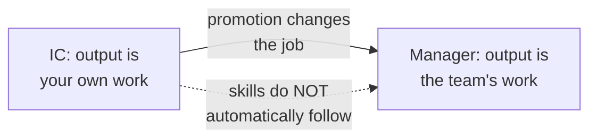

import Scenario from "../../../components/Scenario.astro";
import LevelIntro from "../../../components/LevelIntro.astro";
import PracticeCheck from "../../../components/PracticeCheck.astro";

export const unit = {
  track: "people-management",
  unitSlug: "ic-excellence-management",
};

<Scenario label="The problem">
  <Fragment slot="facts">
    

      

        12 → 15
        Maya's own PRs merged per month, before vs. after the promotion
      

      

        

      

      

        2 of 4
        reports unclear on this week's priority
      

      

        

      

    

    

      
🚀 Promoted 3 months ago to manage the team she used to code on

      
🐢 The team's release cadence has halved since

      
😕 Maya: "I'm doing more than ever. How is this going wrong?"

    

  </Fragment>

Maya was the strongest backend engineer on a four-person team. Three months
after being promoted to manage that same team, she has personally shipped
more code than anyone else on it, and she can recite the exact status of
every hard bug in flight. Meanwhile, two of her four reports privately say
they do not know what to prioritize this week, and the team's release
cadence has slowed by half.

| Metric (Maya's team)         | Before promotion | 3 months into managing |
| ---------------------------- | ---------------- | ---------------------- |
| Maya's PRs merged personally | 12 per month     | 15 per month           |
| Reports unclear on priority  | not tracked      | 2 of 4                 |
| Team release cadence         | baseline         | halved                 |

**Before reading on: Maya's own output went up, not down, since the
promotion. So what, exactly, is going wrong?**

</Scenario>

The trap Maya fell into is the most common one in this transition, and it is
not about effort or talent.

<LevelIntro
  items={[
    "Why the scoreboard changes when the job does",
    "The retreat-to-familiar-work failure mode",
    "Why the two skill sets do not transfer 1:1",
  ]}
/>

## What is a manager's actual output?

**If Maya's personal numbers are fine, which numbers are not?** The ones that
now define her job.

- An individual contributor (IC) produces their own work. A manager's output
  is **the output of the people they manage**: a manager who is still the top
  personal producer while reports are unclear or blocked is failing at the
  actual job, whatever the dashboard says.
- The shift is often described as going from a **multiplier of one** (your own
  effort) to a **multiplier of many** (a team's collective effort).

<PracticeCheck
  track={unit.track}
  unitSlug={unit.unitSlug}
  topicId="output-equation"
/>

## Why does a new manager drift back to the old job?

**Uncertain in an unfamiliar role, what does almost everyone reach for?** The
thing they already know how to do well.

- **The retreat trap:** a new manager picks up code or the hardest technical
  problem themselves. It feels productive and it _is_ productive, but it is
  no longer the job, and it starves the team of coaching, unblocking and
  prioritizing that only the manager is positioned to give.
- Those unfamiliar tasks are exactly the ones only the manager has the
  context, authority or relationship to do. A strong engineer on the team
  could have written that code; nobody else can set the team's priorities.

| Task on the manager's list                | Who else could do it?         | Why it is easy to skip                       |
| ----------------------------------------- | ----------------------------- | -------------------------------------------- |
| Write the tricky module                   | A strong engineer on the team | Familiar, fast feedback, feels like progress |
| Clarify this week's priority across teams | Only the manager              | Unfamiliar, political, slow to show results  |
| Coach a stuck report                      | Mostly the manager            | Slower today than just fixing it yourself    |

<PracticeCheck
  track={unit.track}
  unitSlug={unit.unitSlug}
  topicId="retreat-trap"
/>

## Does being great at the work carry over?

**If Maya is clearly skilled, what is she short on?** Skills of a different
kind. Excellence at the work and excellence at enabling others' work are two
competencies that happen to share a career ladder.

- Neither job is harder or better than the other; they are different, and
  mastery of one does not transfer automatically, in either direction.
- Treating a promotion as a plain reward for technical excellence, rather than
  a real change of job, sets both the new manager and the team up for a rough
  transition.
- The practical shift: measure success by team output and team growth, and
  deliberately build the new skills (delegating, coaching, unblocking,
  prioritizing across other people's work).

| Term               | Simple meaning                                                        |
| ------------------ | --------------------------------------------------------------------- |
| Multiplier of many | Value produced through the team's effort rather than your own         |
| Retreat trap       | Falling back to familiar hands-on work when the new job feels unclear |
| Enabling work      | Unblocking, coaching, clarifying priorities for others                |

Maya is not failing because she is untalented; she is optimizing the wrong
equation. L2 writes that equation out.

<PracticeCheck
  track={unit.track}
  unitSlug={unit.unitSlug}
  topicId="skill-transfer"
/>
