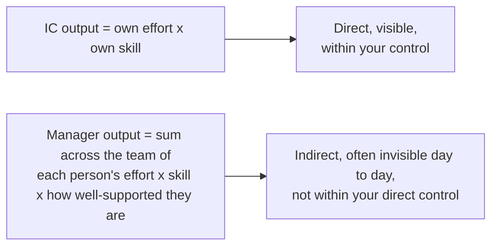
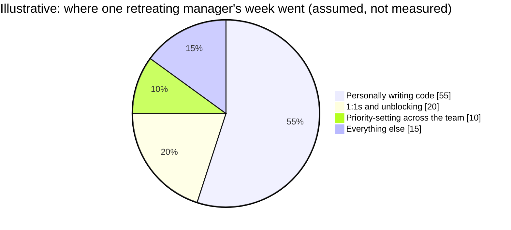
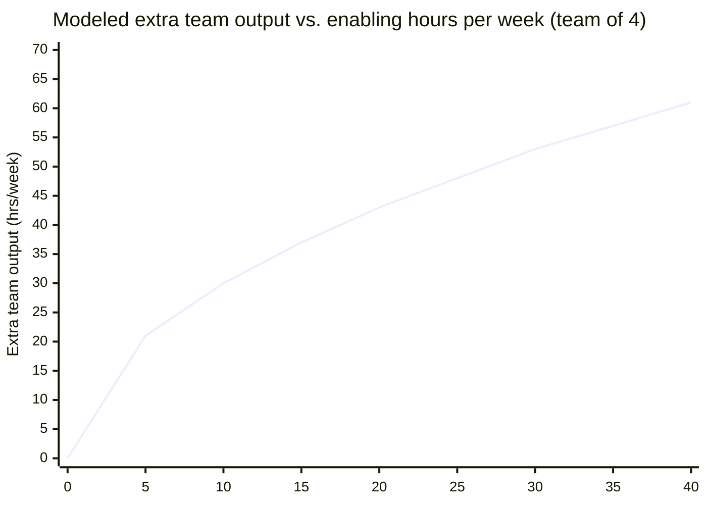

import LevelIntro from "../../../components/LevelIntro.astro";
import Checkpoint from "../../../components/Checkpoint.astro";
import PracticeCheck from "../../../components/PracticeCheck.astro";

export const unit = {
  track: "people-management",
  unitSlug: "ic-excellence-management",
};

L1 named the trap Maya fell into: her personal numbers rose while her team's
clarity and cadence fell. L2 writes out the two output equations behind that,
shows why the pull back to familiar work is so strong, and puts a number on
what an hour of enabling work can buy.

<LevelIntro
  items={[
    "The IC equation vs. the manager equation",
    "Why the retreat pull is so strong",
    "What enabling hours buy, with diminishing returns",
  ]}
/>

## What do the two equations look like?

Maya is still measuring herself against the equation she used as an IC, but
the job underneath her changed. Where does the new equation leave a gap the
old one never had?

The manager equation has a term the IC one does not: **how well-supported each
person is**. Unclear priorities, missing context, a decision only the manager
can make, or an unaddressed skill gap all multiply down every team member's
effective output. Closing those gaps is now the job, even though it produces
no code and no personally attributable output. Maya's two unclear reports are
that missing term showing up as a cost.

<Checkpoint question="Maya's PR count went up after her promotion. Using the manager equation above, why can that number alone not tell you whether she is doing the job well?">

Because the manager equation is not about Maya's own effort and skill at all.
It is the sum, across the whole team, of each person's effort and skill
multiplied by how well-supported they are. Her PR count only measures her own
term from the old IC equation. A high personal number can coexist with two
reports who are unclear on priorities, which is a direct hit to the
"how well-supported" term for those two people. The two numbers answer
different questions, and only one is her scoreboard now.

</Checkpoint>

<PracticeCheck
  track={unit.track}
  unitSlug={unit.unitSlug}
  topicId="output-equation"
/>

## Why is the pull back to familiar work so strong?

If the new equation is better for the team, why does almost every new manager
still drift back to the old one? Picture a day's to-do list: unblock someone
on an ambiguous requirement, hold a hard feedback conversation, work out why a
report seems disengaged, rule between two competing asks from other teams.
Every one is unfamiliar and uncomfortable. Next to that list sits a familiar
alternative: "I'll just write this tricky bit myself, I know exactly how."

The familiar task is genuinely productive and gives fast feedback, which is
what makes it so easy to default to. But each of the unclear tasks is
something _only_ the manager is positioned to do, while the code could have
been written by a strong engineer on the team. Retreating does not merely fail
to help; it withholds capacity the team cannot get anywhere else.

The split above is an assumed example to show the shape of a retreat, not data
from a study.

<PracticeCheck
  track={unit.track}
  unitSlug={unit.unitSlug}
  topicId="retreat-trap"
/>

## Which skills do not carry over 1:1?

Nobody disputes Maya is skilled. If skill is not the missing piece, what
specifically is?

| IC skill (what earned the promotion)        | Manager skill (what the job needs)                                                    | Why it is not the same muscle                                                    |
| ------------------------------------------- | ------------------------------------------------------------------------------------- | -------------------------------------------------------------------------------- |
| Solving a hard technical problem personally | Knowing when to let someone struggle productively instead of solving it for them      | The jump-in-and-fix instinct now works against building the other person's skill |
| Writing clear code                          | Writing clear, actionable feedback on someone else's work                             | Needs framing that lands without demotivating: a different communication skill   |
| Prioritizing your own backlog               | Prioritizing across several people's conflicting, partly visible work                 | Needs visibility and judgment the IC role never demanded                         |
| Being right                                 | Being willing to be wrong in the open so reports feel safe to disagree and take risks | In tension with the IC habit of proving competence by having the answer          |

None of the right-hand skills comes free with the left-hand ones. They have to
be built deliberately, the way the IC skills once were.

<Checkpoint question="A strong IC is promoted and, in week one, rewrites a struggling teammate's pull request instead of leaving comments for the teammate to act on. Which row of the table does this match, and what does it cost even though the PR is now better?">

It matches the first row: solving the problem personally instead of letting
someone work through it. The instinct that made them a strong IC is now working
against the actual goal, because the teammate never has to build the skill of
finding that kind of bug. The PR is better today, but the team's capability
did not grow, and the same category of mistake is likely to return, since the
underlying gap was never closed.

</Checkpoint>

<PracticeCheck
  track={unit.track}
  unitSlug={unit.unitSlug}
  topicId="skill-transfer"
/>

## What should Maya measure instead, and what does an enabling hour buy?

If her PR count is the wrong scoreboard, what should she ask herself at the end
of a week? Not "what did I produce," but "is my team more capable, more
unblocked and clearer on priorities than a month ago, even in areas I did not
touch?" That is slower and harder to answer, which is exactly why the familiar
question quietly replaces it.

The interactive demo on this unit models the trade-off for a 40-hour week.
Its assumed rule: each hour a manager spends enabling the team lifts every
report's output, with diminishing returns (the first hours, clearing obvious
blockers, matter most). For a team of 4, the modeled extra team output:

This is a teaching model, not a measurement. Its shape is the point: the first
5 hours buy about 21 team hours, while the last 5 (35 to 40) buy only about 4.
The better trade is not "all enabling, no hands-on work" but making sure the
early, high-return enabling hours happen before anything else.

L3 walks the same starting team through a month handled both ways.

<PracticeCheck
  track={unit.track}
  unitSlug={unit.unitSlug}
  topicId="right-scoreboard"
/>
