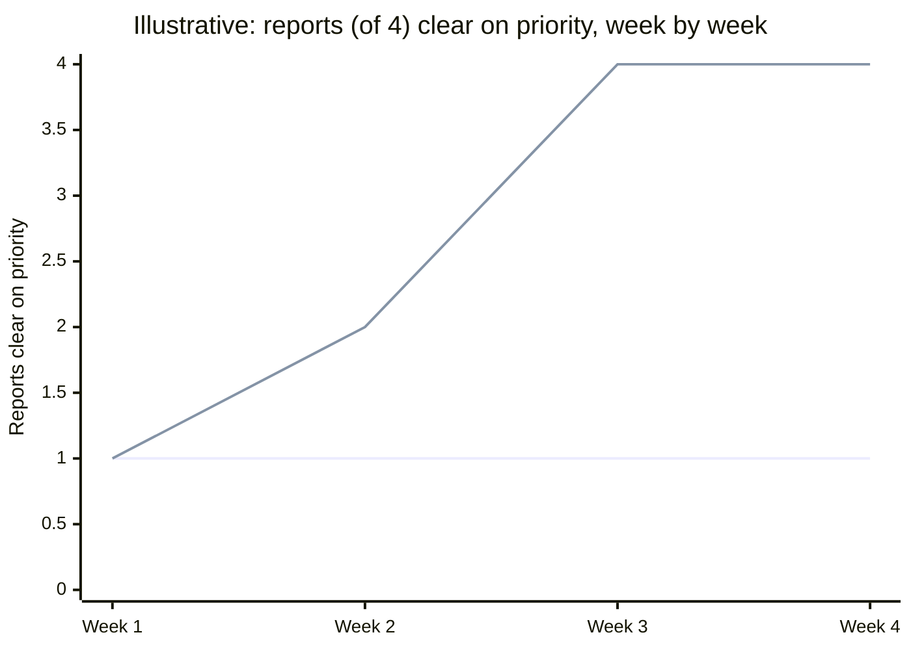

import Scenario from "../../../components/Scenario.astro";
import LevelIntro from "../../../components/LevelIntro.astro";
import Checkpoint from "../../../components/Checkpoint.astro";
import PracticeCheck from "../../../components/PracticeCheck.astro";

export const unit = {
  track: "people-management",
  unitSlug: "ic-excellence-management",
};

<Scenario label="The scenario">
  <Fragment slot="facts">
    

      
👤 Manager: an excellent engineer, just promoted

      
👥 Team: the same 4 people they used to be a peer of

      
❓ An ambiguous new project, no clear owner

      
🧑‍💻 One newer engineer, stuck on the same kind of problem repeatedly

      
📋 A backlog with no agreed priority order

    

    
Two paths, identical starting point

    

      
🅰️ Path A: retreat to familiar IC work

      
🅱️ Path B: do the actual management job

    

  </Fragment>

An excellent engineer is promoted to manage the four-person team they used to
be a peer of. The same starting situation (an ambiguous new project, one
engineer stuck repeatedly, a backlog of unclear priority) produces very
different four-week outcomes depending on where the new manager's time goes.

**Before reading on: both managers are equally skilled and equally hardworking,
facing identical facts. If neither is lazy or incompetent, what could produce
two different outcomes?**

</Scenario>

The same facts can produce different outcomes, depending on which problems the
manager treats as theirs to solve directly.

<LevelIntro
  items={[
    "Week-by-week outcomes of retreat vs. real management",
    "Why the gap hides in any single week",
    "Failure modes that survive the first month",
  ]}
/>

## What does each path look like, week by week?

**Path A: retreating to IC work.**

1. **Week 1.** Unsure how to run a kickoff for the ambiguous project, the
   manager spends the week writing the design doc personally. It is excellent
   and fast, because it is exactly what they were promoted for.
2. **Week 2.** The stuck engineer is still stuck. Debugging it directly takes
   twenty minutes, so the manager does that rather than sitting with the
   engineer to build the underlying skill.
3. **Week 3.** Priorities stay unclear, because clarifying them means
   uncomfortable conversations with other teams. The manager picks up more of
   the technical backlog instead.
4. **Week 4 outcome.** The doc is excellent. The engineer was "unblocked" three
   times without the gap closing, and privately feels not trusted to work it
   out. The rest of the team makes private guesses about priorities that do not
   agree. The manager produced a lot of good work; the team is no more capable
   or clear than a month ago.

**Path B: doing the actual job.**

1. **Week 1.** A kickoff meeting surfaces and resolves the ambiguity as a
   team. The manager contributes judgment but does not write the doc; an
   experienced engineer on the team does, with the manager reviewing and coaching.
2. **Week 2.** Seeing the engineer stuck, the manager sits with them, asks
   questions instead of supplying the answer, and helps them find the fix. It
   is slower this week, but the same class of problem does not return.
3. **Week 3.** The manager has the cross-team conversations, then shares one
   ranked priority list: work only the manager has the standing to do.
4. **Week 4 outcome.** No design doc carries the manager's name and they
   shipped less code than almost anyone. But the engineer solved two similar
   problems alone, the engineer who wrote the doc grew, and everyone works from
   one list.

<Checkpoint question="A colleague who looks only at Path B's manager's personal output for the month (docs written, code shipped) concludes it was a quiet, low-output month. Why is that read wrong, and what would you look at instead?">

It is still applying the IC scoreboard to a job whose output is the team's. By
that scoreboard Path B really does look weaker, since Path A has a doc and a
month of shipped code to point to. The things to look at instead are on the
team: whether the stuck engineer can now solve that class of problem alone,
whether the engineer who wrote the doc grew, and whether the team works from
one shared list instead of four guesses. All three happened because the
manager's time went to enabling them, and the gain is attributed to the team,
which is the shift L1 and L2 describe.

</Checkpoint>

| Week | Path A's time went to                    | Path B's time went to                                   | What that bought or cost the team                           |
| ---- | ---------------------------------------- | ------------------------------------------------------- | ----------------------------------------------------------- |
| 1    | Personally writing the design doc        | Running a kickoff; coaching a teammate to write the doc | Path B: a report grew, and the doc still shipped            |
| 2    | Fixing the stuck engineer's bug directly | Sitting with the engineer to find the fix together      | Path A: the bug class recurs; Path B: the gap closes        |
| 3    | More personal backlog work               | Cross-team priority conversations                       | Path A: team still guessing; Path B: one shared ranked list |
| 4    | Personal output high, team clarity flat  | Personal output low, team capability and clarity up     | The trade Path A never noticed making                       |

The two lines are illustrative values chosen to show the trajectories (flat
vs. rising), not measurements. Everything each manager did individually was
done well; what differed was which problems they treated as theirs to solve
versus theirs to enable someone else to solve. That is invisible in any single
week's activity log and only visible in the trajectory.

<PracticeCheck
  track={unit.track}
  unitSlug={unit.unitSlug}
  topicId="two-paths"
/>

## Which failure modes survive past month one?

Suppose the manager follows Path B for a year. Is the retreat pull gone? Not
necessarily, and several other traps remain.

| Failure                                                | What it looks like                                                                                   | Why it fails                                                                              |
| ------------------------------------------------------ | ---------------------------------------------------------------------------------------------------- | ----------------------------------------------------------------------------------------- |
| Judging a new manager's week by IC standards           | Path B's manager shows less visible individual work every single week, so Path A scores higher       | Without deliberately reframing the measure, the transition is hard to self-correct        |
| Over-correcting to never doing technical work          | The manager loses touch with the technical work and with the credibility and judgment the role needs | The shift is in the default under ambiguity (delegate and coach first), not a total ban   |
| Treating the retreat as a one-time first-month slip    | Every future moment of uncertainty recreates the same pull toward familiar work                      | It is a standing discipline to maintain, not a phase that is grown out of                 |
| Promoting someone as a reward, with no new-job framing | The new manager was never taught the Path B skills before getting the role                           | Set up to fail by the implicit message that promotion equals recognition of IC excellence |

<Checkpoint question="A manager who followed Path B for a full year decides they are now past the retreat risk and stops watching for it. Using the failure modes above, is that safe?">

No. One failure mode is treating the retreat as a one-time first-month mistake
when it is a recurring pull. The comfort of familiar, fast-feedback work does
not disappear once someone has resisted it for a while. Every new moment of
ambiguity (a new team, a harder political conflict, an unfamiliar kind of
underperformance) recreates the same pull, however long ago they last gave in
to it. Treating it as solved is what lets it resurface unnoticed.

</Checkpoint>

<PracticeCheck
  track={unit.track}
  unitSlug={unit.unitSlug}
  topicId="failure-modes"
/>

## Beyond this example

  🧑‍💻 This four-person, four-week case
  &rarr;
  
    🧑‍💼 The unclear-versus-familiar trade-off on your own plate this week
  

This team and this month are one case, not the whole territory. Questions to
test whether the model transferred, not just this scenario:

- What changes about Path B's Week 3 if the priority conflict is with a peer
  manager who outranks this one politically? Does "have the uncomfortable
  conversation" still hold, or does the manager need to build trust and
  standing first?
- Suppose the stuck engineer in Path B still has not closed the gap by Week 4
  despite the coaching. What would the manager need to notice, and by when, to
  avoid sliding into a fifth week of an approach that is not working for this
  person?
- Name one task on your plate that only you can do (it depends on your
  context, authority or relationships) and one that is familiar and
  comfortable but someone else could plausibly do. Which got more of your time
  this week, and does that match which one only you could do?
