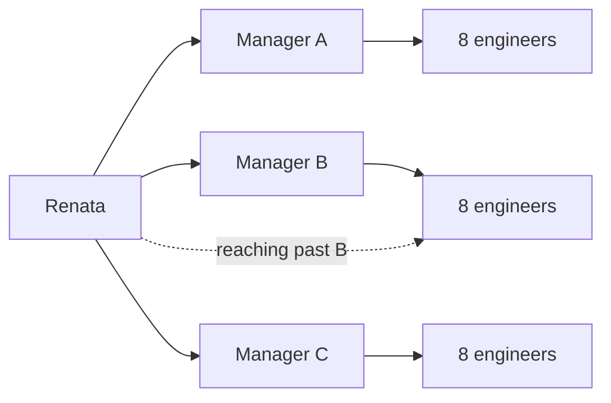

import Scenario from "../../../components/Scenario.astro";
import LevelIntro from "../../../components/LevelIntro.astro";
import PracticeCheck from "../../../components/PracticeCheck.astro";

export const unit = {
  track: "people-management",
  unitSlug: "management-managers",
};

<Scenario label="Renata was promoted over three managers, and her best habit just backfired">
  <Fragment slot="facts">
    

      

        

          Engineers Renata can reach directly
          0 of 24
        

        

          

        

      

      
📈 <strong>Promotion</strong>: from managing 8 engineers to leading 3 managers who run 24

      
🕹️ <strong>Old habit</strong>: she jumps into an engineer's Slack thread and unblocks them herself

      
😬 <strong>Result</strong>: the engineer's manager hears about it from the engineer, and starts second-guessing her

    

  </Fragment>

Renata was an excellent manager of eight engineers. She always knew who was
blocked, and she could unblock almost anyone in five minutes. She has just
been promoted to director over three managers, who between them run twenty-four
engineers.

In her first week she sees an engineer stuck, jumps into the thread, and fixes
it. The engineer is grateful. The engineer's manager learns about it from the
engineer, not from Renata, and starts quietly re-checking every decision
Renata makes about that team.

**The habit that made Renata great one layer down just damaged a working
relationship. What did it get wrong?**

</Scenario>

The habit itself was fine: unblocking people fast is good management. What
broke is the **layer** it ran on. Renata acted as if she still managed the
engineer directly, but she now manages the engineer's manager. Each time she
reaches past that manager, she is not only solving one ticket. She is telling
the manager, whether she means to or not, "I do not trust you to run your own
team."

<LevelIntro
  items={[
    "Managing through a layer",
    "Why her decisions arrive changed",
    "Culture set on purpose, not by default",
  ]}
/>

## What actually changed when Renata was promoted?

| Before the promotion                       | After the promotion                                       |
| ------------------------------------------ | --------------------------------------------------------- |
| 8 engineers report to her                  | 3 managers report to her                                  |
| She sees each outcome and can act on it    | Each outcome is produced by a manager's decisions         |
| Her speed at unblocking is the lever       | A manager's capability is the lever                       |
| Her words reach an engineer as she said it | Her words reach an engineer after a manager reshapes them |

Renata influences 24 engineers, but only through three people. The solid
arrows are the relationships she can invest in. The dotted arrow exists too,
and every use of it weakens the solid line next to it.

## Key terms

- **Management of managers**: leading a team made of managers. Your job is to
  make each manager better at running their team, not to run it for them.
- **Second-order leadership**: your decisions reach an engineer only after a
  manager has interpreted and adapted them. What lands is never exactly what
  you said.
- **Reaching past a manager**: directing, correcting or praising someone on
  another manager's team without that manager in the loop. It is damaging even
  when well meant.
- **Culture at scale**: the norms for feedback, incident reviews and
  calibration that you must set deliberately, because you will never be in
  most of the rooms where they are applied.

<PracticeCheck
  track={unit.track}
  unitSlug={unit.unitSlug}
  topicId="managing-through-a-layer"
/>

## Why culture gets set on purpose

If Renata says nothing, each of the three managers runs retros, reviews and
calibration the way they learned elsewhere. Nobody notices until one team
feels treated differently from its neighbor. One explicit, shared standard
costs one conversation. Fragmentation costs far more to repair later.

## What the rest of the unit covers

L2 works out how Renata coaches a struggling manager instead of fixing the
problem for them, and how culture gets set across teams she does not touch.
L3 follows her first quarter: one struggling manager, two teams whose
priorities collide, and three managers who each run calibration differently.
