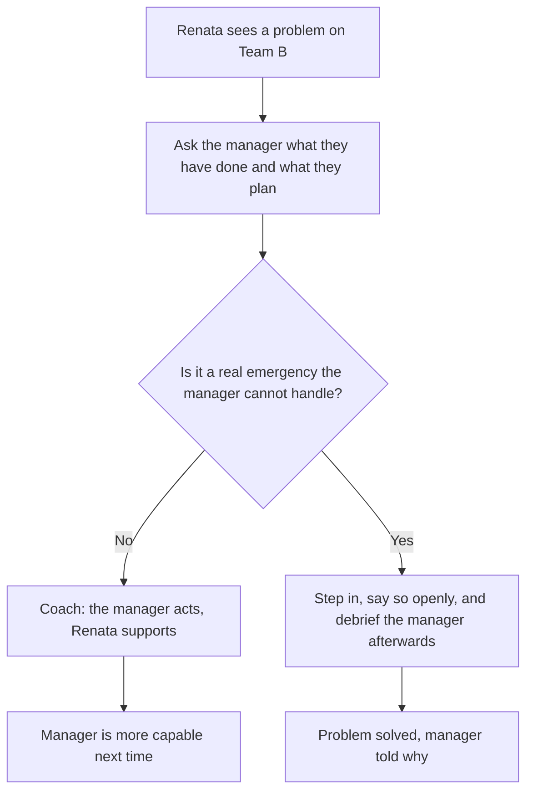

import LevelIntro from "../../../components/LevelIntro.astro";
import Checkpoint from "../../../components/Checkpoint.astro";
import PracticeCheck from "../../../components/PracticeCheck.astro";

export const unit = {
  track: "people-management",
  unitSlug: "management-managers",
};

L1 named the shift: Renata now manages the managers, and everything she does
reaches an engineer after another person has interpreted it. L2 works out what
that means for how she helps a struggling manager and how she shapes teams she
rarely sees.

<LevelIntro
  items={[
    "Coaching versus fixing",
    "When stepping in directly is right",
    "Standards that set culture at scale",
  ]}
/>

## If Renata can see the fix, why not just make it?

**Team B has missed its sprint commitment two sprints running. Renata knows
what she would do. Why shouldn't she run Team B's next planning session
herself?** It solves this sprint. But the manager learns nothing, and Team B
sees that their manager does not really run the team when it matters. Renata
cannot personally fix every team anyway, so her only durable leverage is
making each manager more capable.

| Situation                                | Fixing it directly                     | Coaching the manager                                                              |
| ---------------------------------------- | -------------------------------------- | --------------------------------------------------------------------------------- |
| A report is missing expectations         | Renata talks to the report herself     | Renata asks what the manager has already said, then plans the next talk with them |
| Two engineers on a team are in conflict  | Renata mediates it personally          | Renata asks how the manager plans to handle it and helps shape that plan          |
| A manager's 1:1s are pure status updates | Renata sits in and models a better 1:1 | Renata asks what the manager wants from 1:1s and works on the gap                 |

<Checkpoint question="A manager says in a 1:1: 'Honestly, it would be faster if you just told me what to do.' Is agreeing the same kind of move as the Slack-thread rescue in L1?">

Yes. Both swap Renata's judgment in for the manager's at the exact moment the
manager was supposed to be building their own. It is faster in the narrow
sense that the problem gets solved sooner. But each time she answers the
request directly, she trades a few minutes now for a manager who returns with
the same request next time. Working the problem through with them is slower
today and cheaper every time after.

</Checkpoint>

## Is fixing it directly ever the right call?

**If coaching is the default, is it also the rule?** No. A true emergency, such
as a safety issue or something that puts the whole company at risk, can justify
Renata acting directly, because the manager cannot be expected to handle it
alone. Two things keep that honest: she tells the manager before or right after
she acts, and she goes back over it with them. The failure on the other side is
**abdication**: leaving a manager to sink alone and calling it coaching.
Coaching still means Renata knows what is happening on each team.

<PracticeCheck
  track={unit.track}
  unitSlug={unit.unitSlug}
  topicId="coaching-vs-fixing"
/>

## How does culture get set in rooms Renata never enters?

**Renata will rarely attend Team A, B or C's retros, reviews or calibration
sessions. How can she influence them?** Not by attending. By naming a small
number of explicit standards every manager is expected to apply, and then
checking outcomes rather than watching process. Without that, each manager
defaults to what they learned before, and three managers quietly produce three
meanings of "meets expectations."

| What Renata decides once, explicitly         | What goes wrong if she does not                         |
| -------------------------------------------- | ------------------------------------------------------- |
| What every calibration write-up must contain | Ratings rest on very different amounts of evidence      |
| What "blameless" means in a postmortem       | One team learns from incidents, another hunts for fault |
| What she reviews across all three teams      | Drift is noticed only when someone complains            |

<Checkpoint question="Renata hires three strong, experienced managers and tells them to run their teams as they see best. Why does that still tend to produce three different cultures?">

Strong managers each bring the habits of wherever they learned to manage, and
those habits differ. "Run it as you see best" leaves every choice to that
default. Good intent does not create consistency. A shared standard has to be
named by someone above them, because no individual manager can see that three
teams have drifted apart.

</Checkpoint>

A standard that is announced once and never checked drifts back within a cycle
or two. The standard needs a visible follow-up, such as Renata reading a
sample of write-ups each cycle.

<PracticeCheck
  track={unit.track}
  unitSlug={unit.unitSlug}
  topicId="culture-at-scale"
/>
