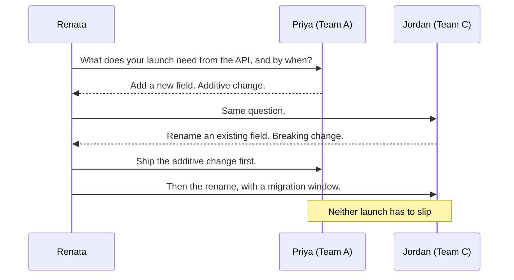

import Scenario from "../../../components/Scenario.astro";
import LevelIntro from "../../../components/LevelIntro.astro";
import Checkpoint from "../../../components/Checkpoint.astro";
import PracticeCheck from "../../../components/PracticeCheck.astro";

export const unit = {
  track: "people-management",
  unitSlug: "management-managers",
};

<Scenario label="Week nine: two launches, one shared API, and nobody who can see both">
  <Fragment slot="facts">
    

      
🅰️ <strong>Team A (Priya)</strong>: adds a new field to the shared API

      
🅲 <strong>Team C (Jordan)</strong>: renames an existing field in the same API

      
👀 <strong>Who can see both?</strong> Only Renata, found out by accident

    

  </Fragment>

Renata overhears in a hallway that Team A and Team C both think the shared
internal API is theirs to change first, for two different launches. Priya and
Jordan have never discussed it. Each has told their engineers to move fast.

**Renata could rule on which launch matters more in five minutes. What would
that quick ruling cost her beyond this one conflict?**

</Scenario>

L2 gave the model: Renata's leverage is the managers, she coaches rather than
fixes, and she sets explicit standards. This level tests it on three situations
in her first quarter.

<LevelIntro
  items={[
    "Coaching a manager through one report",
    "Resolving a collision between two teams",
    "One calibration standard for three managers",
  ]}
/>

## Situation 1: a manager who is handling a report badly

Six weeks in, Renata notices Marcus, an engineer on Team B, has missed two
deadlines. **Her old instinct is to pull Marcus into a 1:1. Why is that the
wrong first move?** Marcus's manager, Diego, is accountable for him. Going to
Marcus first repeats the L1 mistake: a faster answer for Renata, and a message
to Diego that she does not trust him.

She starts with Diego instead.

> Renata: "Marcus has missed the last two deadlines. What have you already said
> to him?"
>
> Diego: "I mentioned it once, in passing, in our last 1:1. He is usually solid."
>
> Renata: "What did you say, as close to word for word as you remember?"
>
> Diego: "Something like 'let's try to keep deadlines a bit tighter.'"

Marcus would hear that as ordinary encouragement, not as a pattern that
matters. Renata does not talk to Marcus. She spends fifteen minutes with Diego
drafting what he will say: name the two misses, say what must change, and by
when. Marcus hears it from his own manager, and Diego has practiced a hard
conversation instead of having it taken from him.

<Checkpoint question="Two weeks later Marcus has not improved and Diego is still unsure. Should Renata now take the conversation with Marcus herself?">

Not by default. Diego's uncertainty at two weeks is exactly the kind of
ongoing support coaching is for. Closer help is the right escalation: sit in as
an observer while Diego leads, review his plan and timeline together, or share a
similar case she has seen. Taking over would still bypass Diego. The exception
is a situation that stops being a coaching problem and puts people or the
company at real risk that Diego cannot be expected to handle.

</Checkpoint>

## Situation 2: two teams, one shared API

**Why does this collision surface at Renata's level and not Priya's or
Jordan's?** Neither manager can see what the other team has committed to. The
cross-team view is the thing Renata has and they individually lack, so catching
it is her job, not evidence that either of them failed.

| Approach                                    | What it gives this time         | What it costs afterward                                                   |
| ------------------------------------------- | ------------------------------- | ------------------------------------------------------------------------- |
| Renata picks a winner                       | A fast, clear answer today      | Managers learn to escalate cross-team conflicts instead of resolving them |
| Renata convenes both and asks for the facts | A slower answer, a real meeting | Both practice resolving it together and raise the next one earlier        |

She convenes both and asks each to lay out what their launch needs from the
API and by when, not "which launch matters more."

The real answer lived in the technical shape of the two changes: one additive,
one breaking. Sequencing them removed the conflict. A ruling on "whose priority
wins" would have picked a winner without ever discovering there was nothing to
rule on. The move is the same as `mediation`: get both real positions into one
room before anyone proposes a fix. What differs is who is in conflict. Here it
is two teams, represented by their managers, over a shared dependency.

<PracticeCheck
  track={unit.track}
  unitSlug={unit.unitSlug}
  topicId="cross-team-conflict"
/>

## Situation 3: three managers, three calibration formats

At the end of the quarter Renata reads the calibration write-ups. Diego writes a
narrative paragraph per person. Priya uses a rubric with specific examples.
Jordan writes one or two sentences and a rating.

**Is this a personality quirk to leave alone?** No, and it is not anyone's
fault. Without a shared standard, each manager defaults to what they learned
before, so the same rating rests on very different evidence. Renata does not
rewrite their write-ups. She publishes one standard before the next cycle.

| Requirement                                                                                    | The failure it prevents                                   |
| ---------------------------------------------------------------------------------------------- | --------------------------------------------------------- |
| At least two specific, dated examples per rated competency                                     | Ratings built on general impressions                      |
| A comparison to the written bar for the role, not just to peers                                | Ratings that only rank teammates against each other       |
| For any below-expectations rating, a note on whether the person has already been told directly | A below-bar rating that comes as a surprise to the person |

The third requirement matters at this scale because Renata cannot personally
confirm that every below-bar rating was communicated beforehand. Making the
standard force that fact into writing every cycle surfaces what she could not
otherwise see.

<Checkpoint question="Renata publishes the standard, and the next cycle's write-ups look identical in format to the old ones. What did she skip?">

The follow-up. A standard that is only announced drifts back to whatever each
manager did before. Renata needs a visible check each cycle, such as reading a
sample of write-ups against the three requirements and giving the managers
feedback on them. Naming the standard is half the work; verifying it is what
makes it real.

</Checkpoint>

<PracticeCheck
  track={unit.track}
  unitSlug={unit.unitSlug}
  topicId="calibration-standard"
/>

## Where the model strains

| Failure mode                                           | What it gets wrong                                                 |
| ------------------------------------------------------ | ------------------------------------------------------------------ |
| Reaching past a manager to fix a report's problem      | Solves one instance and signals distrust                           |
| Deciding every cross-team conflict herself             | Teaches managers to escalate instead of resolving sideways         |
| Letting each manager keep their own calibration format | Good intent does not substitute for a stated shared bar            |
| Refusing ever to step in, even in a real emergency     | Leaves a manager unsupported exactly when direct help is warranted |
| Announcing a standard and never checking it            | It drifts back within a cycle or two                               |

## This is a case, not the whole territory

Renata's three situations share one discipline: work through the manager, do
not substitute your judgment for theirs by default, and make standards
explicit. The tactics differ each time: coach the conversation, convene the two
managers, publish one standard. The test for any new situation is whether she
is still working through the manager layer or has slipped back into managing at
the old altitude.

**Try extending it yourself.** Suppose Jordan's ratings were consistently one
whole rating band more generous than Priya's and Diego's for comparable work.
That is not a documentation problem but a bar problem. Would "publish one
standard and check it" still be the right first move, or does it need a direct
conversation with Jordan alongside the shared fix? And what changes if Jordan
were new to managing versus a veteran?
