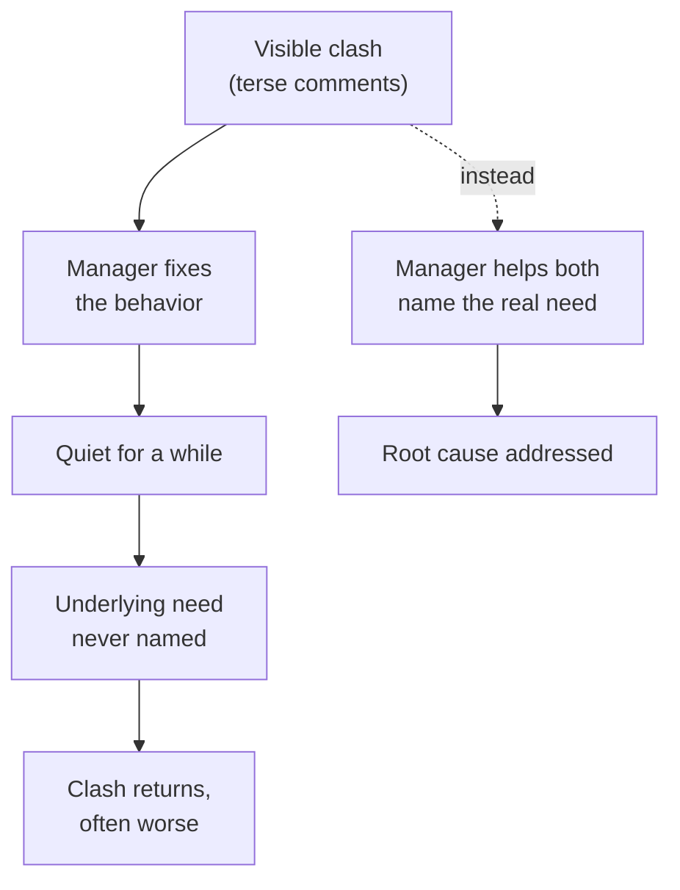

import Scenario from "../../../components/Scenario.astro";
import LevelIntro from "../../../components/LevelIntro.astro";
import PracticeCheck from "../../../components/PracticeCheck.astro";

export const unit = {
  track: "people-management",
  unitSlug: "mediation",
};

<Scenario label="The problem">
  <Fragment slot="facts">
    

      
💥 <strong>Visible</strong>: Priya and Devon clash in code review, in front of the whole team

      
🩹 <strong>First fix</strong>: Sam posts "please be more respectful of each other's time"

      
🔁 <strong>Result</strong>: about 1 week of calm, then the same pattern, worse

    

    

      

        6 weeks of friction
        1 week of relief
      

      

        

      

    

  </Fragment>

Sam manages a small engineering team. Two of its engineers, Priya and Devon,
have spent six weeks clashing in code review: terse comments, changes
re-requested, visible tension in team meetings. Neither is generally hard to
work with. Sam posted a message asking both to "be more respectful of each
other's time." It worked for about a week. Then the same pattern came back,
worse.

**What did the message miss, and why does the clash keep returning?**

</Scenario>

The message aimed at the _tone_ of the comments. But two capable people do not
collide for six weeks over tone; tone is where something else becomes
visible. Fix only the visible layer and the thing underneath simply waits for
the next stressful review.

<LevelIntro
  items={[
    "Why a surface fix wears off",
    "Positions versus interests",
    "What a neutral mediator does",
  ]}
/>

## Why did the polite reminder wear off?

**If the reminder worked for a week, why not send another one?** Because it
treated the symptom as the cause.

- **Surface fix:** an instruction aimed at the visible behavior ("be nicer,"
  "follow the style guide," "compromise on this one"). It can quiet things for
  a while.
- **Root cause:** the unmet need that makes the behavior happen. Until it is
  named, the behavior has a reason to return.
- A repeated fix also adds a cost: both people now feel unheard as well as
  irritated, so the second flare-up is usually worse than the first.

<PracticeCheck
  track={unit.track}
  unitSlug={unit.unitSlug}
  topicId="surface-fix-recurs"
/>

## What is each person actually asking for?

**Ask Priya what is wrong and she says "Devon nitpicks everything." Is that
the problem, or something the problem is wearing?**

- **Position:** what a person says they want or object to ("stop leaving so
  many small comments").
- **Interest:** the reason behind the position ("when every choice I made gets
  questioned, it feels like my judgment is not trusted").
- People argue about positions. The conflict is usually about interests.
- **Mediation** is helping two people work through a conflict without the
  mediator picking a side or handing down a solution. The mediator stays
  **neutral**: no blame, no verdict, no solution proposed first. The job is
  structuring a conversation in which both people can say what they actually
  need.

| Term       | Simple meaning                                                  |
| ---------- | --------------------------------------------------------------- |
| Position   | What someone says they want ("stop nitpicking")                 |
| Interest   | Why they want it ("I need my judgment to be trusted")           |
| Neutrality | Taking no side, assigning no blame, proposing no solution first |
| Root cause | The unmet need underneath the specific incidents                |

<PracticeCheck
  track={unit.track}
  unitSlug={unit.unitSlug}
  topicId="position-interest"
/>
