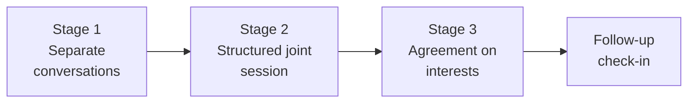

import Scenario from "../../../components/Scenario.astro";
import LevelIntro from "../../../components/LevelIntro.astro";
import Checkpoint from "../../../components/Checkpoint.astro";
import PracticeCheck from "../../../components/PracticeCheck.astro";

export const unit = {
  track: "people-management",
  unitSlug: "mediation",
};

<Scenario label="The scenario">
  <Fragment slot="facts">
    

      
1️⃣ Sam meets Priya alone, then Devon alone

      
2️⃣ One joint session: each states an interest, the other listens

      
3️⃣ An agreement that answers each interest, then a follow-up check-in

    

  </Fragment>

Sam has learned that the polite reminder was a surface fix. Priya and Devon
are still clashing, and putting them in a room to "talk it out" would most
likely replay the same argument with an audience. **What sequence gives each of
them a real chance to say what they need, and an agreement that outlasts the
next stressful review?**

</Scenario>

L2 set up the pieces: positions versus interests, the mirror-image pattern, and
the neutral behaviors. L3 runs the whole mediation end to end.

<LevelIntro
  items={[
    "Private conversations that surface real interests",
    "A joint session that avoids re-arguing positions",
    "An agreement that answers interests, not comment counts",
  ]}
/>

## Stage 1: why talk to each person alone first?

Neither person is likely to say a real interest out loud, cold, in front of the
other. So Sam meets each one privately, not to gather ammunition but to hear
the interest without an audience.

**With Priya:**

> Sam: "Walk me through what's been happening in reviews with Devon."
>
> Priya: "He leaves five comments on things that don't matter, like variable
> names. It feels like he's looking for reasons to slow me down."
>
> Sam: "What would it mean if that were true?"
>
> Priya: _(pause)_ "Honestly? It would mean he doesn't think I know what I'm
> doing. And I designed half the service he's commenting on."

**With Devon:**

> Sam: "Same question. Walk me through what's been happening with Priya."
>
> Devon: "I leave a comment and she pushes back immediately, or says 'that's
> a style preference.' Most of my comments are real edge cases."
>
> Sam: "What does it feel like when she responds that way?"
>
> Devon: "Like my review doesn't count. I read the diff carefully and it gets
> waved off in one line."

**Before reading on: what does each "what would it mean" answer reveal that the
opening complaint did not?** Priya's "nitpicking" is a position about Devon's
behavior; her deeper answer is the interest, feeling her competence is not
respected. Devon's "she dismisses real issues" is also a position; his deeper
answer, "my review doesn't count," is the mirror-image interest.

<PracticeCheck
  track={unit.track}
  unitSlug={unit.unitSlug}
  topicId="private-first"
/>

## Stage 2: what does the joint session look like?

Sam does not say "talk it out." Each person states their interest, not their
position, while the other listens without responding. Then they switch.

> Sam: "Priya, tell Devon what it feels like on your end when a PR gets a lot
> of comments. Not the comments themselves, just what it feels like."
>
> Priya: "It feels like you don't trust my design decisions."
>
> Sam: "Devon, don't respond yet. Now the same for you: what does it feel like
> when your comments get waved off?"
>
> Devon: "Like the time I spend reviewing carefully doesn't matter to you."

Neither had to concede that their position was wrong. And because Sam had
already heard both privately, the mirror image became visible to Priya and
Devon themselves, in the room together.

> Devon: "I didn't think you felt that way. I think you're a strong engineer.
> I just comment on everything, that's how I review."
>
> Priya: "I didn't realize the pushback felt like dismissal. I've gotten used
> to defending decisions by default."

<Checkpoint question="Sam already heard both interests privately. Why not just tell each of them the other's interest instead of having them say it face to face?">

The point is not only that Sam knows both interests; it is that Priya and
Devon hear each other say it, in their own words. If Sam reported "Devon says
his reviews feel like they don't count," Priya could discount it as Sam's
interpretation or as something said to look reasonable. Hearing Devon say it
himself, right after she said her own piece and had to sit with it unanswered,
makes the recognition land as real instead of asserted on someone's behalf.

</Checkpoint>

<PracticeCheck
  track={unit.track}
  unitSlug={unit.unitSlug}
  topicId="joint-session"
/>

## Stage 3: what agreement is likely to hold?

"Devon will comment less" and "Priya will push back less" would only be new
positions. Instead each change answers the interest the other person named:

| Interest named           | Change that answers it                                                          |
| ------------------------ | ------------------------------------------------------------------------------- |
| Priya: trust my judgment | Devon marks each comment "must address" or "just a thought, your call"          |
| Devon: my review counts  | Priya replies with her reasoning, not a one-line dismissal, even when confident |

Both changes are small. They are likely to stick not because they are clever
but because each directly answers what the other person actually said. Sam
then books a short follow-up check-in, because a calmer room shows the
interests were heard, not that the changes will hold under pressure.

<Checkpoint question="Suppose Sam had proposed 'Devon, at most two comments per PR; Priya, reply to every comment within a day.' More or less likely to hold, and why?">

Less likely. It is a rule about position-level behavior, count and speed,
rather than the interest underneath. Devon can stay under two comments while
those two still read as a verdict on Priya's judgment. Priya can reply within a
day with the same one-line dismissal. The rule can be followed to the letter
while the feeling that started the conflict is fully intact, which is exactly
the surface fix that recurs.

</Checkpoint>

<PracticeCheck
  track={unit.track}
  unitSlug={unit.unitSlug}
  topicId="interest-resolution"
/>

## What does this one case not prove?

The _structure_ generalizes: separate conversations first, then a joint session
where each person states an interest. The _finding_ does not. A mirror-image
competence conflict is one case, not the whole territory. Sometimes one
person's interest is legitimate and the other's stated position really is the
core problem, and that has to be addressed directly rather than compromised
around. The mediator's job is to find out which situation is in front of them.

**Try extending it.** Suppose Sam's private conversations had shown that
Devon's comments really were mostly personal style preference and Priya's
pushback was a reasonable response. Would the joint-session structure still be
the right tool? What if the clash were between a manager and their report, so
Sam could not claim to be neutral? What if only one of the two would agree to
a joint session at all?

| Failure mode                                             | What it gets wrong                                                                   |
| -------------------------------------------------------- | ------------------------------------------------------------------------------------ |
| Skipping private conversations                           | Neither person states a real interest cold, so the argument replays with an audience |
| Letting the joint session stay at the position level     | The mirror-image interest never surfaces                                             |
| Proposing the resolution before both interests are named | Solves a problem nobody has explained yet                                            |
| Assuming every conflict is a symmetric misunderstanding  | A legitimate one-sided grievance goes unaddressed                                    |
| Declaring success once the room feels calmer             | Calm is not proof the changes hold; a follow-up check-in is                          |

<PracticeCheck
  track={unit.track}
  unitSlug={unit.unitSlug}
  topicId="one-sided-case"
/>
