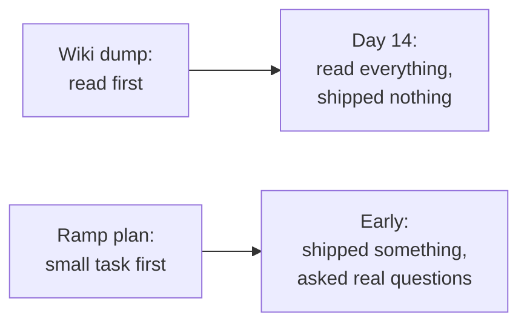

import Scenario from "../../../components/Scenario.astro";
import LevelIntro from "../../../components/LevelIntro.astro";
import PracticeCheck from "../../../components/PracticeCheck.astro";

export const unit = {
  track: "people-management",
  unitSlug: "onboarding-design",
};

<Scenario label="The problem">
  <Fragment slot="facts">
    

      

        0 shipped
        after 14 days, 40 pages read
      

      

        

      

    

    

      
📚 Day 1: a 40-page wiki and "read this, then we talk in two weeks"

      
✅ Day 14: everything read, exactly as asked

      
❓ Day 14: nothing shipped, no idea who owns what

    

  </Fragment>

A manager hands a new hire, Tomas, a 40-page internal wiki on day one and
says "read this, then let's talk in two weeks." Two weeks later, at the
check-in, Tomas has not shipped a single change and cannot say who owns which
part of the system. He read every page he was given. Nothing about the plan
was lazy or careless.

**Why did someone who did exactly what was asked end up this far behind?**

</Scenario>

Notice that the plan did not fail from too little effort on either side. It
failed from how the work was ordered: reading first, doing later.

<LevelIntro
  items={[
    "Why a document dump and no guidance are one mistake",
    "What a ramp plan puts in their place",
    "A signal that shows whether it is working",
  ]}
/>

## Is "too much to read" a different problem from "no guidance at all"?

**A manager who says "just look around and ask questions" and a manager who
sends 40 pages seem to be opposites. Are they?** They share one root cause:
both hand over a pile of unstructured material and leave the new hire to guess
what matters right now. Neither ties any of it to something they are actually
doing.

| Approach            | What the new hire gets                      | Why it stalls                                   |
| ------------------- | ------------------------------------------- | ----------------------------------------------- |
| Information dump    | Everything, before touching work            | Nothing is anchored to a task, so little sticks |
| "Look around, ask"  | Nothing concrete to start with              | No way to tell which questions matter first     |
| Ramp plan (the fix) | A small real task plus the context it needs | Context arrives when it is used, so it sticks   |

- **Onboarding** is the process of getting someone new productive in a role. It
  is a design problem, not a handover of documents.
- **Cognitive overload** is what happens when too much unanchored information
  arrives at once: little is retained because none of it connects to current
  work.
- A **ramp plan** is a sequence of increasingly larger tasks that builds a new
  hire's context gradually, instead of requiring all of it up front.

<PracticeCheck
  track={unit.track}
  unitSlug={unit.unitSlug}
  topicId="same-root-cause"
/>

## How do you know the plan is working?

**Tomas "covered" 100% of the assigned material. Was the onboarding going
well?** Coverage measures what he was given, not what he can do. A better
signal is **time-to-first-contribution**: how long until a new hire ships
something real, however small.

- Coverage can be 100% while time-to-first-contribution is still undefined.
- A **buddy** (a teammate who is not the manager) gives the new hire somewhere
  to take two-minute questions without booking a meeting.
- Time-to-first-contribution says whether the plan is working. It does not
  say why, which is what L2 takes apart.

<PracticeCheck
  track={unit.track}
  unitSlug={unit.unitSlug}
  topicId="ttfc-signal"
/>
