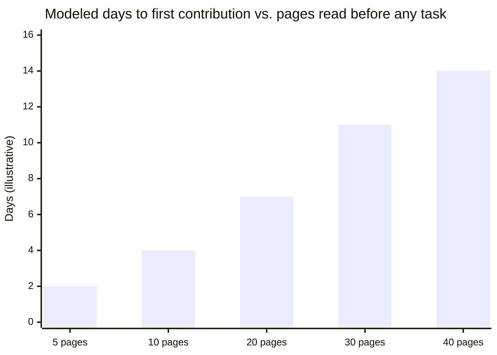
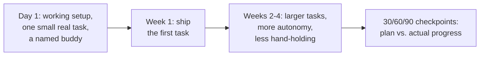

import LevelIntro from "../../../components/LevelIntro.astro";
import Checkpoint from "../../../components/Checkpoint.astro";
import PracticeCheck from "../../../components/PracticeCheck.astro";

export const unit = {
  track: "people-management",
  unitSlug: "onboarding-design",
};

L1 showed Tomas finishing a 40-page wiki and shipping nothing. L2 works out
the mechanism: why that ordering stalls people, what a ramp plan puts in each
stage instead, and who handles the small questions in between.

<LevelIntro
  items={[
    "How the size of an upfront dump delays the first contribution",
    "What a ramp plan sequences from day 1 to the checkpoint",
    "Why small questions go to a buddy, not the manager",
  ]}
/>

## Why does more upfront reading push the first contribution later?

**If Tomas had been given 10 pages instead of 40, would he have shipped
sooner?** Only if the 10 pages were not still a read-everything-first
assignment. The interactive demo on this unit models one simple relationship:
the more context a new hire must absorb before any task, the later the first
real contribution. The unit's modeled rate is 0.35 days of delay per page, which
reproduces Tomas's 14 days at 40 pages.

This is a teaching model, not a measurement of any real team. The shape is the
point: reading first buys delay, and cutting the pages only shrinks the delay.
Moving the reading behind a task removes it.

<Checkpoint question="A manager trims the wiki from 40 pages to 10 but keeps 'read this, then we talk in two weeks'. Does that fix the root cause?">

No. Cutting length shortens the delay but keeps the sequence: reading first,
doing later. The pages still have no task to attach to, so the new hire still
stores material with no immediate use and still has no early signal of whether
they are on the right track. The fix is changing the order, so the context a
person reads is the context their current task needs.

</Checkpoint>

## What does a ramp plan put in each stage?

**If the reading moves behind the work, what actually comes first?**

| Stage     | What the new hire does                         | What context arrives                   |
| --------- | ---------------------------------------------- | -------------------------------------- |
| Day 1     | Runs the project, takes one small real task    | Only what that task touches            |
| Week 1    | Ships it and sees how review works             | The review norms, by experiencing them |
| Weeks 2-4 | Takes larger tasks touching more of the system | The next slice, pulled in by the task  |
| 30/60/90  | Compares progress with what the plan expected  | Adjustments to the plan itself         |

The wiki is not thrown away. A section becomes the right reading at the moment a
task touches that part of the system.

<PracticeCheck
  track={unit.track}
  unitSlug={unit.unitSlug}
  topicId="ramp-sequence"
/>

## Why a buddy and not just the manager?

**Tomas had a manager the whole time and still went two weeks without course
correction. What was missing?** A manager's check-in is scheduled and rare. The
early days produce many small questions (which setting, which owner, which
file), and each one waiting for a calendar slot either blocks progress or gets
solved by guessing. A **buddy** is a named teammate who can be interrupted for a
two-minute answer.

| Channel          | Cadence               | Good for                                       |
| ---------------- | --------------------- | ---------------------------------------------- |
| Manager check-in | Scheduled, infrequent | Direction, priorities, checking the plan       |
| Buddy            | Immediate, informal   | Small frequent "what does this mean" questions |

<Checkpoint question="A new hire has a low-stakes question about which config file controls a setting they are touching. Save it for the manager check-in or ask the buddy now?">

Ask the buddy now. The buddy role exists so small questions have a low-overhead
path. Saving it for the check-in recreates Tomas's gap: the question sits
unanswered long enough to either block the task or get answered by a guess, and
the manager's limited time gets spent on things only the manager can decide.

</Checkpoint>

<PracticeCheck
  track={unit.track}
  unitSlug={unit.unitSlug}
  topicId="buddy-vs-manager"
/>
